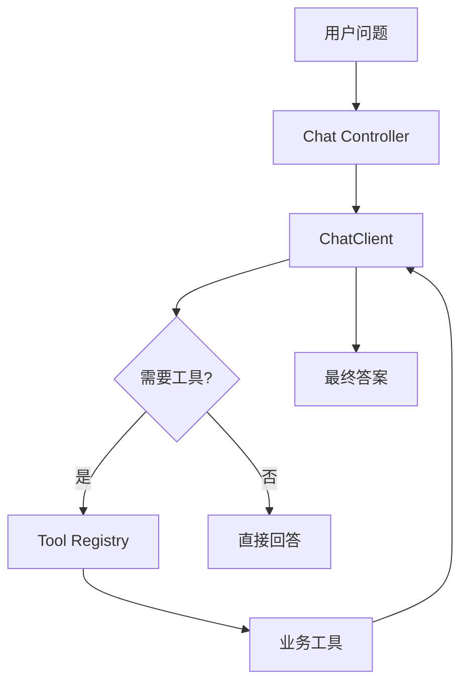

# Function Calling 工具机器人

> [!info] 项目简介
> 用 Spring AI 工具调用能力实现一个能查天气、计算、查数据库和调用业务接口的工具机器人。

## 🎯 本节定位

本项目在智能问答机器人的基础上加入工具调用，前置知识见 [[../02-框架-SpringAI与LangChain4j/SpringAI/06-Function-Calling工具调用|Function Calling]]。本篇也会区分 Function Calling、MCP 和 Agent，后续项目再深入实现 MCP 与 Agent。

## 📌 项目背景

LLM 本身不适合直接完成实时查询、精确计算和业务系统操作。Function Calling 的价值是把模型的语言理解能力和确定性的工具函数连接起来，让模型选择工具，但由代码负责执行和校验。

## 🎯 项目目标

- [ ] 定义 3~5 个稳定可测的工具函数
- [ ] 让模型根据用户意图自动选择工具
- [ ] 记录工具调用参数、结果和失败原因
- [ ] 总结 Function Calling、MCP、Agent 的边界

## 🛠️ 技术栈

| 类别 | 选型 |
| ---- | ---- |
| 语言/框架 | Spring Boot 3 + Spring AI |
| 模型 | DeepSeek / 通义 / OpenAI 兼容接口 |
| 工具 | Java Method Tool / Function Calling |
| 可观测 | 日志 + Langfuse（可选） |

## 🏗️ 架构设计



## 📋 实现步骤

- [ ] 实现计算器工具
- [ ] 实现天气查询或模拟外部 API 工具
- [ ] 实现数据库查询工具
- [ ] 增加工具参数校验和异常提示
- [ ] 增加工具调用日志
- [ ] 整理 10 条测试问题验证工具选择

## 🗣️ 从提问到工具结果

用户问“12 加 30 是多少？”模型可以选择 `add` 工具并提出参数；应用校验参数后执行 Java 方法，把结果 `42` 返回模型，模型再组织回复。是否调用工具由模型和配置共同决定，实际测试时应检查工具记录，而不是只看最终回答。
先用无副作用的计算器验证流程，再接入订单或数据库查询；业务工具需要依据服务端确定的用户身份校验访问权限，不能把模型提供的用户 ID 当成授权依据。

## 💻 Spring AI 工具片段

下例是一个工具类中的方法，展示声明方式；工具注册、`chatClient` 和模型配置已省略，未连接模型运行。`Math.addExact` 在整数溢出时会抛出异常，调用方需处理错误。

```java
@Tool(description = "计算两个整数的和")
int add(int a, int b) {
    return Math.addExact(a, b);
}
```

将工具实例传给 `chatClient.prompt().tools(工具实例)` 后，框架可根据模型的工具请求执行方法；工具调用流程与版本和模型能力有关，详见关联的 Spring AI 笔记。

## 🧠 难点与关键技术点

- 工具 schema 要清晰描述参数类型、约束和失败返回。
- 模型可能选择错工具或缺参数，需要有追问和拒绝策略。
- 业务工具不能直接暴露高风险操作，至少要有白名单和权限边界。

## ✅ 验收标准

- 至少 3 个工具有明确入参、返回值、异常信息和单测或手工验证样例。
- 10 条测试问题覆盖直接回答、单工具、多工具和参数缺失场景。
- 工具调用日志包含工具名、参数摘要、执行耗时、成功/失败状态。
- 文档写清 Function Calling、MCP、Agent 在本项目中的边界。

## 🎯 面试讲法

> [!question]- 工具调用机器人如何工作？
> 模型根据工具描述选择工具并生成参数；服务端校验参数、执行工具，再将结果反馈给模型。可以结合 Function Calling、MCP 和 Agent 的职责区别展开。

## 🔗 关联笔记

- [[../02-框架-SpringAI与LangChain4j/SpringAI/06-Function-Calling工具调用]]
- [[../02-框架-SpringAI与LangChain4j/SpringAI/02-ChatClient与ChatModel]]
- [[../05-Agent-MCP-Skills/01-Agent设计模式详解]]
- [[../05-Agent-MCP-Skills/09-MCP协议详解]]
- [[05-项目-通用ReAct-Agent]]
- [[_index|本区项目索引]]

## 📚 参考资料

- [Spring AI Tools Documentation](https://docs.spring.io/spring-ai/reference/api/tools.html)
- [OpenAI Function Calling Guide](https://platform.openai.com/docs/guides/function-calling)
- [Model Context Protocol Documentation](https://modelcontextprotocol.io/docs)
