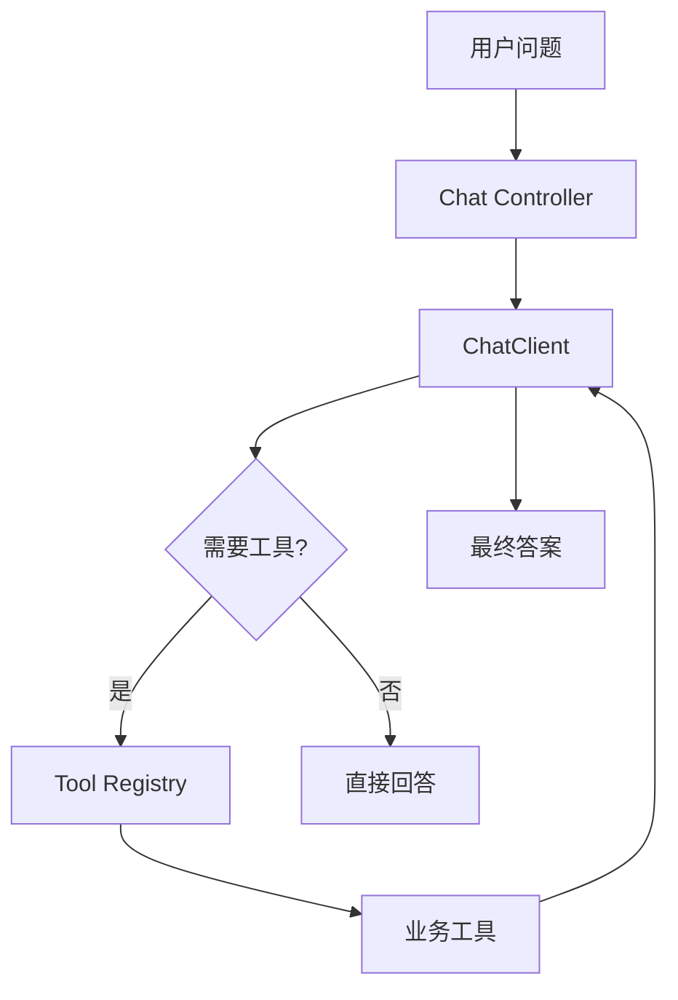

# Function Calling 工具机器人

> [!info] 项目简介
> 用 Spring AI 工具调用能力实现一个能查天气、计算、查数据库和调用业务接口的工具机器人。

## 🎯 本节定位

- **本章第 2 个项目，工具调用**。前置：01 智能问答机器人 + 阶段二 [[../02-框架-SpringAI与LangChain4j/SpringAI/06-Function-Calling工具调用]]。
- **延伸**：本项目目标之一是总结 Function Calling、MCP、Agent 的边界；MCP 与 Agent 的深入实现在阶段五（05 区）与 05、06 项目，本处只做概念对比。

## 📌 项目背景

LLM 本身不适合直接完成实时查询、精确计算和业务系统操作。Function Calling 的价值是把模型的语言理解能力和确定性的工具函数连接起来，让模型选择工具，但由代码负责执行和校验。

## 🎯 项目目标

- [ ] 定义 3~5 个稳定可测的工具函数
- [ ] 让模型根据用户意图自动选择工具
- [ ] 记录工具调用参数、结果和失败原因
- [ ] 总结 Function Calling、MCP、Agent 的边界

## 🛠️ 技术栈

| 类别 | 选型 |
| ---- | ---- |
| 语言/框架 | Spring Boot 3 + Spring AI |
| 模型 | DeepSeek / 通义 / OpenAI 兼容接口 |
| 工具 | Java Method Tool / Function Calling |
| 可观测 | 日志 + Langfuse（可选） |

## 🏗️ 架构设计

## 📋 实现步骤

- [ ] 实现计算器工具
- [ ] 实现天气查询或模拟外部 API 工具
- [ ] 实现数据库查询工具
- [ ] 增加工具参数校验和异常提示
- [ ] 增加工具调用日志
- [ ] 整理 10 条测试问题验证工具选择

## 🧠 难点与关键技术点

- [[../02-框架-SpringAI与LangChain4j/SpringAI/06-Function-Calling工具调用]]
- [[../02-框架-SpringAI与LangChain4j/SpringAI/02-ChatClient与ChatModel]]
- [[../05-Agent-MCP-Skills/09-MCP协议详解]]
- [[../05-Agent-MCP-Skills/01-Agent设计模式详解]]
- 工具 schema 要清晰描述参数类型、约束和失败返回。
- 模型可能选择错工具或缺参数，需要有追问和拒绝策略。
- 业务工具不能直接暴露高风险操作，至少要有白名单和权限边界。

## ✅ 验收标准

- 至少 3 个工具有明确入参、返回值、异常信息和单测或手工验证样例。
- 10 条测试问题覆盖直接回答、单工具、多工具和参数缺失场景。
- 工具调用日志包含工具名、参数摘要、执行耗时、成功/失败状态。
- 文档写清 Function Calling、MCP、Agent 在本项目中的边界。

## 🎯 面试讲法

可以按“模型负责决策，代码负责执行”来讲：先定义工具 schema，再让模型根据用户问题选择工具，最后由服务端校验参数、执行工具并把结果交回模型生成答案。补一句它和 MCP、Agent 的区别，会更像工程项目而不是 API demo。

## 🔗 关联笔记

- [[../05-Agent-MCP-Skills/09-MCP协议详解]]
- [[05-项目-通用ReAct-Agent]]
- [[_index|本区项目索引]]

## 📚 参考资料

- [Spring AI Tools Documentation](https://docs.spring.io/spring-ai/reference/api/tools.html)
- [OpenAI Function Calling Guide](https://platform.openai.com/docs/guides/function-calling)
- [Model Context Protocol Documentation](https://modelcontextprotocol.io/docs)

