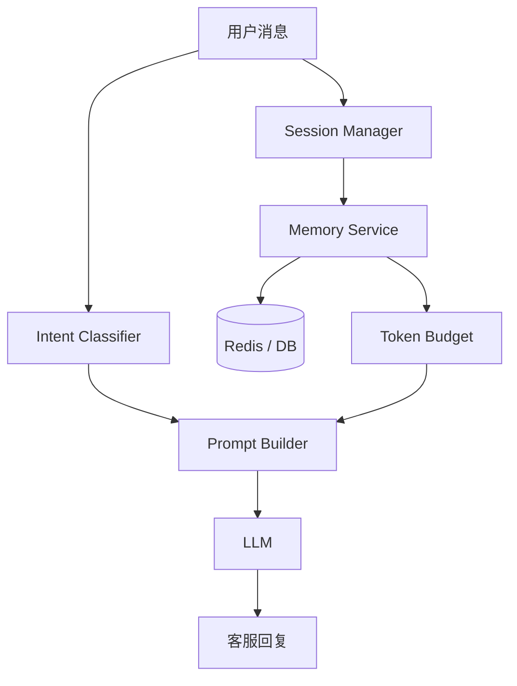

# 智能客服多轮对话系统

> [!info] 项目简介
> 在基础聊天机器人上加入多轮记忆、Token 预算、摘要记忆、语义记忆和意图识别，形成可演示的智能客服。

## 🎯 本节定位

- **本章第 4 个项目，多轮对话与记忆**。前置：01 智能问答机器人 + 阶段四 [[../04-多轮对话与上下文工程/_index]]（滑动窗口、摘要记忆、语义检索记忆）。
- **延伸**：07 业务 Agent 项目将把多轮记忆与 RAG、工具调用整合为端到端系统。

## 📌 项目背景

客服场景里的用户会连续追问、切换话题、补充订单信息，也可能触发敏感问题或人工转接。这个项目的重点不是单次回答，而是让系统在多用户、多会话下稳定管理上下文，并在预算有限时保留关键记忆。

## 🎯 项目目标

- [ ] 支持多用户、多会话隔离
- [ ] 实现滑动窗口、摘要记忆和语义检索记忆
- [ ] 支持话题切换、人工转接和敏感问题兜底
- [ ] 可以接入 RAG 系统作为客服知识来源

## 🛠️ 技术栈

| 类别 | 选型 |
| ---- | ---- |
| 语言/框架 | Spring Boot 3 + Spring AI |
| 模型 | DeepSeek / 通义 |
| 存储 | Redis + PostgreSQL |
| 向量库 | Milvus / pgvector |
| 可观测 | Langfuse |

## 🏗️ 架构设计

## 📋 实现步骤

- [ ] 实现会话创建、查询和隔离
- [ ] 实现最近 N 轮滑动窗口记忆
- [ ] 实现超长对话摘要记忆
- [ ] 实现语义检索记忆
- [ ] 增加意图识别和话题切换逻辑
- [ ] 接入企业知识库 RAG 检索结果

## 🧠 难点与关键技术点

- [[../01-LLM基础与Prompt/13-上下文工程概述]]
- [[../04-多轮对话与上下文工程/06-分层记忆]]
- [[../04-多轮对话与上下文工程/02-Token窗口裁剪]]
- [[03-项目-企业知识库RAG系统]]
- 会话隔离和并发安全要优先保证，不能出现用户上下文串话。
- 摘要记忆要保留业务关键信息，不能只做泛泛总结。
- 话题切换、人工转接和敏感问题需要明确状态迁移。

## ✅ 验收标准

- 多用户、多会话并发请求不会串上下文，Redis / DB 中能定位会话记录。
- 超过 Token 预算后能触发裁剪或摘要，且保留当前问题所需关键信息。
- 至少覆盖普通咨询、追问、换话题、人工转接、敏感问题 5 类脚本。
- 接入 RAG 时回答能区分“会话记忆”和“知识库引用”。

## 🎯 面试讲法

可以从“为什么多轮对话不是简单拼历史消息”切入，说明滑动窗口、摘要记忆、语义记忆和 Token 预算各自解决什么问题。再用客服脚本展示会话隔离、话题切换和人工转接。

## 🔗 关联笔记

- [[../04-多轮对话与上下文工程/_index]]
- [[01-项目-智能问答机器人]]
- [[_index|本区项目索引]]

## 📚 参考资料

- [Spring AI Chat Memory](https://docs.spring.io/spring-ai/reference/api/chat-memory.html)
- [Langfuse Documentation](https://langfuse.com/docs)
- [OpenAI Prompt Engineering Guide](https://platform.openai.com/docs/guides/prompt-engineering)
