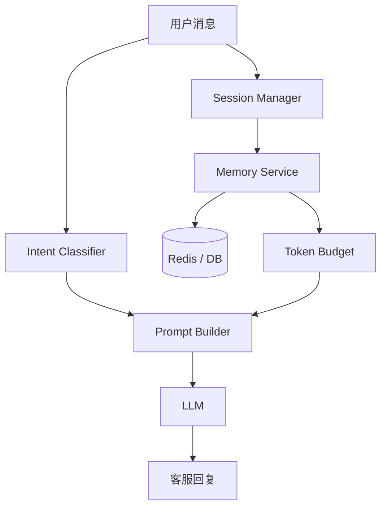

# 智能客服多轮对话系统

> [!info] 项目简介
> 在基础聊天机器人上加入多轮记忆、Token 预算、摘要记忆、语义记忆和意图识别，形成可演示的智能客服。

## 🎯 本节定位

本项目在智能问答机器人的基础上加入多轮对话与记忆，建议先学习 [[../04-多轮对话与上下文工程/_index|多轮对话与上下文工程]]。后续业务 Agent 项目会将记忆与 RAG、工具调用结合。

## 📌 项目背景

客服场景里的用户会连续追问、切换话题、补充订单信息，也可能触发敏感问题或人工转接。本项目的核心是在多用户、多会话并发场景下稳定管理对话上下文，并在受限的 Token 预算内保留关键业务信息。

## 🎯 项目目标

- [ ] 支持多用户、多会话隔离
- [ ] 实现滑动窗口、摘要记忆和语义检索记忆
- [ ] 支持话题切换、人工转接和敏感问题兜底
- [ ] 可以接入 RAG 系统作为客服知识来源

## 🛠️ 技术栈

| 类别 | 选型 |
| ---- | ---- |
| 语言/框架 | Spring Boot 3 + Spring AI |
| 模型 | DeepSeek / 通义 |
| 存储 | Redis + PostgreSQL |
| 向量库 | Milvus / pgvector |
| 可观测 | Langfuse |

## 🏗️ 架构设计

## 📋 实现步骤

- [ ] 实现会话创建、查询和隔离
- [ ] 实现最近 N 轮滑动窗口记忆
- [ ] 实现超长对话摘要记忆
- [ ] 实现语义检索记忆
- [ ] 增加意图识别和话题切换逻辑
- [ ] 接入企业知识库 RAG 检索结果

## 🗣️ 一段对话怎么管理？

用户先说“查询订单 A123”，再问“它什么时候发货？”系统应在当前会话中保留订单号，让第二轮的“它”有明确指代。历史过长时，可以把已确认的订单号与处理进度放入摘要，再保留最近几轮原文；摘要生成后要检查关键信息是否丢失。
会话 ID 只能用于定位，不能单独作为授权凭据；服务端还要验证当前用户是否有权查看该会话和订单。同一会话同时收到两个请求时，需控制消息顺序与更新冲突。

## 🧠 难点与关键技术点

- 会话隔离和并发安全要优先保证，不能出现用户上下文串话。
- 摘要记忆要保留业务关键信息，不能只做泛泛总结。
- 话题切换、人工转接和敏感问题需要明确状态迁移。

## ✅ 验收标准

- 不同用户、不同会话的记录严格隔离，并持久化完整记录。
- 同一会话的并发更新使用会话锁或乐观并发控制，重试时用幂等键避免消息重复。
- 超过 Token 预算后能触发裁剪或摘要，且保留当前问题所需关键信息。
- 覆盖普通咨询、多轮追问、话题切换、人工转接与敏感问题拦截。
- 后端工单或坐席队列创建成功后再确认转接；调用失败时给出明确引导。
- 接入 RAG 时回答能区分“会话记忆”和“知识库引用”。

## 🎯 面试讲法

> [!question]- 多轮客服为什么不能只把历史消息全部拼进提示词？
> 上下文窗口和成本有限，需要结合滑动窗口、摘要或语义记忆保留必要信息。还要验证会话隔离、话题切换和人工转接是否按设计工作。

## 🔗 关联笔记

- [[../01-LLM基础与Prompt/13-上下文工程概述]]
- [[../04-多轮对话与上下文工程/06-分层记忆]]
- [[../04-多轮对话与上下文工程/02-Token窗口裁剪]]
- [[03-项目-企业知识库RAG系统]]
- [[../04-多轮对话与上下文工程/_index]]
- [[01-项目-智能问答机器人]]
- [[_index|本区项目索引]]

## 📚 参考资料

- [Spring AI Chat Memory](https://docs.spring.io/spring-ai/reference/api/chat-memory.html)
- [Langfuse Documentation](https://langfuse.com/docs)
- [OpenAI Prompt Engineering Guide](https://platform.openai.com/docs/guides/prompt-engineering)
