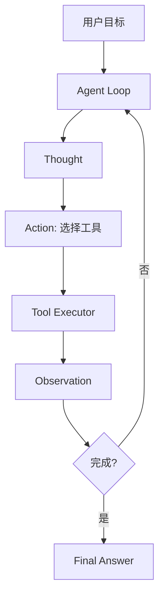

# 通用 ReAct Agent

> [!info] 项目简介
> 用 Spring AI 原语实现 ReAct 循环，让模型能思考、调用工具、观察结果并继续执行，直到给出最终答案。

## 📌 项目背景

单轮工具调用适合简单任务，但多步骤问题需要模型在“判断下一步、调用工具、观察结果、继续决策”之间循环。这个项目用于沉淀一个可控的 ReAct 执行框架，并把每轮行为记录下来方便调试和评估。

## 🎯 项目目标

- [ ] 实现 Thought / Action / Observation 的基本循环
- [ ] 接入搜索、计算、文件、数据库、HTTP API 等工具
- [ ] 限制最大轮次，避免无限循环
- [ ] 记录每一步推理、工具调用和最终回答

## 🛠️ 技术栈

| 类别 | 选型 |
| ---- | ---- |
| 语言/框架 | Spring Boot 3 + Spring AI |
| 模型 | DeepSeek / 通义 / OpenAI 兼容接口 |
| 工具 | Function Calling / MCP Client（可选） |
| 可观测 | Langfuse |

## 🏗️ 架构设计

## 📋 实现步骤

- [ ] 定义 Agent 状态对象和最大执行轮次
- [ ] 接入基础工具集
- [ ] 实现工具执行结果回填
- [ ] 增加失败重试和终止条件
- [ ] 输出完整执行轨迹
- [ ] 用 10 个任务验证工具选择与循环终止

## 🧠 难点与关键技术点

- [[01-Agent设计模式详解]]
- [[09-MCP协议详解]]
- [[06-Function-Calling工具调用]]
- [[18-Agent可观测]]
- 循环终止条件必须明确，否则容易无限调用工具。
- 工具参数需要结构化校验，不能把模型输出直接交给业务接口。
- 执行轨迹要区分内部调试信息和用户可见答案。

## ✅ 验收标准

- Agent 每轮都记录任务 ID、轮次、Action、Observation、终止原因。
- 最大轮次、工具白名单和工具失败重试策略可配置。
- 10 个验证任务覆盖成功完成、工具失败、参数缺失和达到最大轮次。
- 输出中能区分用户可见最终答案和内部执行轨迹。

## 🎯 面试讲法

可以从 ReAct 的 Thought / Action / Observation 循环讲起，再说明最大轮次、工具白名单、参数校验和轨迹记录如何保证可控。最后用一个多工具任务说明 Agent 为什么需要循环，而不是一次 Function Calling 就结束。

## 🔗 关联笔记

- [[../05-Agent-MCP-Skills/01-Agent设计模式详解]]
- [[06-项目-MCP-Server工具集]]
- [[07-项目-业务Agent系统]]

## 📚 参考资料

- [ReAct: Synergizing Reasoning and Acting in Language Models](https://arxiv.org/abs/2210.03629)
- [Spring AI Reference Documentation](https://docs.spring.io/spring-ai/reference/)
- [Langfuse Documentation](https://langfuse.com/docs)
