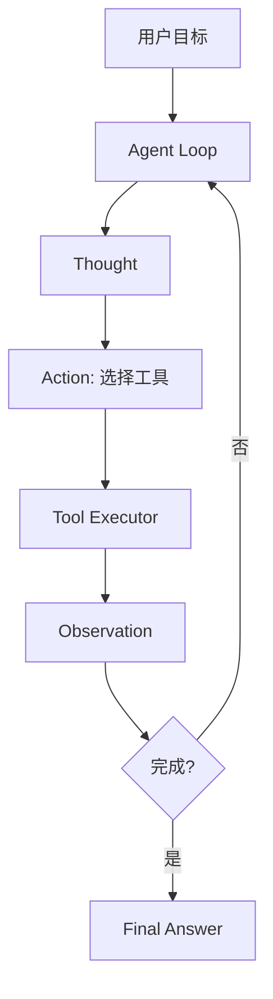

# 通用 ReAct Agent

> [!info] 项目简介
> 用 Spring AI 原语实现 ReAct 循环，让模型能思考、调用工具、观察结果并继续执行，直到给出最终答案。

## 🎯 本节定位

本项目在工具机器人的基础上实现 Agent 执行循环，前置知识见 [[../05-Agent-MCP-Skills/01-Agent设计模式详解|Agent 设计模式]]。后续 MCP 项目提供工具接入，业务 Agent 项目再增加状态、审批与审计。

## 📌 项目背景

工具调用也可以连续执行多轮；ReAct 着重根据每次工具观察调整下一步。这个项目用于实现有边界的 ReAct 循环，并记录工具行为方便调试和评估；不能假设能够读取模型的完整隐藏推理。

## 🎯 项目目标

- [ ] 实现 Thought / Action / Observation 的基本循环
- [ ] 接入搜索、计算、文件、数据库、HTTP API 等工具
- [ ] 限制最大轮次，避免无限循环
- [ ] 记录结构化决策摘要、工具调用参数与最终回答

## 🛠️ 技术栈

| 类别 | 选型 |
| ---- | ---- |
| 语言/框架 | Spring Boot 3 + Spring AI |
| 模型 | DeepSeek / 通义 / OpenAI 兼容接口 |
| 工具 | Function Calling / MCP Client（可选） |
| 可观测 | Langfuse |

## 🏗️ 架构设计

## 📋 实现步骤

- [ ] 定义 Agent 状态对象和最大执行轮次
- [ ] 接入基础工具集
- [ ] 实现工具执行结果回填
- [ ] 增加失败重试和终止条件
- [ ] 输出可审计的决策摘要和工具执行轨迹
- [ ] 用 10 个任务验证工具选择与循环终止

## 🗣️ 观察如何影响下一步？

用户问“订单 A123 延误了，能补偿吗？”一次可能的过程是：先查订单状态，工具返回“已延误”；再查该订单适用的补偿规则；最后根据两项结果说明是否符合条件。若订单工具返回无权限，系统应停止查询并说明限制，不能把失败当成“没有延误”。
这只是设计样例，不代表可以读取模型的隐藏推理。记录可观察的工具请求、结果和终止原因即可；实际退款或发券要经过独立授权、幂等和审批流程。

## 🧠 难点与关键技术点

- 用最大轮次、总耗时和 Token 预算限制执行范围。
- 同一工具和参数反复调用却没有进展时，应及时终止并记录原因。
- 任务终态结合服务端状态与模型输出判断。
- 工具参数需要结构化校验，不能把模型输出直接交给业务接口。
- 执行轨迹要区分内部调试信息和用户可见答案。

## ✅ 验收标准

- Agent 每轮都记录任务 ID、轮次、Action、Observation、终止原因。
- 最大轮次、工具白名单和工具失败重试策略可配置。
- 10 个验证任务覆盖成功完成、工具失败、参数缺失和达到最大轮次。
- 输出中能区分用户可见最终答案和内部执行轨迹。

## 🎯 面试讲法

> [!question]- 如何介绍受控的 ReAct 执行循环？
> Agent 根据工具返回的观察结果决定下一步。可以用多工具任务说明循环，再介绍最大轮次、工具白名单、参数校验和可观察的执行轨迹；不假设能读取模型的隐藏推理。

## 🔗 关联笔记

- [[../05-Agent-MCP-Skills/09-MCP协议详解]]
- [[../02-框架-SpringAI与LangChain4j/SpringAI/06-Function-Calling工具调用]]
- [[../05-Agent-MCP-Skills/18-Agent可观测]]
- [[../05-Agent-MCP-Skills/01-Agent设计模式详解]]
- [[06-项目-MCP-Server工具集]]
- [[07-项目-业务Agent系统]]
- [[_index|本区项目索引]]

## 📚 参考资料

- [ReAct: Synergizing Reasoning and Acting in Language Models](https://arxiv.org/abs/2210.03629)
- [Spring AI Reference Documentation](https://docs.spring.io/spring-ai/reference/)
- [Langfuse Documentation](https://langfuse.com/docs)
