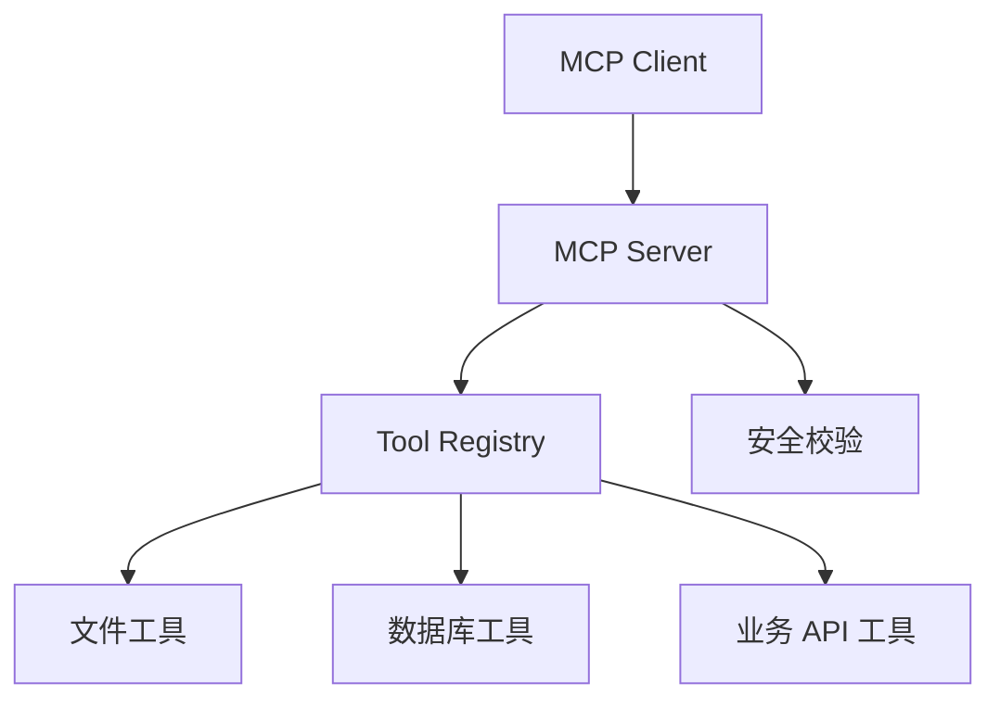

# MCP Server 工具集

> [!info] 项目简介
> 用 Java / Spring AI 实现一组 MCP Server 工具，让 Claude Desktop、Cursor 或自研 Agent 能调用业务能力。

## 📌 项目背景

当多个 AI 客户端都需要调用同一批业务能力时，把工具写死在某个应用里会导致重复开发和接入成本。MCP Server 可以把工具能力以统一协议暴露出去，让不同客户端按同一 schema 调用。

## 🎯 项目目标

- [ ] 暴露 3 个以上有实际意义的工具
- [ ] 用 MCP Inspector 验证工具协议和参数
- [ ] 接入至少一个 MCP Client 演示调用
- [ ] 输出工具说明、参数约束和安全边界

## 🛠️ 技术栈

| 类别 | 选型 |
| ---- | ---- |
| 语言/框架 | Spring Boot 3 + Spring AI MCP |
| 协议 | Model Context Protocol |
| 工具 | MCP Inspector / Claude Desktop / Cursor |
| 可观测 | 日志 + Langfuse（可选） |

## 🏗️ 架构设计

## 📋 实现步骤

- [ ] 初始化 MCP Server 项目
- [ ] 实现文件读取或知识库查询工具
- [ ] 实现数据库查询工具
- [ ] 实现业务 API 调用工具
- [ ] 用 MCP Inspector 调试每个工具
- [ ] 写 Claude Desktop / Cursor 接入说明

## 🧠 难点与关键技术点

- [[09-MCP协议详解]]
- [[10-MCP-Server开发-Java实战]]
- [[16-AGENTS规范详解]]
- [[13-Skills详解]]
- 工具参数 schema、错误返回和权限边界要明确，否则客户端很难稳定调用。
- 本地调试要用 Inspector 先验证协议，再接入真实客户端。
- 文件、数据库和业务 API 工具都需要限制访问范围。

## ✅ 验收标准

- MCP Inspector 能列出全部工具，并成功调用每个工具的正常路径。
- 每个工具都有参数 schema、权限边界、失败返回和最小调用样例。
- 至少一个 MCP Client 能完成端到端调用演示。
- README 写清本地启动、Inspector 调试和客户端接入配置。

## 🎯 面试讲法

可以把 MCP Server 类比成“给 Agent 用的工具网关”：服务端注册工具和 schema，客户端发现工具并发起调用，Inspector 用来验证协议和参数。重点讲清安全边界和错误返回，避免只停留在“能列出工具”。

## 🔗 关联笔记

- [[../05-Agent-MCP-Skills/09-MCP协议详解]]
- [[05-项目-通用ReAct-Agent]]
- [[07-项目-业务Agent系统]]

## 📚 参考资料

- [Model Context Protocol Documentation](https://modelcontextprotocol.io/docs)
- [MCP Inspector](https://modelcontextprotocol.io/docs/tools/inspector)
- [Spring AI MCP Documentation](https://docs.spring.io/spring-ai/reference/api/mcp/mcp-overview.html)
