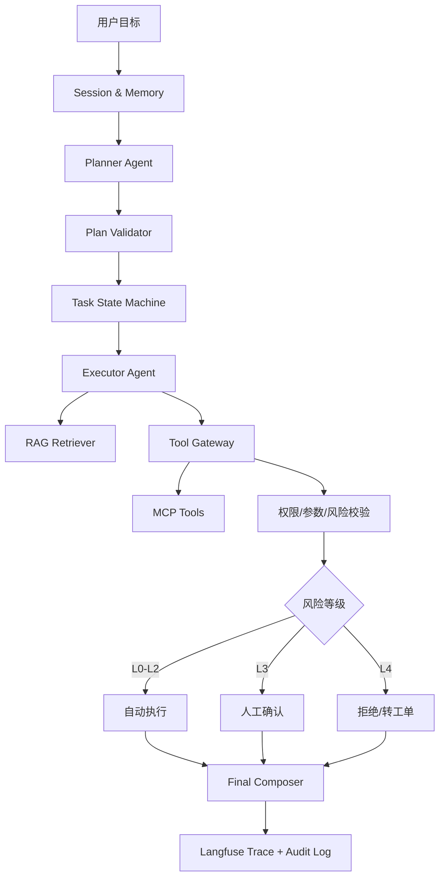
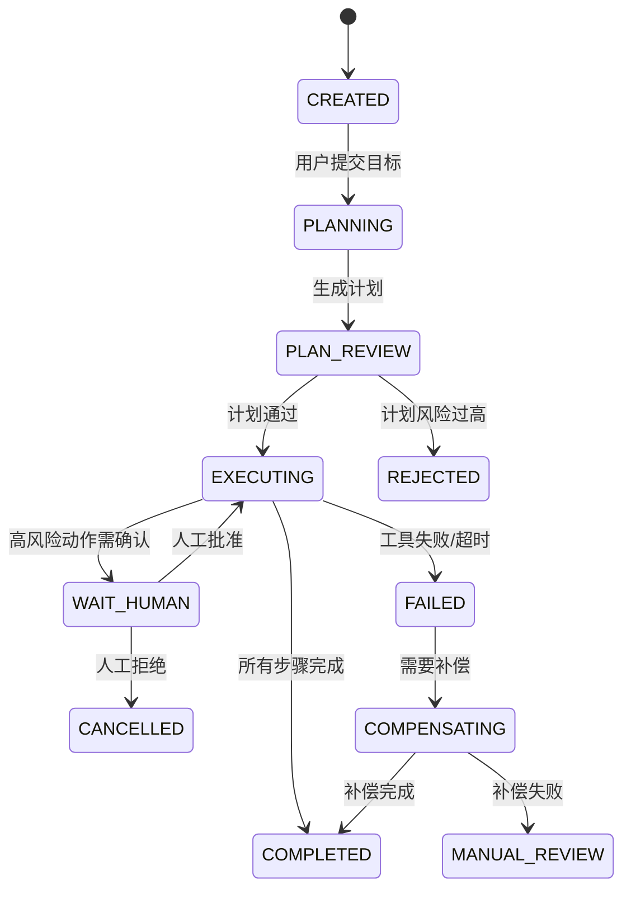
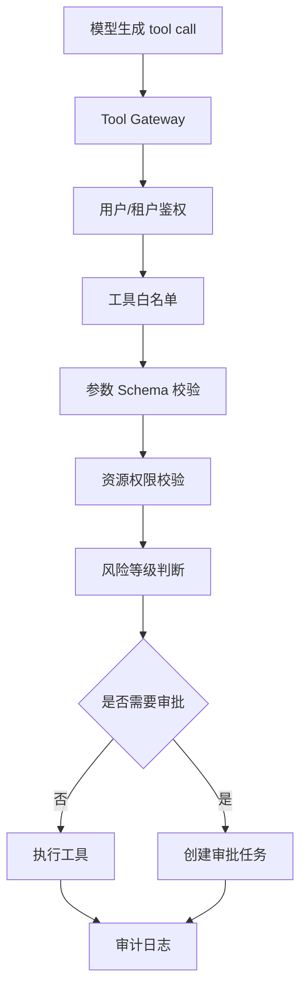

# 业务 Agent 系统

> [!info] 项目简介
> 选择一个真实业务场景，把 RAG、多轮对话、MCP 工具、Skills 和 Agent 编排组合成一个可展示的端到端系统。面试目标是证明 Agent 不是“让模型自己乱跑”，而是一个可控、可观测、可审批、可回滚的业务自动化系统。

## 🎯 本节定位

- **本章第 7 个项目，端到端业务 Agent**。前置：03 RAG、04 多轮、05 ReAct、06 MCP 四个项目，以及阶段五 [[../05-Agent-MCP-Skills/21-Agent权限治理与分级自治]]。
- **延伸**：08 场景选型把本项目经验映射到 AI 客服、AI 搜索、办公助手等面试场景。

## 📌 项目背景

真实业务系统很少只需要“回答问题”，通常还要查知识库、调用业务接口、保留会话上下文，并在高风险步骤让人确认。这个项目用于把前面分散学习的 RAG、记忆、MCP、Skills 和 Agent 编排整合成一个端到端案例。

可选业务场景：

| 场景 | Agent 任务 | 高风险动作 |
| ---- | ---------- | ---------- |
| 智能客服 | 查知识库、查订单、生成处理建议 | 退款、补偿券、改地址 |
| 运维助手 | 查告警、查日志、生成处置步骤 | 重启服务、扩容、回滚 |
| AI BI | 查询指标、生成分析报告 | 执行大 SQL、导出敏感数据 |
| 办公助手 | 查制度、写邮件、创建待办 | 发邮件、改日程、审批流 |

推荐首版选择“智能客服工单 Agent”：风险边界清晰，能串起 RAG、订单查询、人工确认、审计和多轮上下文。

## 🎯 项目目标

- [ ] 明确一个真实业务场景和可量化任务目标。
- [ ] 使用 Plan-Execute 或状态机编排复杂任务。
- [ ] 整合 RAG 检索、多轮记忆、MCP 工具和 Skills 指令。
- [ ] 按风险等级实现只读、草稿、自动执行、需审批、禁止执行。
- [ ] 接入可观测和基础评估，能复盘成本、效果和失败点。

## 🛠️ 技术栈

| 类别 | 选型 |
| ---- | ---- |
| 语言/框架 | Spring Boot 3 + Spring AI |
| 模型 | DeepSeek / 通义 / OpenAI 兼容接口 |
| 知识库 | 企业知识库 RAG |
| 工具协议 | MCP / Function Calling |
| 编排 | Plan-Execute / 状态机 / 简化 Multi-Agent |
| 可观测 | Langfuse + 应用日志 + 审计表 |
| 权限 | Tool Gateway + RBAC/ABAC |

## 🏗️ 架构设计



## 🧩 Agent 状态机



## 🔐 权限与风险分级

| 等级 | 动作 | 示例 | 控制 |
| ---- | ---- | ---- | ---- |
| L0 只读 | 查询知识和状态 | 查制度、查订单 | 权限过滤、引用溯源 |
| L1 草稿 | 生成建议 | 生成回复话术、SQL 草稿 | 标记草稿，不落库 |
| L2 低风险自动执行 | 可撤销动作 | 创建工单标签、生成报表 | 幂等、限流、审计 |
| L3 高风险需审批 | 影响用户权益 | 退款、发券、改地址 | 人工确认、二次校验 |
| L4 禁止自治 | 高危动作 | 转账、删库、改权限 | 拒绝或转人工工单 |

核心原则：Agent 不是安全主体。Agent 只能提出“要调用什么工具和参数”，真正的鉴权、参数校验、审批和审计必须在 Java 服务端完成。

## 🛠️ Tool Gateway 设计

工具调用统一经过 Tool Gateway：



### 工具定义示例

| 工具 | 风险等级 | 幂等键 | 说明 |
| ---- | -------- | ------ | ---- |
| `queryOrder(orderId)` | L0 | 否 | 只读查询 |
| `searchPolicy(question)` | L0 | 否 | RAG 检索制度 |
| `draftReply(ticketId)` | L1 | 否 | 生成客服回复草稿 |
| `addTicketTag(ticketId, tag)` | L2 | 是 | 可撤销低风险动作 |
| `createRefund(ticketId, amount)` | L3 | 是 | 需人工确认 |
| `changeUserRole(userId, role)` | L4 | - | 禁止 Agent 执行 |

## 🧾 审计表设计

```sql
CREATE TABLE agent_task (
  id BIGINT PRIMARY KEY,
  tenant_id BIGINT NOT NULL,
  user_id BIGINT NOT NULL,
  session_id VARCHAR(128) NOT NULL,
  goal TEXT NOT NULL,
  plan JSON NOT NULL,
  status VARCHAR(32) NOT NULL,
  risk_level VARCHAR(16) NOT NULL,
  created_at DATETIME NOT NULL,
  updated_at DATETIME NOT NULL
);

CREATE TABLE agent_tool_call_log (
  id BIGINT PRIMARY KEY,
  task_id BIGINT NOT NULL,
  step_no INT NOT NULL,
  tool_name VARCHAR(128) NOT NULL,
  arguments JSON NOT NULL,
  risk_level VARCHAR(16) NOT NULL,
  auth_result VARCHAR(32) NOT NULL,
  idempotency_key VARCHAR(128),
  status VARCHAR(32) NOT NULL,
  result_summary TEXT,
  error_message TEXT,
  created_at DATETIME NOT NULL,
  updated_at DATETIME NOT NULL
);

CREATE TABLE agent_approval (
  id BIGINT PRIMARY KEY,
  task_id BIGINT NOT NULL,
  tool_call_id BIGINT NOT NULL,
  approver_id BIGINT NOT NULL,
  status VARCHAR(32) NOT NULL,
  reason TEXT,
  created_at DATETIME NOT NULL,
  updated_at DATETIME NOT NULL
);
```

## 🔁 超时、重试与幂等

| 场景 | 策略 |
| ---- | ---- |
| 工具超时 | 每个工具配置独立 timeout，超时返回可解释错误 |
| 临时失败 | 指数退避重试，限制最大次数 |
| 高风险动作 | 不自动重试，转人工确认 |
| 重复请求 | 使用 taskId + stepNo + toolName 生成幂等键 |
| 部分成功 | 状态机记录完成步骤，只重试失败步骤 |
| 补偿失败 | 进入 `MANUAL_REVIEW`，不让 Agent 无限自修复 |

## 🧠 Memory 设计

| 记忆类型 | 保存内容 | 生命周期 | 风险 |
| -------- | -------- | -------- | ---- |
| 会话记忆 | 当前任务上下文 | session 级 | 过长导致污染 |
| 用户偏好 | 常用格式、语言、角色 | 用户级 | 需要用户授权 |
| 任务轨迹 | plan、tool call、结果 | task 级 | 必须可审计 |
| 长期知识 | 业务制度、FAQ | 知识库 | 必须权限过滤 |

原则：Memory 不是垃圾桶。只保存可解释、可删除、可授权、可审计的信息。

## 👀 可观测字段

Langfuse / 日志至少记录：

- `tenantId / userId / sessionId / taskId`
- 用户目标、生成计划、计划校验结果
- 每一步工具名、参数摘要、耗时、状态
- RAG 召回 chunk、score、引用来源
- 模型输入/输出 token、成本、延迟
- 人工审批结果和原因
- 最终任务状态、失败点、补偿动作

## 🧪 端到端任务样例

### 任务 1：客服查询订单并生成回复

用户：客户问“我的订单为什么还没发货？”

流程：

1. Agent 查询订单状态。
2. RAG 检索发货时效规则。
3. 生成客服回复草稿。
4. 标记为 L1 草稿，不自动发送。

### 任务 2：客户申请小额补偿券

流程：

1. 查询订单是否延迟。
2. 检索补偿规则。
3. 判断补偿金额是否低于自动阈值。
4. L2 自动创建补偿券或 L3 进入审批。
5. 写审计日志。

### 任务 3：退款申请

流程：

1. 查询订单、支付、物流状态。
2. RAG 检索退款政策。
3. 生成退款建议。
4. 因为退款属于 L3，高风险动作必须人工确认。
5. 人工确认后调用退款工具。

## ⚠️ 生产坑与注意事项

- 工具一次性暴露太多，模型容易误选工具。
- 只在 Prompt 里写“不要越权”，但服务端没有真实鉴权。
- 高风险动作没有人工确认。
- 工具参数直接信任模型输出，导致越权或脏数据。
- Agent 无限重试，放大下游故障。
- Memory 保存敏感信息且不可删除。
- 没有审计日志，出错后无法复盘。
- 多轮对话中上一轮工具结果污染下一轮任务。

## ✅ 验收标准

- 业务场景、用户角色、输入输出和成功标准写成一页说明。
- 至少 5 个端到端任务能跑通，包含 RAG、MCP 工具、记忆和 Skill 指令。
- 至少 2 个高风险任务能暂停、展示风险、等待人工确认并继续执行。
- Tool Gateway 能完成工具白名单、参数校验、权限校验、风险分级和审计。
- Langfuse 或日志中能复盘每个任务的步骤、耗时、Token 成本和失败点。
- 故障场景可演示：工具超时、权限拒绝、审批拒绝、重复请求、部分失败补偿。

## 🎤 面试 3 层回答

### 30 秒版

业务 Agent 的重点不是让模型全自动，而是把 RAG、工具调用、多轮记忆和审批流程组合起来，并通过 Tool Gateway 做权限、参数、风险、幂等和审计控制。

### 2 分钟版

我会把 Agent 看成一个状态机：先理解用户目标并生成计划，再校验计划风险，然后逐步调用 RAG 和业务工具。所有工具调用都经过 Java 服务端的 Tool Gateway，做用户权限、工具白名单、参数校验和风险分级。低风险动作可以自动执行，高风险动作必须人工确认，禁止类动作只能生成建议或工单。整个过程用 Langfuse 和审计表记录，方便排查和评估。

### 项目版

在智能客服 Agent 项目里，我会让 Agent 先查订单，再检索政策，生成处理建议。查询类是 L0，回复草稿是 L1，打标签是 L2，退款和发券是 L3 必须审批，改权限和转账是 L4 禁止执行。这样既能展示 Agent 自动化能力，又能体现生产级权限治理和风险控制。

## 🎯 高频追问

> [!question] 高频问题
> - Q: Agent 为什么不能直接操作所有工具？
>   - A: 模型输出不是可信指令，真正的鉴权、参数校验、审批和审计必须在服务端完成。
> - Q: 如何防止 Agent 越权？
>   - A: 工具白名单、租户/角色权限、参数级校验、风险分级、人工审批和审计日志。
> - Q: 工具调用失败怎么办？
>   - A: 区分可重试和不可重试错误；低风险临时失败可退避重试，高风险失败转人工，所有步骤记录状态和幂等键。
> - Q: Agent 和 Workflow 有什么区别？
>   - A: Workflow 路径固定、可控性强；Agent 更灵活但风险更高。生产上通常用状态机/Workflow 约束 Agent，而不是完全放任。
> - Q: 如何评估 Agent 效果？
>   - A: 看任务完成率、工具调用成功率、人工接管率、错误率、平均步骤数、P95 延迟、Token 成本和高风险动作审批通过率。

## 🔗 关联笔记

- [[../05-Agent-MCP-Skills/17-Agent-MCP-Skills组合实战]]
- [[../05-Agent-MCP-Skills/01-Agent设计模式详解]]
- [[../05-Agent-MCP-Skills/13-Skills详解]]
- [[../05-Agent-MCP-Skills/21-Agent权限治理与分级自治]]
- [[05-项目-通用ReAct-Agent]]
- [[03-项目-企业知识库RAG系统]]
- [[06-项目-MCP-Server工具集]]
- [[_index|本区项目索引]]

## 📚 参考资料

- [Model Context Protocol Documentation](https://modelcontextprotocol.io/docs)
- [Spring AI Reference Documentation](https://docs.spring.io/spring-ai/reference/)
- [Langfuse Documentation](https://langfuse.com/docs)
- [OWASP Top 10 for LLM Applications](https://owasp.org/www-project-top-10-for-large-language-applications/)
