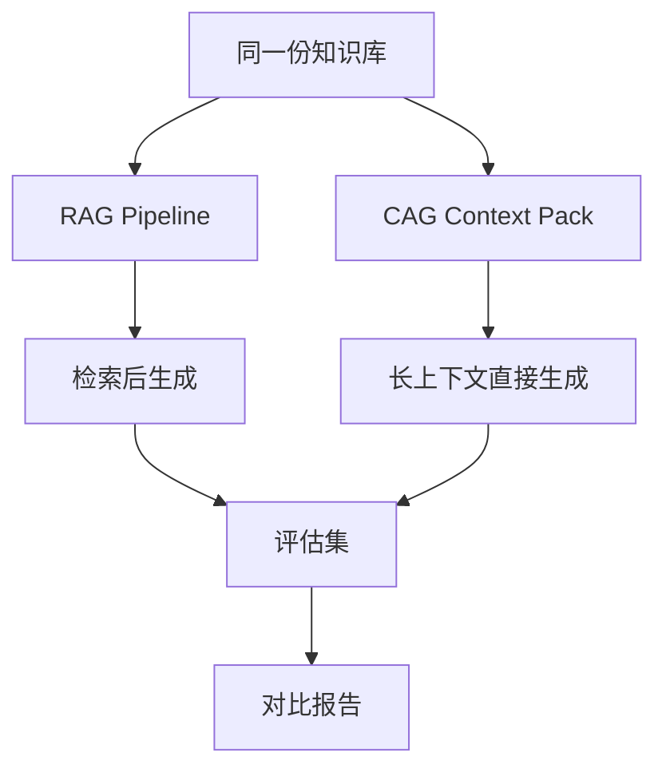

# CAG vs RAG 对比实验

> [!info] 项目简介
> 使用同一份小型知识库分别实现 RAG 和 CAG，对比准确率、延迟、成本、上下文长度和维护复杂度。

## 🎯 本节定位

本实验在 RAG 项目和 [[../03-知识库技术-RAG/02-RAG工业级进阶与检索调优|检索优化与缓存]] 的基础上，对比 CAG 与 RAG；评估口径可参考 [[../03-知识库技术-RAG/03-前沿演进与质量评估|RAG 评估]]。

## 📌 项目背景

本实验分别比较检索后生成、直接提供长上下文，以及在服务支持时复用缓存的方案。长上下文和缓存复用不是同一件事，应分别记录效果、延迟和成本。

## 🎯 项目目标

- [ ] 用同一份知识库构建 RAG 版本和 CAG 版本
- [ ] 准备同一批评估问题和标准答案
- [ ] 记录两种方案的效果、延迟、成本和失败案例
- [ ] 总结适用场景和选型边界

## 🛠️ 技术栈

| 类别 | 选型 |
| ---- | ---- |
| 语言/框架 | Spring Boot 3 + Spring AI / Python 对照脚本 |
| 模型 | DeepSeek / 通义 / 长上下文模型 |
| 向量库 | Milvus / pgvector（RAG 版本） |
| 评估 | Ragas / 人工评分表 |

## 🏗️ 架构设计

## 📋 实现步骤

- [ ] 选定 20~50 篇小型文档
- [ ] 实现 RAG 检索生成链路
- [ ] 实现长上下文基线，并在服务支持时测试缓存复用
- [ ] 准备 30 条评估问题
- [ ] 记录准确率、延迟、Token 成本
- [ ] 输出对比结论和选型表

## 🧪 一条评测样本如何比较？

给两套方案同一份差旅制度和同一个问题：“普通员工在北京出差的住宿上限是多少？”标准答案记录为制度中的金额及其章节位置。RAG 记录检索到的片段；长上下文方案记录提供了哪些文档；两者都记录实际回答、出处和耗时。
若回答错误，先判断 RAG 是否漏召回原文，再判断长上下文是否忽略了适用人员。缓存实验还应记录服务商返回的缓存命中用量，不能根据前缀相同就自行认定命中。以上只是样本设计，不是已经得到的测试结果。

## 🧠 难点与关键技术点

- 保持知识库、问题集、基座模型和采样参数一致，记录索引与缓存版本。
- 多次运行并统计均值和分位数，避免只凭单次结果下结论。
- 分别记录长上下文基线、冷启动和缓存命中的首字延迟与 Token 成本。
- 用服务商的用量指标确认实际缓存命中；不支持缓存时只报告长上下文结果。
- RAG 的检索失败和 CAG 的上下文干扰要分开归因。

## ✅ 验收标准

- RAG 和长上下文基线使用同一知识库、同一评估问题和同一评分口径；如果服务支持缓存，再单独测试缓存复用并记录实际命中。
- 对比表至少包含准确率、引用质量、首 Token 延迟、总耗时、Token 成本。
- 失败案例按“检索失败、上下文过长、幻觉、引用错误”分类记录。
- 最终结论给出适用场景、限制条件和下一步优化方向。

## 🎯 面试讲法

> [!question]- 如何介绍 CAG 与 RAG 对比实验？
> RAG 按问题检索资料，CAG 则探索预加载知识并复用缓存。使用同一评估集比较回答质量、延迟、成本和失败案例，再结合知识规模、权限与更新频率解释实际结果。

## 🔗 关联笔记

- [[../03-知识库技术-RAG/01-RAG核心原理与全链路实战]]
- [[../03-知识库技术-RAG/02-RAG工业级进阶与检索调优]]
- [[../03-知识库技术-RAG/03-前沿演进与质量评估]]
- [[../03-知识库技术-RAG/_index]]
- [[03-项目-企业知识库RAG系统]]
- [[_index|本区项目索引]]

## 📚 参考资料

- [Ragas Documentation](https://docs.ragas.io/)
- [Spring AI Reference Documentation](https://docs.spring.io/spring-ai/reference/)
- [OpenAI Prompt Caching](https://platform.openai.com/docs/guides/prompt-caching)
