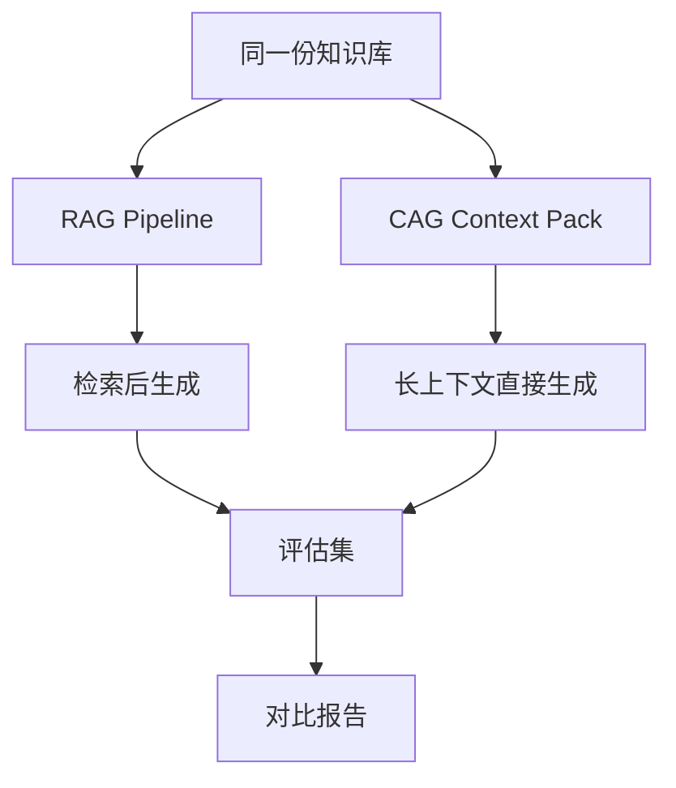

# CAG vs RAG 对比实验

> [!info] 项目简介
> 使用同一份小型知识库分别实现 RAG 和 CAG，对比准确率、延迟、成本、上下文长度和维护复杂度。

## 🎯 本节定位

- **加分项目：CAG vs RAG 对比实验**。前置：03 RAG 项目 + 阶段三 [[../03-知识库技术-RAG/16-CAG缓存增强生成]] 与 [[../03-知识库技术-RAG/18-Long-Context长上下文]]。
- **延伸**：对比结论可用于面试选型论证；评估口径复用 [[../03-知识库技术-RAG/12-RAG评估-Ragas]]。

## 📌 项目背景

长上下文模型让“直接把资料塞进上下文”的 CAG 方案变得可行，但它和 RAG 在成本、延迟、可维护性和引用质量上各有边界。这个实验用同一数据集对比两种方案，避免只凭感觉选型。

## 🎯 项目目标

- [ ] 用同一份知识库构建 RAG 版本和 CAG 版本
- [ ] 准备同一批评估问题和标准答案
- [ ] 记录两种方案的效果、延迟、成本和失败案例
- [ ] 总结适用场景和选型边界

## 🛠️ 技术栈

| 类别 | 选型 |
| ---- | ---- |
| 语言/框架 | Spring Boot 3 + Spring AI / Python 对照脚本 |
| 模型 | DeepSeek / 通义 / 长上下文模型 |
| 向量库 | Milvus / pgvector（RAG 版本） |
| 评估 | Ragas / 人工评分表 |

## 🏗️ 架构设计

## 📋 实现步骤

- [ ] 选定 20~50 篇小型文档
- [ ] 实现 RAG 检索生成链路
- [ ] 实现 CAG 上下文打包链路
- [ ] 准备 30 条评估问题
- [ ] 记录准确率、延迟、Token 成本
- [ ] 输出对比结论和选型表

## 🧠 难点与关键技术点

- [[../03-知识库技术-RAG/01-RAG基础与全链路]]
- [[../03-知识库技术-RAG/16-CAG缓存增强生成]]
- [[../03-知识库技术-RAG/18-Long-Context长上下文]]
- [[../03-知识库技术-RAG/12-RAG评估-Ragas]]
- 必须保证两种方案使用同一知识库、问题集和评分口径。
- CAG 的上下文打包顺序会影响答案，需要记录打包策略。
- RAG 的检索失败和 CAG 的上下文干扰要分开归因。

## ✅ 验收标准

- RAG 和 CAG 使用同一知识库、同一评估问题和同一评分口径。
- 对比表至少包含准确率、引用质量、首 Token 延迟、总耗时、Token 成本。
- 失败案例按“检索失败、上下文过长、幻觉、引用错误”分类记录。
- 最终结论给出适用场景、限制条件和下一步优化方向。

## 🎯 面试讲法

可以先说明 RAG 和 CAG 都是给模型补充外部知识，但一个靠检索，一个靠长上下文。再展示同一评估集下的准确率、延迟、成本和失败案例，最后给出“知识库小且稳定可用 CAG，资料大且更新频繁优先 RAG”的边界。

## 🔗 关联笔记

- [[../03-知识库技术-RAG/_index]]
- [[03-项目-企业知识库RAG系统]]
- [[_index|本区项目索引]]

## 📚 参考资料

- [Ragas Documentation](https://docs.ragas.io/)
- [Spring AI Reference Documentation](https://docs.spring.io/spring-ai/reference/)
- [OpenAI Prompt Caching](https://platform.openai.com/docs/guides/prompt-caching)
