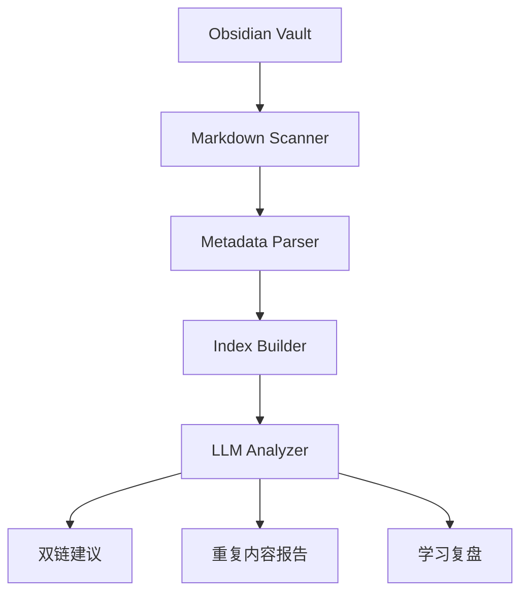

# Obsidian LLM Wiki

> [!info] 项目简介
> 用 AI 辅助维护 Obsidian 知识库，实现笔记索引、双链建议、重复内容发现和学习复盘生成。

## 📌 项目背景

Markdown 知识库长期积累后容易出现重复笔记、孤立笔记、标签混乱和过期内容。这个项目用 LLM 做辅助维护，目标是给出建议和报告，而不是自动覆盖用户原文。

## 🎯 项目目标

- [ ] 扫描本地 Markdown 知识库并生成结构化索引
- [ ] 为新笔记推荐双链和标签
- [ ] 发现重复、过期或孤立笔记
- [ ] 生成阶段学习复盘和下一步行动清单

## 🛠️ 技术栈

| 类别 | 选型 |
| ---- | ---- |
| 语言/框架 | Spring Boot 3 / Python 脚本 |
| 模型 | DeepSeek / 通义 / OpenAI 兼容接口 |
| 存储 | 本地 Markdown + SQLite |
| 向量库 | pgvector / 本地向量索引 |

## 🏗️ 架构设计

## 📋 实现步骤

- [ ] 扫描指定目录内的 Markdown 文件
- [ ] 解析 frontmatter、标题、标签和双链
- [ ] 生成笔记索引和孤立笔记列表
- [ ] 实现双链推荐 Prompt
- [ ] 实现重复内容检测和过期内容提示
- [ ] 输出复盘报告到 Obsidian 文档

## 🧠 难点与关键技术点

- [[17-LLM-Wiki知识库范式]]
- [[05-Embedding模型选型]]
- [[07-Prompt工程基础]]
- [[16-AGENTS规范详解]]
- Markdown frontmatter、双链和相对路径解析要尽量保留原始语义。
- LLM 生成的双链建议只能作为候选，需要给出理由和置信度。
- 对本地 vault 的写入要默认保守，避免误改用户笔记。

## ✅ 验收标准

- 能扫描指定 vault 并输出笔记数量、孤立笔记、缺失 frontmatter 和坏链统计。
- 双链推荐要给出推荐理由，且不会直接覆盖原笔记。
- 重复内容报告包含相似笔记、相似原因和建议处理动作。
- 生成的复盘文档能落到 Obsidian 目录，并保留生成时间和输入范围。

## 🎯 面试讲法

可以讲成“给个人知识库做一个 AI 维护助手”：扫描 Markdown 得到结构化索引，再用规则和向量相似度发现孤立、重复、坏链，最后让 LLM 生成双链建议和复盘报告。强调默认只产出建议，不直接覆盖原文。

## 🔗 关联笔记

- [[../03-知识库技术-RAG/_index]]
- [[09-项目-CAG-vs-RAG对比实验]]

## 📚 参考资料

- [Obsidian Help - Internal Links](https://help.obsidian.md/links)
- [CommonMark Spec](https://spec.commonmark.org/)
- [Spring AI Reference Documentation](https://docs.spring.io/spring-ai/reference/)
