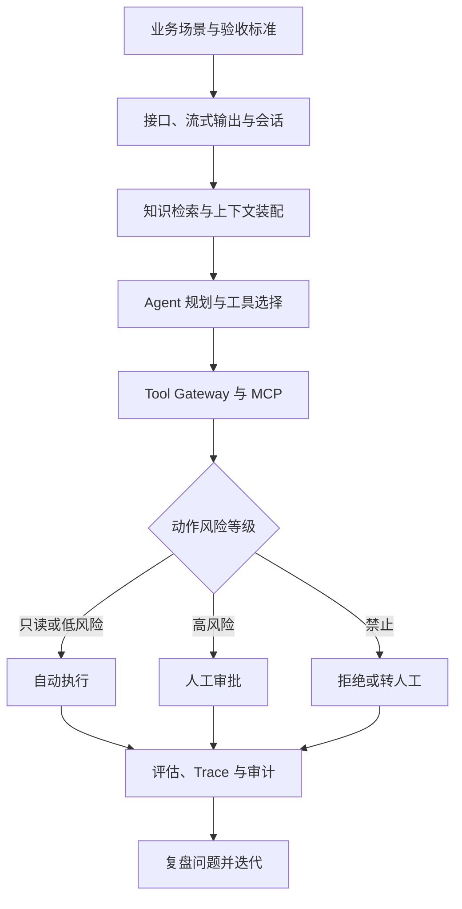

# 项目实战：本章总结与复习

> [!abstract] 一句话总结
> 本章用聊天、RAG、工具调用和业务 Agent 项目训练完整交付能力：从场景与验收标准出发，经上下文和工具完成任务，再用权限、评估、可观测与审计证明系统可靠。

## 知识 / 能力概览

| 项目层次 | 代表内容 | 核心能力 |
| -------- | -------- | -------- |
| LLM 应用底座 | 智能问答、多轮客服 | 普通与流式接口、Prompt、会话隔离、Token 预算与记忆 |
| 知识增强 | 企业 RAG、CAG 对比、Obsidian Wiki | 解析切分、混合检索、重排、引用、权限过滤、评估实验 |
| 工具与协议 | Function Calling、MCP Server | 工具 Schema、参数校验、错误处理、标准化能力接入 |
| Agent 编排 | ReAct Agent、业务 Agent | 计划与执行循环、状态机、Tool Gateway、人工审批与补偿 |
| 业务落地 | 客服、搜索、办公、数据分析 | 把技术指标映射为降本、提效、准确率和风险控制 |

## 项目交付主线

## 快速复习

- 先写业务目标、用户角色、输入输出和验收标准，再选模型与框架。
- RAG 的质量链路是解析、切分、召回、融合、重排、生成和引用；权限过滤必须在无权内容进入 Prompt 前完成。
- 多轮记忆要按用户与会话隔离，并受 Token 预算、摘要策略和敏感信息生命周期约束。
- 模型只提出工具名和参数；服务端负责鉴权、白名单、Schema 校验、风险分级、幂等和审计。
- ReAct 解决“思考、行动、观察”的执行循环，业务 Agent 还必须有状态机、超时重试、审批和失败补偿。
- 没有评估集、Trace、成本与延迟指标，就无法稳定定位 RAG 或 Agent 的 badcase。

## 自测问题

1. 基础问答项目怎样验证流式接口、会话隔离和可观测字段？
2. RAG 答错时，如何区分解析、召回、排序、Prompt 和模型生成问题？
3. 为什么权限过滤不能只写在系统提示词里？
4. Function Calling、MCP 与 ReAct 分别解决哪一层问题？
5. L0 到 L4 的动作如何决定自动执行、审批、拒绝和审计策略？
6. 如何设计同数据集、同模型条件下的 CAG 与 RAG 对比实验？
7. 怎样把一个 Demo 讲成有业务价值、可评估、可治理的项目？

## 相关编号双链

应用底座：[[01-项目-智能问答机器人]] · [[04-项目-智能客服多轮对话系统]]

知识增强：[[03-项目-企业知识库RAG系统]] · [[09-项目-CAG-vs-RAG对比实验]] · [[10-项目-Obsidian-LLM-Wiki]]

工具与 Agent：[[02-项目-Function-Calling工具机器人]] · [[05-项目-通用ReAct-Agent]] · [[06-项目-MCP-Server工具集]] · [[07-项目-业务Agent系统]]

场景选型：[[08-行业场景-AI客服-AI搜索-办公助手-数据分析Agent]]

索引：[[_index|本区项目索引]]

## 🔗 下一章衔接

项目实战是能力的最终验证。学完本章后进入 **[[10-AI应用开发/09-标杆产品拆解/_index|09 · 标杆产品拆解]]**——把你在项目里踩过的坑（上下文工程、工具调用、权限治理、评估）放到 Codex 与 Claude Code 的产品视角里重新审视，理解成功产品如何把这些能力规模化。
