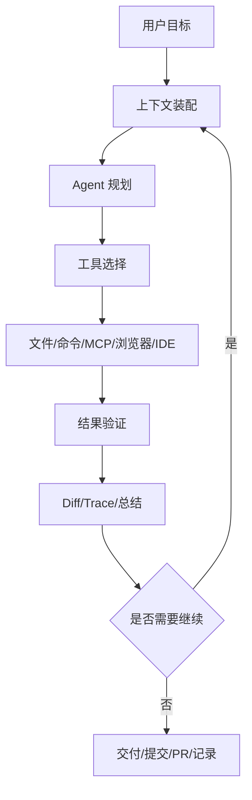

# 标杆产品对比：Codex vs Claude Code

> [!abstract] 一句话总结
> Codex 更像“多 surface 的软件工程 Agent 平台”，Claude Code 更像“terminal-native 的代码协作 Agent”。两者共同说明：成功的编程 Agent 核心不是模型本身，而是上下文、工具、权限和工作流产品化。

## 快速对比

| 维度 | Codex | Claude Code |
| ---- | ----- | ----------- |
| 产品定位 | OpenAI 的 coding agent，覆盖 CLI、IDE、桌面 app、云端等多个 surface | Anthropic 的 agentic coding tool，核心体验围绕终端和代码库 |
| 主要入口 | Codex app、CLI、IDE extension、cloud/web、GitHub/Slack/Linear 等集成 | CLI、IDE 集成、GitHub Actions、MCP 等 |
| 项目规则 | `AGENTS.md`，支持全局、仓库、子目录层级 | `CLAUDE.md` / memory，支持项目记忆和团队约定 |
| 扩展机制 | Skills、Plugins、MCP、Hooks、Subagents、Automations | MCP、Hooks、Subagents、Skills、Slash commands、Settings |
| 安全模型 | sandbox mode + approval policy + workspace/worktree/cloud 隔离 | permissions/settings/hooks 等控制工具执行与行为 |
| 工作流重点 | 多线程、worktree、自动化、review、可并行代理 | terminal-native、深度代码库上下文、可脚本化 hooks |
| 对我们启发 | 适合学习“AI 工程平台”设计 | 适合学习“开发者工作流 Agent”设计 |

## 共同成功因素

### 1. 把 Agent 放进真实工作流

用户不是问“帮我写个函数”，而是让 Agent 读仓库、改文件、跑测试、解释 diff、做 review、继续历史任务。这要求产品具备：

- 文件系统访问。
- 命令执行。
- Git/diff 视图。
- 持续线程。
- 可验证的完成标准。

### 2. 用持久规则解决重复提示

一次 prompt 只能解决一次任务。成功产品都把“项目怎么做事”固化成文件或配置：

- Codex：`AGENTS.md`。
- Claude Code：`CLAUDE.md` / memory。

这其实是上下文工程的产品化：把稳定规则放进可自动加载的上下文，而不是让用户每次重说。

### 3. 工具调用必须有安全边界

编程 Agent 能写文件、执行命令、访问外部服务。没有权限治理，就不能上生产。两者都强调：

- 哪些命令能自动执行。
- 哪些操作需要确认。
- 哪些目录可写。
- 哪些工具可用。
- 如何审计和回滚。

### 4. 扩展能力比内置能力更重要

Codex 和 Claude Code 都不是只靠内置工具取胜，而是让生态接入：

- MCP 接入外部工具和数据。
- Skills / subagents 扩展工作流。
- hooks / automation 把固定动作嵌入生命周期。

## 架构抽象

## 对 AI 应用开发的启发

如果我们要做企业级 AI Agent，不要从“大模型聊天”开始，而要从这些问题开始：

1. 用户的真实工作流是什么？
2. 哪些上下文应该自动加载？
3. 哪些工具可以调用？
4. 哪些动作需要审批？
5. 如何展示可验证结果？
6. 如何复用团队经验？
7. 如何处理长任务和并行任务？

## 面试讲法

> Codex 和 Claude Code 的成功说明，Agent 产品的核心不是单次模型调用，而是把模型嵌入开发工作流。它们都围绕上下文、工具、权限、验证和可持续协作做产品化。做企业 Agent 也一样，要先设计工作流和治理边界，再接模型。

## 关联

- [[Codex/01-Codex产品定位与总体架构]]
- [[Claude-Code/01-Claude-Code产品定位与总体架构]]
- [[../05-Agent-MCP-Skills/21-Agent权限治理与分级自治]]
- [[../05-Agent-MCP-Skills/09-MCP协议详解]]

## 📚 参考资料

- [OpenAI Codex Documentation](https://developers.openai.com/codex/)
- [Anthropic Claude Code Overview](https://docs.anthropic.com/en/docs/claude-code/overview)

