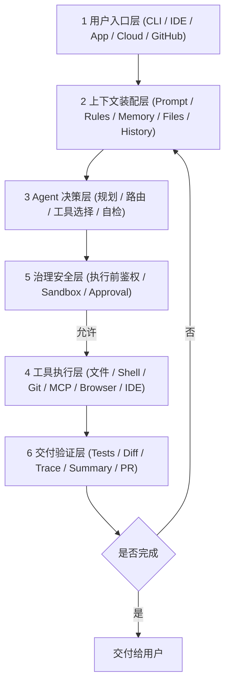

# 编程 Agent 通用架构图

> [!abstract] 一句话总结
> Codex 和 Claude Code 可以抽象成同一类系统：入口层接收目标，上下文层装配信息，Agent 层规划决策，工具层执行动作，治理层控制风险，交付层输出可验证结果。

以下基于公开产品能力提炼出编程 Agent 的**六层通用参考架构**，用于梳理各核心模块的职责边界与协作关系：

## 六层架构

## 1. 用户入口层

入口决定产品形态：

| 入口 | 代表 | 强项 |
| ---- | ---- | ---- |
| CLI | Claude Code / Codex CLI | 贴近终端和命令 |
| IDE | Codex IDE / Claude Code IDE 集成 | 贴近代码编辑 |
| App | Codex app | 多线程、worktree、Git 可视化 |
| Cloud | Codex Cloud / CI 集成 | 后台任务和远程环境 |
| 协作平台 | GitHub / Slack / Linear | 进入团队流程 |

## 2. 上下文装配层

上下文不是越多越好，而是要分层：

| 上下文 | 例子 | 生命周期 |
| ------ | ---- | -------- |
| 本次任务 | 用户 prompt、错误信息 | 单次任务 |
| 项目规则 | `AGENTS.md`、`CLAUDE.md` | 长期 |
| 代码上下文 | 源码、测试、配置 | 按需读取 |
| 工具上下文 | MCP tools、server instructions | 工具可用期间 |
| 经验上下文 | Skills、模板、团队方法论 | 可复用 |
| 历史上下文 | thread、memory、trace | 会话或长期 |

## 3. Agent 决策层

核心职责：

- 判断任务类型。
- 决定读哪些文件。
- 决定是否需要工具。
- 决定修改方案。
- 解释测试失败。
- 判断是否完成。

这里可以是单 Agent，也可以是 supervisor + subagents（见 [[../05-Agent-MCP-Skills/06-Multi-Agent-Supervisor实现]]）。

## 4. 工具执行层

编程 Agent 的工具通常包括：

- 文件读取和编辑。
- 全文搜索。
- shell 命令。
- Git diff / status / commit。
- 测试和构建。
- MCP 外部工具。
- 浏览器或 IDE API。

工具层必须返回结构化结果，让 Agent 能继续推理。

## 5. 治理安全层

这一层决定产品能不能上生产。

| 风险 | 控制手段 |
| ---- | -------- |
| 误删文件 | sandbox、可写目录限制 |
| 危险命令 | 最小权限沙箱、命令白名单与人工审批机制 |
| 泄露密钥 | secret scan、输出脱敏 |
| 越权工具 | MCP 权限过滤、工具白名单 |
| 并行冲突 | worktree、任务写范围隔离 |
| 结果不可验 | 强制测试、diff、trace |

## 6. 交付验证层

成功的编程 Agent 不应只说“我改好了”，而应交付：

- 文件 diff。
- 测试结果。
- 构建结果。
- 修改原因。
- 残余风险。
- 后续建议。

## Codex 和 Claude Code 放到架构图里

| 架构层 | Codex | Claude Code |
| ------ | ----- | ----------- |
| 入口层 | CLI / IDE / app / cloud / integrations | CLI / IDE / Desktop / Web / GitHub |
| 上下文层 | AGENTS.md / Skills / MCP / thread | CLAUDE.md / memory / settings / MCP |
| 决策层 | coding agent + subagents | agentic coding tool + subagents |
| 工具层 | 文件、shell、Git、MCP、浏览器等 | 文件、shell、Git、MCP 等 |
| 治理层 | sandbox、approval、worktree、managed config | permissions、hooks、settings |
| 交付层 | diff、commit、PR、review、summary | 代码修改、测试、summary、协作集成 |

## 能讲清楚的核心话术

> 编程 Agent 的通用架构可分为六层：入口层嵌入开发者工作流，上下文层动态装配项目规则与代码文件，Agent 决策层负责规划与工具选择，工具层执行文件读写与命令调用，治理层把控权限与安全边界，交付层通过自动化测试、Diff 与执行轨迹验证结果可靠性。

## 关联

- [[Codex/02-Codex一次任务执行全链路]]
- [[Claude-Code/02-Claude-Code一次任务执行全链路]]
- [[03-从Codex和Claude-Code反推企业Agent设计]]

## 📚 参考资料

- [OpenAI Codex Documentation](https://developers.openai.com/codex/)
- [OpenAI Codex Manual](https://developers.openai.com/codex/codex-manual.md)
- [Anthropic Claude Code Overview](https://code.claude.com/docs/overview)
