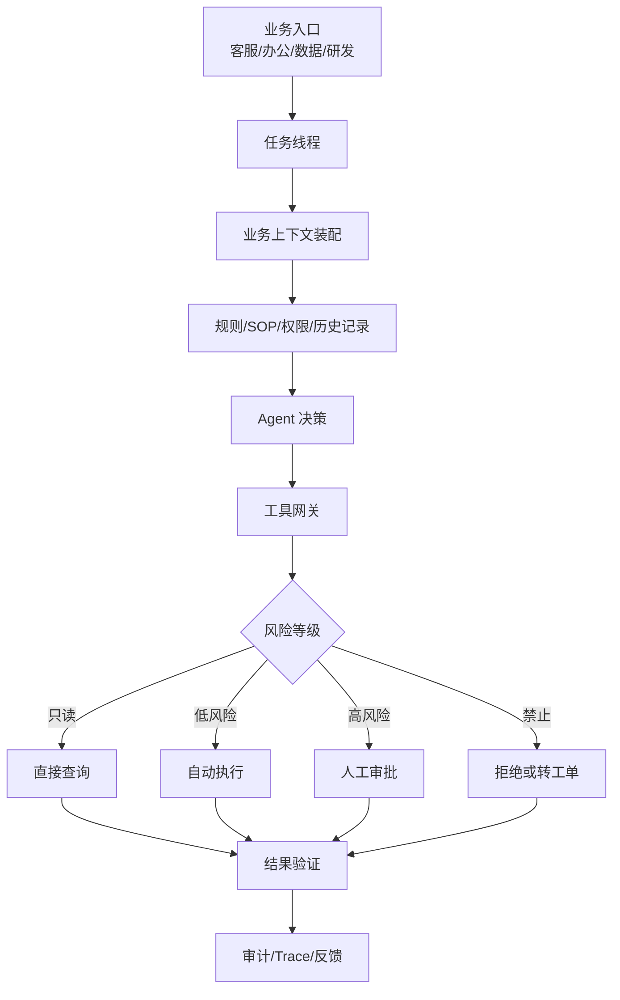

# 从 Codex 和 Claude Code 反推企业 Agent 设计

> [!abstract] 一句话总结
> Codex 和 Claude Code 的产品设计可以迁移到企业 Agent：先嵌入真实工作流，再设计上下文、工具、权限、验证和复用机制。

## 不要从“聊天框”开始

很多 AI 应用失败，是因为先做聊天框，再想怎么接业务。Codex 和 Claude Code 给出的反例是：

- 先找高频工作流。
- 再让 Agent 站到工作流里。
- 再给它上下文和工具。
- 最后用权限和验证控制风险。

## 映射到企业场景

| 编程 Agent 设计 | 企业 Agent 对应设计 |
| --------------- | ------------------- |
| 代码库 | 企业业务系统 / 知识库 / 数据库 |
| AGENTS.md / CLAUDE.md | 业务规则、岗位 SOP、权限说明 |
| 文件编辑 | 创建工单、修改草稿、生成报表 |
| shell / test | 业务校验、规则引擎、审批流 |
| Git diff | 变更预览、操作审计、回滚记录 |
| sandbox / permissions | 数据权限、工具白名单、风险等级 |
| worktree | 草稿环境、沙盒环境、灰度租户 |
| subagents | 财务、法务、客服、数据分析专家 Agent |
| skills | 可复用业务流程包 |
| MCP | 企业系统标准接入层 |

## 企业 Agent 通用架构

## 设计步骤

### 1. 定义工作流

先问：

- 用户每天重复做什么？
- 哪些步骤最耗时？
- 哪些步骤需要查资料？
- 哪些步骤可以自动化？
- 哪些步骤必须人工审批？

### 2. 定义上下文

把上下文分成四类：

| 类型 | 例子 |
| ---- | ---- |
| 稳定规则 | SOP、政策、风控规则 |
| 实时数据 | 订单、库存、客户信息 |
| 历史记录 | 会话、工单、操作日志 |
| 任务输入 | 用户本次问题、附件、目标 |

### 3. 定义工具

工具不要一次性全部暴露给模型。要按场景、用户、风险过滤。

示例：

- 客服 Agent：查订单、查物流、创建工单、申请退款。
- 数据 Agent：查指标、生成 SQL、画图、解释波动。
- 办公 Agent：查制度、写邮件草稿、生成周报、创建待办。

### 4. 定义权限和风险等级

借鉴 [[../05-Agent-MCP-Skills/21-Agent权限治理与分级自治]]：

- L0：只读。
- L1：生成草稿。
- L2：低风险自动执行。
- L3：高风险需审批。
- L4：禁止自治。

### 5. 定义验证方式

不同任务要有不同验证：

| 任务 | 验证 |
| ---- | ---- |
| RAG 问答 | 引用证据、无答案拒答 |
| SQL 分析 | 只读、limit、结果核验 |
| 工单操作 | 参数校验、幂等、审批 |
| 文档生成 | 格式校验、敏感信息扫描 |
| 代码修改 | 测试、lint、diff |

## 最小可行企业 Agent

如果要做一个可面试的项目，可以按这个最小闭环：

1. 一个 Web Chat 入口。
2. 一个任务线程表。
3. 一个业务规则文档，相当于企业版 `AGENTS.md`。
4. 两个只读工具：查知识库、查业务数据。
5. 一个低风险写工具：创建工单或生成草稿。
6. 一个高风险操作：必须人工审批。
7. 一套 trace 和 eval badcase。

## 讲给面试官的版本

> 我会借鉴 Codex 和 Claude Code 的设计做企业 Agent。它们的成功点不是模型本身，而是把 Agent 放进真实工作流：自动加载项目规则，按需读取上下文，通过工具执行动作，用权限和审批控制风险，最后用测试、diff 或 trace 验证结果。企业场景可以把代码库换成业务系统，把 AGENTS.md/CLAUDE.md 换成 SOP，把 shell/test 换成业务校验和审批流。

## 关联

- [[02-编程Agent通用架构图]]
- [[Codex/02-Codex一次任务执行全链路]]
- [[Claude-Code/02-Claude-Code一次任务执行全链路]]
- [[../05-Agent-MCP-Skills/21-Agent权限治理与分级自治]]
- [[../06-平台与工程化/09-AI应用评估数据集与回归测试]]

## 📚 参考资料

- [OpenAI Codex Documentation](https://developers.openai.com/codex/)
- [Anthropic Claude Code Overview](https://code.claude.com/docs/overview)
- [Model Context Protocol Specification](https://modelcontextprotocol.io/specification)

