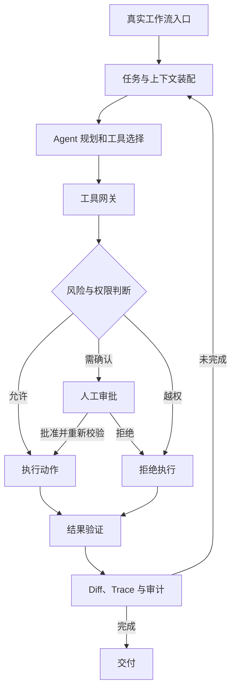

# 标杆产品拆解：本章总结与复习

> [!abstract] 一句话总结
> Codex 与 Claude Code 共同证明，编程 Agent 的产品力来自真实工作流中的上下文、工具、权限和验证；本章再据此推导可治理的企业 Agent 架构。

## 知识 / 能力概览

### 标杆产品核心机制

- **Codex**：OpenAI 的软件工程 Agent，覆盖 CLI、IDE、桌面端与云端等入口，核心机制包括持续任务线程（Thread）、`AGENTS.md` 分层规则、Skills、MCP、Sandbox 隔离、Approval 审批策略与 Git worktree 并行隔离。
- **Claude Code**：Anthropic 的智能编码工具，核心体验围绕终端与代码库展开，核心机制包括 `CLAUDE.md` 与 Auto Memory、Settings、Permissions、Hooks 生命周期拦截、MCP、Subagents 与 Skills。
- **共性演进方向**：两者均具备读取仓库上下文、调用外部工具、编辑文件并结合测试或差异比对持续迭代的能力，但在多端形态与治理机制上各有侧重。

### 通用架构与企业迁移

- **六层通用参考架构**：编程 Agent 可归纳为用户入口层、上下文装配层、Agent 决策层、工具执行层、治理安全层与交付验证层。
- **企业场景映射**：构建企业业务 Agent 时，可将代码库映射为业务系统与知识库，将规则文件映射为岗位 SOP，将 Git Diff 映射为变更预览与操作审计，将 Sandbox 映射为业务测试沙盒。
- **工程设计顺序**：优先梳理业务工作流、上下文分层、受控工具集、权限边界与验证标准，最后接入模型与前端界面。
- **安全与权限底线**：高风险业务动作必须依赖服务端鉴权与人工审批，而非单纯依赖模型推理或 Prompt 软约束。

## 架构推导图

## 快速复习

- 编程 Agent 可归纳为入口、上下文装配、Agent 决策、工具执行、治理安全与交付验证六层架构。
- Codex 突出多端协同、任务线程、worktree 并行与沙箱审批；Claude Code 突出终端原生体验、项目记忆、Hooks 生命周期治理与权限配置。
- 持久规则文件减少重复提示，MCP 标准化外部系统连接，Skills 沉淀可复用流程，Subagents 处理专业化分工。
- Agent 任务的完成标准在于提供自动化测试、Diff、执行轨迹、知识引用或业务校验等可验证结果。
- 企业落地应从高频垂直场景与最小工具集起步，按风险等级逐步开放自治能力。

## 自测问题

1. 编程 Agent 的六层通用架构分别承担什么职责？
2. Codex 与 Claude Code 的共同能力和产品侧重点分别是什么？
3. 为什么项目规则、实时数据和复用流程应该使用不同的上下文载体？
4. 如何把 sandbox、approval、hooks、permissions 映射到企业权限治理？
5. 一个企业 Agent 的最小可行闭环为什么必须包含验证与审计？
6. 哪些高风险业务动作不应交给 Agent 自主决定？

## 相关编号双链

本章抽象：[[01-标杆产品对比-Codex-vs-Claude-Code]] · [[02-编程Agent通用架构图]] · [[03-从Codex和Claude-Code反推企业Agent设计]]

Codex：[[Codex/01-Codex产品定位与总体架构]] · [[Codex/02-Codex一次任务执行全链路]] · [[Codex/03-Codex执行模型-线程-沙箱-审批]] · [[Codex/04-Codex上下文工程-AGENTS-MCP-Skills]]

Claude Code：[[Claude-Code/01-Claude-Code产品定位与总体架构]] · [[Claude-Code/02-Claude-Code一次任务执行全链路]] · [[Claude-Code/03-Claude-Code上下文工程-CLAUDE-md-Memory]] · [[Claude-Code/04-Claude-Code工具系统-MCP-Hooks-Subagents-Skills]]
