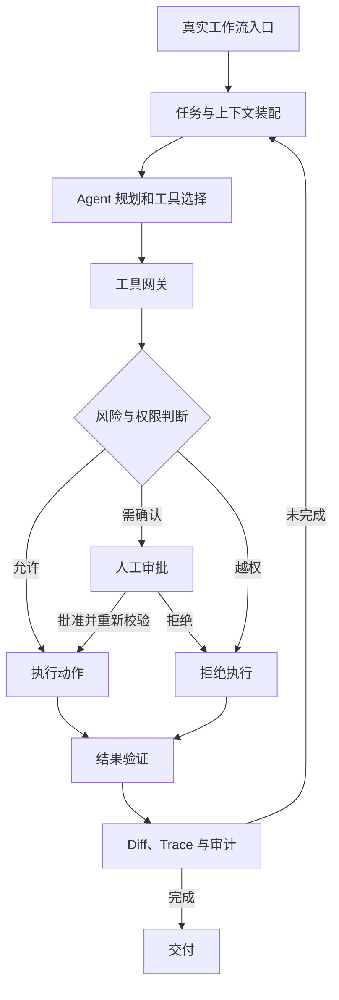

# 标杆产品拆解：本章总结与复习

> [!abstract] 一句话总结
> Codex 与 Claude Code 共同证明，编程 Agent 的产品力来自真实工作流中的上下文、工具、权限和验证；本章再据此推导可治理的企业 Agent 架构。

## 📋 知识 / 能力概览

### 标杆产品核心机制

- **Codex**：OpenAI 的编程 Agent，支持多个入口；常见机制包括 `AGENTS.md`、Skills、MCP、沙箱、审批和 worktree。
- **Claude Code**：Anthropic 的编程 Agent，支持多个入口；使用 `CLAUDE.md`、Auto Memory、权限、Hooks、MCP、Subagents 和 Skills。
- 两者都能读取代码库、调用工具、编辑文件并结合测试或差异比对迭代，入口和治理方式各有侧重。

### 通用架构与企业迁移

- 可以从用户入口、上下文、Agent 决策、工具执行、安全治理和交付验证六层分析编程 Agent。
- 迁移到企业场景时，代码库可类比业务系统与知识库，规则文件对应岗位 SOP，Diff 和沙箱对应变更预览、审计与测试环境。
- 先梳理业务工作流、上下文、工具、权限和验证标准，再考虑模型与前端接入。
- 高风险业务动作需要服务端鉴权，并按业务风险决定是否要求人工审批。

## 🏗️ 架构推导图

## 🧠 快速复习

- 编程 Agent 可归纳为入口、上下文装配、Agent 决策、工具执行、治理安全与交付验证六层架构。
- Codex 突出多端协同、任务线程、worktree 并行与沙箱审批；Claude Code 突出终端原生体验、项目记忆、Hooks 生命周期治理与权限配置。
- 持久规则文件减少重复提示，MCP 标准化外部系统连接，Skills 沉淀可复用流程，Subagents 处理专业化分工。
- Agent 任务的完成标准在于提供自动化测试、Diff、执行轨迹、知识引用或业务校验等可验证结果。
- 企业落地应从高频垂直场景与最小工具集起步，按风险等级逐步开放自治能力。

## ❓ 自测问题

> [!question]- 编程 Agent 的六层通用架构分别承担什么职责？
> 入口接收任务；上下文层准备资料；决策层选择动作；工具层执行；治理层限制权限；交付层验证并展示结果。

> [!question]- Codex 与 Claude Code 有哪些共同能力？
> 都支持结合代码库上下文使用工具完成开发任务；入口和具体权限、扩展能力需以各自产品文档及配置为准。

> [!question]- 规则、实时数据和可复用流程适合放在哪里？
> 稳定项目规则放规则文件，实时资料通过工具按需获取，可复用流程可整理为 Skill；具体加载方式依产品而异。

> [!question]- Sandbox、approval、hooks 和 permissions 如何对应企业治理？
> 分别用于限制执行环境、处理需确认的动作、接入生命周期检查和控制工具权限；业务鉴权仍应由服务端执行。

> [!question]- 为什么企业 Agent 要有验证和审计？
> 验证用于判断动作是否达到预期；审计保留谁在何时基于什么执行了什么，以便追溯和处理失败。

> [!question]- 哪些业务动作应交由人工决策？
> 由业务按风险分级决定；例如实际退款、转账或变更重要权限可以要求人工审批和再次鉴权。

## 🔗 相关编号双链

- 本章：[[01-标杆产品对比-Codex-vs-Claude-Code|产品对比]] · [[02-编程Agent通用架构图|通用架构]] · [[03-从Codex和Claude-Code反推企业Agent设计|企业迁移]]
- Codex：[[Codex/01-Codex产品定位与总体架构|产品定位]] · [[Codex/02-Codex一次任务执行全链路|执行过程]] · [[Codex/03-Codex执行模型-线程-沙箱-审批|沙箱与审批]] · [[Codex/04-Codex上下文工程-AGENTS-MCP-Skills|上下文与扩展]]
- Claude Code：[[Claude-Code/01-Claude-Code产品定位与总体架构|产品定位]] · [[Claude-Code/02-Claude-Code一次任务执行全链路|执行过程]] · [[Claude-Code/03-Claude-Code上下文工程-CLAUDE-md-Memory|上下文与记忆]] · [[Claude-Code/04-Claude-Code工具系统-MCP-Hooks-Subagents-Skills|工具与扩展]]
