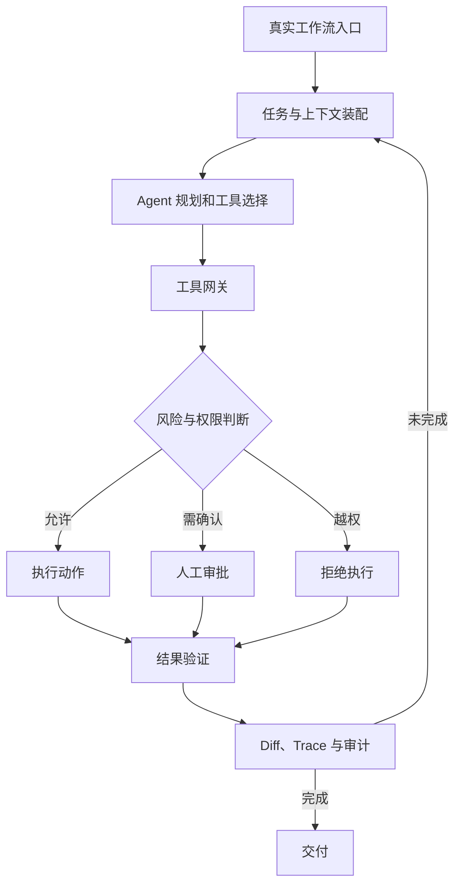

# 标杆产品拆解：本章总结与复习

> [!abstract] 一句话总结
> Codex 与 Claude Code 共同证明，编程 Agent 的产品力来自真实工作流中的上下文、工具、权限和验证；本章再据此推导可治理的企业 Agent 架构。

## 知识 / 能力概览

### 官方事实

以下内容来自本章引用的 OpenAI 与 Anthropic 官方文档所描述的公开产品能力：

- Codex 是 OpenAI 的 coding agent，覆盖 CLI、IDE、app、cloud 等入口；公开机制包括线程、`AGENTS.md`、Skills、MCP、sandbox、approval 和 worktree 等。
- Claude Code 是 Anthropic 的 agentic coding tool，核心体验围绕终端与代码库；公开机制包括 `CLAUDE.md` / memory、settings、permissions、hooks、MCP、subagents 和 skills 等。
- 两者都能读取代码上下文、调用工具、修改文件并结合测试或差异结果继续工作，但入口形态与治理机制的产品侧重点不同。

### 架构推导

以下是根据公开能力做出的设计抽象，不是厂商披露的内部实现：

- 编程 Agent 可抽象为入口、上下文装配、Agent 决策、工具执行、治理安全、交付验证六层。
- 企业 Agent 可把代码库映射为业务系统，把规则文件映射为 SOP，把 Git diff 映射为变更预览与审计，把 sandbox 映射为业务沙盒。
- 设计顺序应是工作流、上下文、工具、权限、验证，最后才是模型和界面。
- 高风险动作需要真实服务端鉴权与人工审批，不能依赖模型自觉或 Prompt 约束。

## 架构推导图

## 快速复习

- **官方事实**回答“产品公开支持什么”；**架构推导**回答“这些能力可以怎样抽象和迁移”。两者不能混写成厂商内部架构。
- Codex 更突出多 surface、线程、worktree 与沙箱审批；Claude Code 更突出 terminal-native、memory、hooks 与权限配置。
- 持久规则减少重复提示，MCP 标准化外部连接，Skills 复用流程，subagents 处理专业分工。
- Agent 的完成标准不是“生成了答案”，而是有测试、Diff、Trace、引用或业务校验等可审查证据。
- 企业落地先做窄场景和最小工具集，再按风险逐级开放自治能力。

## 自测问题

1. 哪些结论是官方公开能力，哪些只是本章的六层架构推导？
2. Codex 与 Claude Code 的共同能力和产品侧重点分别是什么？
3. 为什么项目规则、实时数据和复用流程应该使用不同的上下文载体？
4. 如何把 sandbox、approval、hooks、permissions 映射到企业权限治理？
5. 一个企业 Agent 的最小可行闭环为什么必须包含验证与审计？
6. 哪些高风险业务动作不应交给 Agent 自主决定？

## 相关编号双链

本章抽象：[[01-标杆产品对比-Codex-vs-Claude-Code]] · [[02-编程Agent通用架构图]] · [[03-从Codex和Claude-Code反推企业Agent设计]]

Codex：[[Codex/01-Codex产品定位与总体架构]] · [[Codex/02-Codex一次任务执行全链路]] · [[Codex/03-Codex执行模型-线程-沙箱-审批]] · [[Codex/04-Codex上下文工程-AGENTS-MCP-Skills]]

Claude Code：[[Claude-Code/01-Claude-Code产品定位与总体架构]] · [[Claude-Code/02-Claude-Code一次任务执行全链路]] · [[Claude-Code/03-Claude-Code上下文工程-CLAUDE-md-Memory]] · [[Claude-Code/04-Claude-Code工具系统-MCP-Hooks-Subagents-Skills]]
