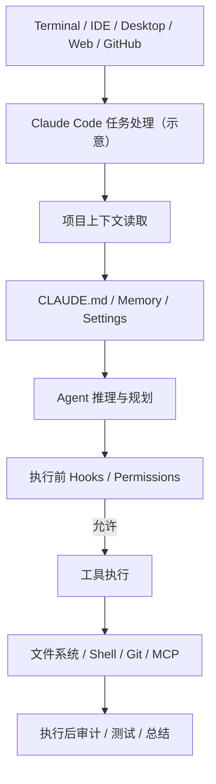

# Claude Code 产品定位与总体架构

> [!abstract] 一句话总结
> Claude Code 是可读取代码、编辑文件和运行命令的编程 Agent，提供终端、IDE、桌面和 Web 等入口；具体能力取决于入口与配置。

## 🎯 官方定位

Anthropic 官方文档把 Claude Code 描述为 agentic coding tool，能够读取代码库、修改文件、执行命令并接入开发工具；终端是其中一种入口。
这一设计使其超越了单行代码补全工具的范畴，成为直接运行在命令行与工作区中的软件工程 Agent。

## 📦 产品心智

Claude Code 与开发流程结合的方式包括：
- 从终端进入项目目录，使用 Git、构建和测试命令。
- 围绕代码库读取项目、理解约定并修改文件。
- 通过 settings、hooks、memory 和 permissions 等配置约束行为。

下图根据公开能力绘制，帮助理解组件关系，并不代表厂商公开的内部实现或所有入口的固定执行顺序。

## 🏗️ 架构抽象

## ⚖️ 与普通聊天助手的差异

| 普通聊天助手 | Claude Code |
| ------------ | ----------- |
| 用户复制代码片段 | Agent 直接读代码库 |
| 输出建议文本 | 可以修改文件、运行命令 |
| 上下文靠用户手动贴 | 项目记忆和规则文件自动参与 |
| 难以验证 | 可以跑测试、看错误、继续修 |
| 不在工程流程里 | 可以接入 hooks、MCP、GitHub |

## 📌 关键模块

### 1. CLI 执行层

Claude Code 以 CLI 为核心交互入口（同时支持 IDE 扩展、桌面端与 Web 端），使 Agent 直接运行在开发者当前项目目录中，能够直接感知工作区文件结构、Git 状态与构建环境。

### 2. Memory / CLAUDE.md

`CLAUDE.md` 由用户维护项目指令；Auto Memory 是 Claude 根据互动记录的经验和偏好，可按配置开启或关闭。它们都能减少重复解释，但不能替代权限控制。

### 3. Tool / MCP

Claude Code 通过工具和 MCP 连接外部系统。MCP 的价值是把工具接入标准化，而不是每个工具单独写死。

### 4. Hooks

Hooks 允许在特定生命周期事件中执行命令或检查。它让 Agent 工作流更像工程流水线：读前检查、工具前拦截、执行后格式化或审计。

### 5. Subagents / Skills

Subagents 用于专业化分工，Skills 用于复用任务能力。这说明 Claude Code 也在从单 Agent 走向可组合的 Agent 系统。

## 💡 对我们做产品的启发

Claude Code 的架构设计表明，Agent 产品无需依赖复杂的图形界面，关键在于深度嵌入用户的高频工作环境，并将上下文装配、工具调用、规则约束与结果验证串联成完整闭环。
企业 Agent 也一样：
- 财务 Agent 应该嵌入财务系统。
- 客服 Agent 应该嵌入工单系统。
- 数据 Agent 应该嵌入 BI / SQL 环境。
- 编程 Agent 应该嵌入代码库和终端。

## 🎯 面试讲法

> [!question]- Claude Code 如何融入开发工作流？
> Claude Code 可读取代码、修改文件和运行命令，并按配置使用项目指令、MCP、Hooks、Subagents 与 Skills；它也提供 IDE、桌面和 Web 等入口。

## 🔗 关联

- [[02-Claude-Code一次任务执行全链路]]：看一次任务如何完整跑完。
- [[../01-标杆产品对比-Codex-vs-Claude-Code]]：与 Codex 的定位差异。
- [[../../05-Agent-MCP-Skills/09-MCP协议详解]]：MCP 协议前置知识。
- [[../../05-Agent-MCP-Skills/13-Skills详解]]：Skills 机制前置知识。

## 📚 参考资料

- [Anthropic Claude Code Overview](https://code.claude.com/docs/overview)
- [Claude Code Settings](https://code.claude.com/docs/settings)
