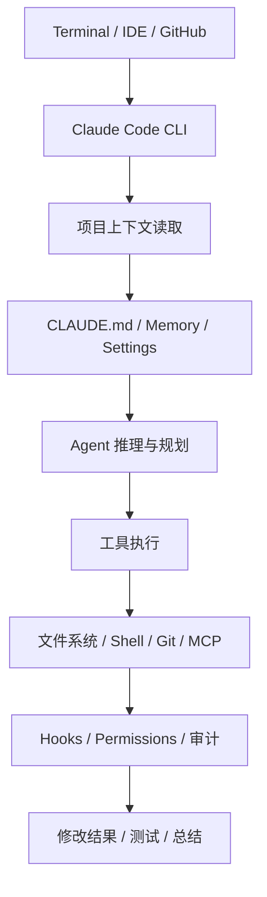

# Claude Code 产品定位与总体架构

> [!abstract] 一句话总结
> Claude Code 的核心优势是 terminal-native：让 Agent 直接站在开发者所在的代码库和命令行环境里工作。

## 官方定位

Anthropic 官方文档把 Claude Code 描述为 agentic coding tool，强调它能理解代码库、在终端中帮助开发者完成编码任务。

这个定位决定了它不是“IDE 补全插件”，而是更接近一个命令行里的软件工程协作者。

## 产品心智

Claude Code 的强体验来自三个点：

1. **从终端进入**：天然处在项目目录、Git、构建命令、测试命令附近。
2. **围绕代码库工作**：任务不是孤立片段，而是读项目、理解约定、修改文件。
3. **可被脚本和配置约束**：通过 settings、hooks、memory、permissions 等把行为纳入团队工程流程。

## 架构抽象

## 与普通聊天助手的差异

| 普通聊天助手 | Claude Code |
| ------------ | ----------- |
| 用户复制代码片段 | Agent 直接读代码库 |
| 输出建议文本 | 可以修改文件、运行命令 |
| 上下文靠用户手动贴 | 项目记忆和规则文件自动参与 |
| 难以验证 | 可以跑测试、看错误、继续修 |
| 不在工程流程里 | 可以接入 hooks、MCP、GitHub |

## 关键模块

### 1. CLI 执行层

CLI 是 Claude Code 的中心入口。它让 Agent 可以处在开发者当前目录里，天然知道工作区、命令和文件结构。

### 2. Memory / CLAUDE.md

用于保存项目说明、团队约定、构建命令、测试方式和偏好。它和 Codex 的 `AGENTS.md` 解决的问题相似：减少重复提示。

### 3. Tool / MCP

Claude Code 通过工具和 MCP 连接外部系统。MCP 的价值是把工具接入标准化，而不是每个工具单独写死。

### 4. Hooks

Hooks 允许在特定生命周期事件中执行命令或检查。它让 Agent 工作流更像工程流水线：读前检查、工具前拦截、执行后格式化或审计。

### 5. Subagents / Skills

Subagents 用于专业化分工，Skills 用于复用任务能力。这说明 Claude Code 也在从单 Agent 走向可组合的 Agent 系统。

## 对我们做产品的启发

Claude Code 说明一个成功 Agent 产品不一定要从复杂 UI 开始。只要它嵌入用户最常用的工作环境，并把工具、上下文、规则、验证串起来，就能形成强产品力。

企业 Agent 也一样：

- 财务 Agent 应该嵌入财务系统。
- 客服 Agent 应该嵌入工单系统。
- 数据 Agent 应该嵌入 BI / SQL 环境。
- 编程 Agent 应该嵌入代码库和终端。

## 面试讲法

> Claude Code 的成功点在于 terminal-native 和 workflow-native。它不是只回答代码问题，而是站在代码库里读取上下文、修改文件、调用命令，并通过 memory、MCP、hooks、subagents、skills 等机制把 Agent 纳入工程流程。

## 关联

- [[02-Claude-Code一次任务执行全链路]]：看一次任务如何完整跑完。
- [[../01-标杆产品对比-Codex-vs-Claude-Code]]：与 Codex 的定位差异。
- [[../../05-Agent-MCP-Skills/09-MCP协议详解]]：MCP 协议前置知识。
- [[../../05-Agent-MCP-Skills/13-Skills详解]]：Skills 机制前置知识。

## 📚 参考资料

- [Anthropic Claude Code Overview](https://docs.anthropic.com/en/docs/claude-code/overview)
- [Claude Code Settings](https://docs.anthropic.com/en/docs/claude-code/settings)

