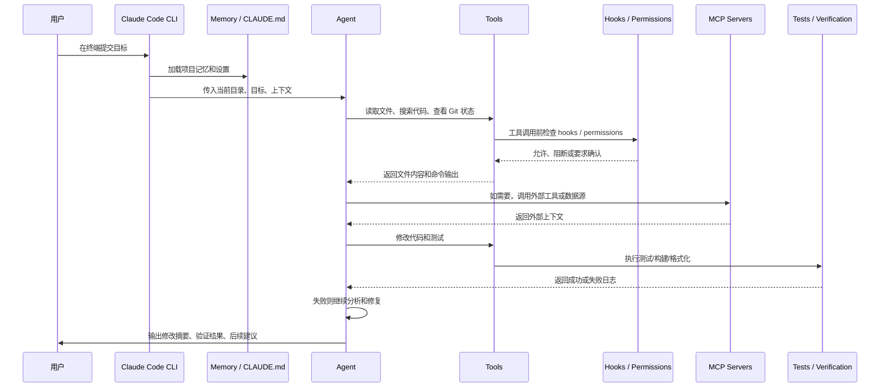
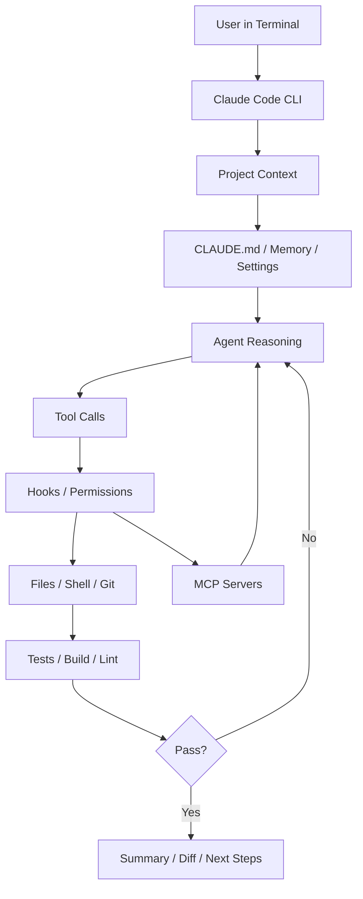

# Claude Code 一次任务执行全链路

> [!abstract] 一句话总结
> Claude Code 的一次任务可以理解为：用户在终端提出目标，Claude Code 读取项目记忆和代码上下文，调用文件/命令/MCP 等工具，经过权限与 hooks 约束，循环修改和验证，最后给出可审查结果。

## 场景例子

用户在项目根目录打开 Claude Code，说：

> 帮我给登录接口补一个参数校验，并更新相关测试。

这个任务背后至少包含：

- 找登录接口在哪里。
- 理解项目约定。
- 修改后端代码。
- 修改或新增测试。
- 运行测试。
- 解释改动。

以下通过时序图梳理一次典型编码任务的端到端执行链路：

## 全链路时序

## 分步骤讲解

### 1. Terminal-native 入口

Claude Code 的强项是从终端进入。终端天然靠近：

- 当前项目目录。
- Git 状态。
- 包管理器。
- 测试命令。
- 环境变量。
- 构建脚本。

所以它比普通网页聊天更接近真实开发工作流。

### 2. Memory / CLAUDE.md 装配

Claude Code 会利用项目记忆来理解“这个项目怎么做事”。这些信息一般包括：

- 项目结构。
- 常用命令。
- 编码规范。
- 测试要求。
- 禁止修改的区域。
- 团队偏好。

这一步使得项目级规范能够跨会话持久复用，避免在每次对话中重复输入背景说明。

### 3. 代码库探索

Agent 会通过工具查找相关文件：

- 搜索接口名、路由、测试。
- 读取 README、配置、已有实现。
- 查看错误日志或测试失败输出。
- 理解依赖关系。

这一步对应开发过程中的上下文调研阶段。

### 4. 工具执行和 hooks 约束

Claude Code 的工具调用受 permissions 与 hooks 机制的统一管控。通过在特定生命周期节点挂载确定性脚本，Hooks 将 Agent 行为纳入工程治理体系：

- 工具调用前拦截危险操作。
- 文件修改后自动格式化。
- 命令执行后记录日志。
- 任务结束前检查测试。

### 5. MCP 扩展外部能力

如果任务需要外部上下文，Claude Code 可以通过 MCP 接入工具和数据源，例如文档、仓库服务、工单系统或内部 API。

企业落地时，MCP server 应该负责：

- 鉴权。
- 权限过滤。
- 参数校验。
- 审计日志。
- 写操作确认。

### 6. 修改、验证、继续修

Claude Code 的执行不是只写一段代码，而是围绕验证循环：

1. 修改代码。
2. 跑测试或 lint。
3. 读取失败日志。
4. 判断是实现问题还是测试问题。
5. 继续修复。
6. 输出结果。

## 一张架构图讲清楚

## 为什么这样设计

| 设计 | 原因 |
| ---- | ---- |
| Terminal-native | 直接进入开发者真实工作环境 |
| CLAUDE.md / Memory | 长期项目规则不靠临时 prompt |
| Hooks | 把 Agent 行为接入工程治理 |
| MCP | 外部工具标准接入 |
| Subagents | 复杂任务专业分工 |
| Skills | 重复任务流程复用 |

## 讲给别人听的版本

> Claude Code 可以理解成一个运行在终端里的代码库 Agent。用户给出目标后，它先加载项目记忆和设置，再读取相关文件和命令输出。需要外部能力时通过 MCP 调工具，工具执行过程受 hooks 和 permissions 约束。它会修改代码、跑测试、根据失败日志继续修，最后输出改动摘要和验证结果。

## 关联

- [[01-Claude-Code产品定位与总体架构]]
- [[03-Claude-Code上下文工程-CLAUDE-md-Memory]]
- [[04-Claude-Code工具系统-MCP-Hooks-Subagents-Skills]]
- [[../02-编程Agent通用架构图]]

## 📚 参考资料

- [Claude Code Overview](https://code.claude.com/docs/overview)
- [Claude Code Memory](https://code.claude.com/docs/memory)
- [Claude Code Hooks](https://code.claude.com/docs/hooks)
- [Claude Code MCP](https://code.claude.com/docs/mcp)
