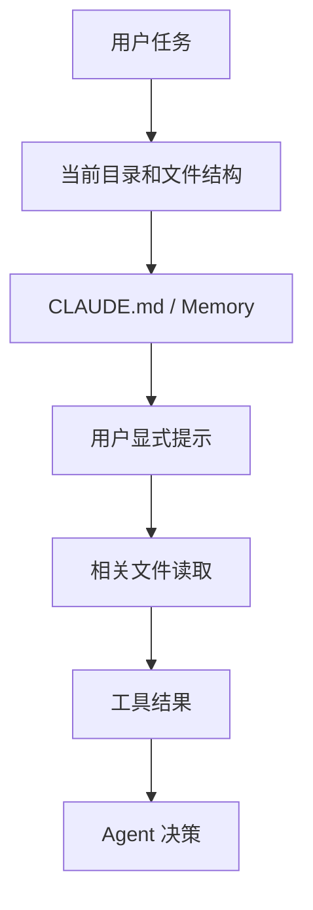

# Claude Code 上下文工程：CLAUDE.md / Memory

> [!abstract] 一句话总结
> Claude Code 的 memory 机制把“项目怎么工作”从临时 prompt 变成可持续上下文，核心载体是 `CLAUDE.md` 这类项目记忆文件。

## 为什么 Memory 重要

编程 Agent 最容易失败的地方不是不会写代码，而是不知道项目约定：

- 该用哪个包管理器。
- 测试命令是什么。
- 哪些目录不能动。
- 代码风格是什么。
- 线上风险边界在哪里。
- 团队希望先问还是直接改。

Memory 机制的核心作用是将这些项目规范持久化为自动加载的上下文，避免每次会话重复输入。

其中，`CLAUDE.md` 由开发者显式编写与维护，用于声明稳定的项目级指令；Auto Memory 则由 Claude 在协作过程中自动提炼并记录经验要点。在实际维护中，建议定期清理过期规则，避免写入敏感凭证，并将强安全限制配置在 Permissions 权限策略中。

此外，新版工具链已逐步兼容 `AGENTS.md` 规范，具体加载优先级取决于工作区内的现有配置文件及项目指令设置。

## CLAUDE.md 应该写什么

| 内容 | 示例 |
| ---- | ---- |
| 项目结构 | `apps/web` 是前端，`services/api` 是后端 |
| 常用命令 | `pnpm test`、`mvn test`、`npm run lint` |
| 修改边界 | 不要改生成文件，不要改迁移历史 |
| 编码规范 | 使用现有组件，不新增无关依赖 |
| 验证要求 | 改接口必须跑对应测试 |
| 安全要求 | 不打印 token，不提交密钥 |

## 与 Codex AGENTS.md 的对照

| 维度 | Claude Code | Codex |
| ---- | ----------- | ----- |
| 项目规则载体 | `CLAUDE.md` / memory | `AGENTS.md` |
| 目标 | 让 Agent 记住项目和团队约定 | 让 Agent 自动加载仓库规则 |
| 适用场景 | Claude Code 工作流 | Codex CLI/IDE/App 工作流 |
| 本质 | 持久上下文 | 持久上下文 |

## 上下文装配流程



## 好的 Memory 写法

好的 memory 应该短、具体、可执行：

```md
# Project conventions

- Use `pnpm` for frontend packages.
- Run `pnpm test` after changing frontend logic.
- Do not edit generated API clients directly.
- Backend APIs live under `services/api`.
- Ask before adding a new runtime dependency.
```

不要写成价值观口号：

```md
- Write high quality code.
- Be careful.
- Make it elegant.
```

这些话无法直接指导工具执行。

## 对企业 Agent 的启发

Memory 不只适用于编程。任何企业 Agent 都需要类似机制：

- 客服 Agent：产品政策、禁用话术、转人工规则。
- 数据 Agent：指标口径、表结构说明、只读限制。
- 办公 Agent：公司格式、审批边界、保密要求。

本质是把组织知识变成 Agent 可加载的操作性上下文。

## 面试讲法

> Claude Code 的 memory 机制说明，上下文工程要区分临时任务和长期规则。长期规则应该沉淀成 `CLAUDE.md` 这类项目记忆，自动进入 Agent 上下文；临时 prompt 只描述本次目标和约束。

## 📚 参考资料

- [Claude Code Memory](https://code.claude.com/docs/memory)
- [Claude Code Settings](https://code.claude.com/docs/settings)
- [[../../05-Agent-MCP-Skills/16-AGENTS规范详解]]
