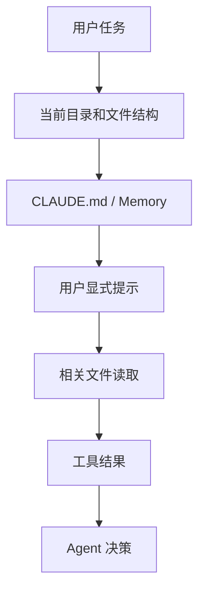

# Claude Code 上下文工程：CLAUDE.md / Memory

> [!abstract] 一句话总结
> `CLAUDE.md` 保存用户编写的持久指令，Auto Memory 保存 Claude 在协作中记录的经验；二者有不同的写入方式、作用范围和加载规则。

## 🧠 为什么 Memory 重要

编程 Agent 最容易失败的地方不是不会写代码，而是不知道项目约定：
- 该用哪个包管理器。
- 测试命令是什么。
- 哪些目录不能动。
- 代码风格是什么。
- 线上风险边界在哪里。
- 团队希望先问还是直接改。

持久指令与记忆能减少重复输入，但它们仍是模型上下文，不能保证每次都被遵守，也不能替代权限策略：
- **`CLAUDE.md`**：由开发者编写和维护，记录项目的稳定指令。
- **Auto Memory**：由 Claude 在协作中记录经验；同一 Git 仓库的多个 worktree 通常共享，但不同机器或云环境不自动共享。

支持该功能的 Claude Code 在工作目录及其上级没有 `CLAUDE.md`、`.claude/CLAUDE.md` 或 `CLAUDE.local.md` 时，默认读取 `AGENTS.md`；也可以配置同时读取。具体行为受版本和设置影响，见[官方文档](https://code.claude.com/docs/en/memory)。应定期检查记忆、避免写入凭证，并将强安全限制放在权限策略中。

## 📄 CLAUDE.md 应该写什么

| 内容 | 示例 |
| ---- | ---- |
| 项目结构 | `apps/web` 是前端，`services/api` 是后端 |
| 常用命令 | `pnpm test`、`mvn test`、`npm run lint` |
| 修改边界 | 不要改生成文件，不要改迁移历史 |
| 编码规范 | 使用现有组件，不新增无关依赖 |
| 验证要求 | 改接口必须跑对应测试 |
| 安全要求 | 不打印 token，不提交密钥 |

## 📄 与 Codex AGENTS.md 的对照

| 维度 | Claude Code | Codex |
| ---- | ----------- | ----- |
| 项目规则载体 | `CLAUDE.md`；配置允许时可读取 `AGENTS.md` | `AGENTS.md` |
| 目标 | 让 Agent 记住项目和团队约定 | 让 Agent 自动加载仓库规则 |
| 适用场景 | Claude Code 工作流 | Codex CLI/IDE/App 工作流 |
| 本质 | 持久上下文 | 持久上下文 |

## 🧠 上下文装配流程

下图是学习示意，具体加载范围与时机取决于文件位置和设置。



## 🧠 好的项目指令写法

项目指令应该短、具体、可执行；下面是可放在 `CLAUDE.md` 中的示意：

```md
# Project conventions

- Use `pnpm` for frontend packages.
- Run `pnpm test` after changing frontend logic.
- Do not edit generated API clients directly.
- Backend APIs live under `services/api`.
- Ask before adding a new runtime dependency.
```

不要写成价值观口号：

```md
- Write high quality code.
- Be careful.
- Make it elegant.
```

这些话无法直接指导工具执行。Auto Memory 与项目指令不同，例如它可能记录“这个项目的前端使用 pnpm”；这类经验需要定期检查，不能代替访问控制。

## 💡 对企业 Agent 的启发

Memory 不只适用于编程。任何企业 Agent 都需要类似机制：
- 客服 Agent：产品政策、禁用话术、转人工规则。
- 数据 Agent：指标口径、表结构说明、只读限制。
- 办公 Agent：公司格式、审批边界、保密要求。

本质是把组织知识变成 Agent 可加载的操作性上下文。

## 🎯 面试讲法

> [!question]- 长期项目指令与本次任务提示应如何分工？
> 稳定的项目约定可写入 `CLAUDE.md`，本次目标与约束放在用户请求中；文件是否加载取决于位置和配置，指令也不能替代权限控制。

## 📚 参考资料

- [Claude Code Memory](https://code.claude.com/docs/memory)
- [Claude Code Settings](https://code.claude.com/docs/settings)
- [[../../05-Agent-MCP-Skills/16-AGENTS规范详解]]
