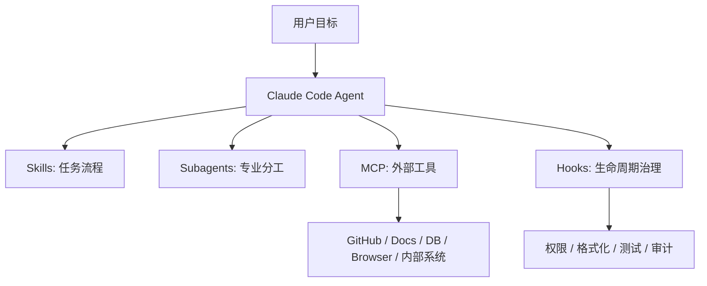

# Claude Code 工具系统：MCP / Hooks / Subagents / Skills

> [!abstract] 一句话总结
> Claude Code 的工具系统体现了生产级 Agent 的四个方向：外部连接用 MCP，生命周期治理用 hooks，复杂任务用 subagents，重复能力用 skills。

## 四类扩展机制

| 机制 | 解决什么 | 类比 |
| ---- | -------- | ---- |
| MCP | 接入外部工具和数据 | 标准化工具连接层 |
| Hooks | 在生命周期节点执行命令 | Agent 版 CI/CD 钩子 |
| Subagents | 专业代理分工 | 多角色协作 |
| Skills | 复用任务流程和资料 | 可加载能力包 |

## MCP：工具连接层

MCP 让 Claude Code 可以连接外部系统，例如文档、数据库、浏览器、GitHub、内部工具。对产品架构来说，MCP 的价值是把工具接入从“定制集成”变成“协议集成”。

企业落地时要关注：

- 工具 schema 是否清楚。
- 鉴权是否走服务端。
- 是否按用户权限过滤工具。
- 是否有调用日志和审计。
- 写操作是否需要确认。

## Hooks：生命周期治理

Hooks 允许开发者在 Claude Code 运行生命周期的关键阶段挂载自定义命令或校验脚本，从而将确定性的工程规范嵌入 Agent 执行链路。

可以用于：

- 工具调用前做权限检查。
- 文件修改后跑格式化。
- 命令执行前拦截危险命令。
- 任务结束后生成审计日志。
- 提交前跑测试。

在实际配置中需根据阶段特性划分职责：`PreToolUse` 在工具执行前触发，适合执行参数检查与高风险操作拦截；`PostToolUse` 在工具执行后触发，适合执行代码格式化、测试验证或审计日志记录。同时，Hook 脚本应纳入仓库受控管理，并与底层的 Sandbox 沙箱及服务端鉴权配合使用。

## Subagents：专业化分工

Subagents 适合把复杂任务拆给不同角色：

- Reviewer Agent：只看代码质量和边界条件。
- Security Agent：只看注入、越权、泄露。
- Test Agent：只补测试和跑用例。
- Docs Agent：只更新文档。

在设计多 Agent 协作时，应合理控制子代理粒度；涉及文件写入的任务需明确划分目录边界或由主 Agent 统一合并变更，避免并发修改冲突。

## Skills：任务能力包

Skills 适合把重复任务沉淀成可加载工作流。例如：

- 代码审查 Skill。
- 故障复盘 Skill。
- 前端 UI 检查 Skill。
- SQL 优化 Skill。

这和 [[../../05-Agent-MCP-Skills/13-Skills详解]] 的核心思想一致：让 Agent 依托明确定义的标准工作流执行任务。

## 架构抽象

## 对企业 AI 平台的启发

如果做企业 Agent 平台，可以照这个结构设计：

- MCP：接入企业系统。
- Hooks：把合规、审计、审批插入关键节点。
- Subagents：按部门或任务类型拆分专家。
- Skills：沉淀团队经验。

这样 Agent 平台就不是单一聊天框，而是可扩展、可治理的工作流系统。

## 面试讲法

> Claude Code 的工具系统可以拆成 MCP、Hooks、Subagents、Skills 四层。MCP 解决连接，Hooks 解决治理，Subagents 解决复杂任务分工，Skills 解决经验复用。这套设计对企业级 Agent 平台很有参考价值。

## 📚 参考资料

- [Claude Code MCP](https://code.claude.com/docs/mcp)
- [Claude Code Hooks](https://code.claude.com/docs/hooks)
- [Claude Code Subagents](https://code.claude.com/docs/sub-agents)
- [Claude Code Skills](https://code.claude.com/docs/skills)
- [[../../05-Agent-MCP-Skills/09-MCP协议详解]]
- [[../../05-Agent-MCP-Skills/13-Skills详解]]
