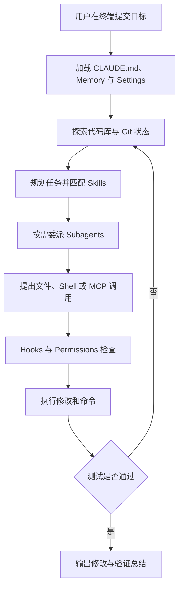

# Claude Code 总结与复习

> [!abstract] 一句话总结
> Claude Code 以终端和代码库为工作现场，用项目记忆装配长期规则，以工具、MCP、hooks、permissions、subagents 和 skills 组成可扩展、可治理的执行闭环。

## 知识 / 能力概览

| 维度 | 关键内容 | 应掌握的能力 |
| ---- | -------- | ------------ |
| 产品定位 | terminal-native 的 agentic coding tool | 从当前目录、Git 和命令环境理解任务入口 |
| 上下文工程 | `CLAUDE.md`、memory、settings | 把长期规则与本次目标分开管理 |
| 工具连接 | 文件、Shell、Git、MCP | 让 Agent 获取代码与外部系统能力 |
| 执行治理 | hooks、permissions | 在生命周期节点拦截、确认、格式化和审计 |
| 能力组合 | subagents、skills | 用专业分工处理复杂任务，用能力包复用流程 |

## 一次任务主线

## 快速复习

- Terminal-native 让 Claude Code 天然靠近当前目录、Git、构建脚本和测试命令。
- `CLAUDE.md` / memory 应记录短、具体、可执行的项目约定，而不是抽象口号。
- MCP 负责标准化外部连接；hooks 负责生命周期治理；permissions 负责允许、拒绝或确认工具行为。
- Subagents 适合专业化分工，但写入范围要隔离；Skills 适合沉淀重复任务的流程和资料。
- 完整任务要经历读取上下文、工具执行、修改、测试、失败分析和结果总结，而不是止于代码生成。

## 自测问题

1. Claude Code 的 terminal-native 形态为什么适合软件工程任务？
2. 哪些内容适合写入 `CLAUDE.md`，哪些只应放在本次提示中？
3. MCP、hooks、permissions、subagents 和 skills 各自解决什么问题？
4. Hooks 可以在哪些关键节点降低误操作和不合规风险？
5. 多个 subagents 参与同一任务时，如何避免重复工作和文件冲突？
6. 一次修改失败后，Claude Code 如何利用测试日志继续闭环？

## 相关编号双链

[[01-Claude-Code产品定位与总体架构]] · [[02-Claude-Code一次任务执行全链路]] · [[03-Claude-Code上下文工程-CLAUDE-md-Memory]] · [[04-Claude-Code工具系统-MCP-Hooks-Subagents-Skills]]

对比与迁移：[[../01-标杆产品对比-Codex-vs-Claude-Code]] · [[../02-编程Agent通用架构图]] · [[../03-从Codex和Claude-Code反推企业Agent设计]]
