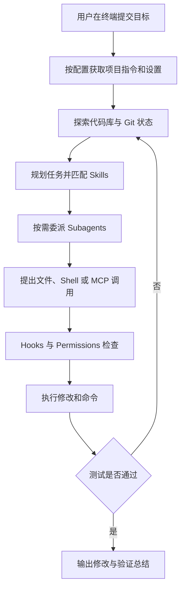

# Claude Code 总结与复习

> [!abstract] 一句话总结
> Claude Code 可在终端、IDE、桌面或 Web 等入口协助编码；根据配置使用项目指令、工具和权限机制，完成可检查的任务。

## 📋 知识 / 能力概览

| 维度 | 关键内容 | 应掌握的能力 |
| ---- | -------- | ------------ |
| 产品定位 | 支持终端、IDE、桌面和 Web 的 agentic coding tool | 从具体入口及其运行环境理解任务 |
| 上下文工程 | `CLAUDE.md`、memory、settings | 把长期规则与本次目标分开管理 |
| 工具连接 | 文件、Shell、Git、MCP | 让 Agent 获取代码与外部系统能力 |
| 执行治理 | hooks、permissions | 在生命周期节点拦截、确认、格式化和审计 |
| 能力组合 | subagents、skills | 用专业分工处理复杂任务，用能力包复用流程 |

## 🗺️ 一次任务主线

下图展示一种可能的终端开发流程；Memory、Skills、Subagents 和 Hooks 是否启用取决于配置，具体任务不一定执行全部步骤。

## 🧠 快速复习

- Terminal-native 让 Claude Code 天然靠近当前目录、Git、构建脚本和测试命令。
- `CLAUDE.md` 适合记录简短、具体、可执行的项目指令；Auto Memory 用于记录经验，应定期检查其准确性。
- MCP 负责标准化外部连接；hooks 负责生命周期治理；permissions 负责允许、拒绝或确认工具行为。
- Subagents 适合专业化分工，但写入范围要隔离；Skills 适合沉淀重复任务的流程和资料。
- 完整任务要经历读取上下文、工具执行、修改、测试、失败分析和结果总结，而不是止于代码生成。

## ❓ 自测问题

> [!question]- Claude Code 的核心工作循环是什么？
> 围绕目标读取相关上下文，按需调用工具、修改文件并验证；具体步骤随任务变化。

> [!question]- CLAUDE.md 与 auto memory 有什么区别？
> CLAUDE.md 主要由用户维护项目指令；auto memory 保存工具积累的经验，两者的加载及配置以官方文档为准。

> [!question]- Permissions、sandbox 和 hooks 各控制什么？
> 权限控制工具使用，sandbox 限制执行环境，hooks 在生命周期节点运行规则或脚本；具体能力取决于配置。

> [!question]- MCP、Skills 和 subagents 分别适合什么？
> MCP 连接外部数据与工具；Skills 整理可复用工作流程；subagents 可分担适合独立处理的子任务。

> [!question]- 如何避免模型改动超出任务范围？
> 在任务和项目规则中说明边界，结合工具权限控制，并在交付前查看 diff 和验证结果。

> [!question]- 如何判断一次任务的结果是否可信？
> 检查实际改动、相关测试或命令结果，以及未验证事项；不要只凭生成的总结判断。

## 🔗 相关编号双链

- Claude Code：[[01-Claude-Code产品定位与总体架构|产品定位]] · [[02-Claude-Code一次任务执行全链路|执行过程]] · [[03-Claude-Code上下文工程-CLAUDE-md-Memory|上下文与记忆]] · [[04-Claude-Code工具系统-MCP-Hooks-Subagents-Skills|工具与扩展]]
- 对比与迁移：[[../01-标杆产品对比-Codex-vs-Claude-Code|产品对比]] · [[../02-编程Agent通用架构图|通用架构]] · [[../03-从Codex和Claude-Code反推企业Agent设计|企业迁移]]
