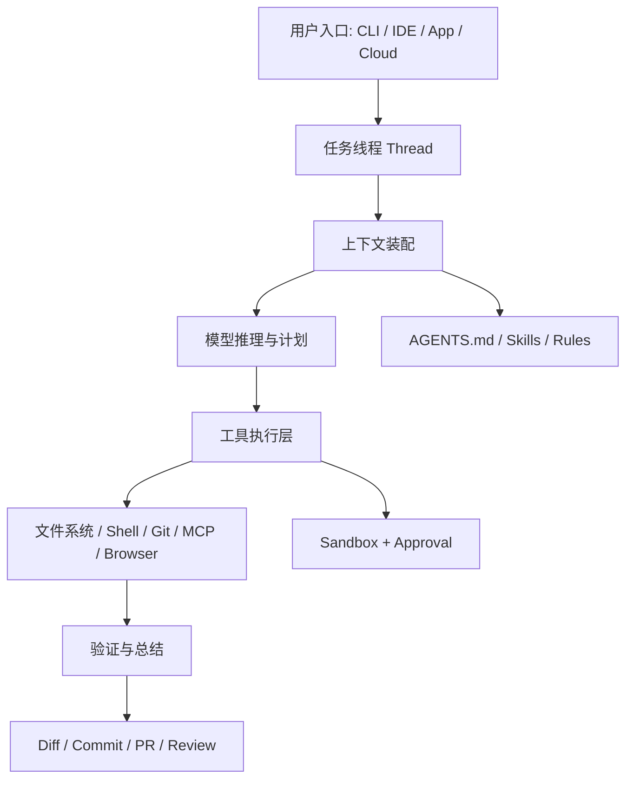

# Codex 产品定位与总体架构

> [!abstract] 一句话总结
> Codex 是覆盖 CLI、IDE、桌面端、云端与协作平台入口的软件工程 Agent 平台。

## 🎯 官方定位

OpenAI 将 Codex 定位为 coding agent。它可以帮助理解代码库、修改文件、运行命令、审查代码和排查问题，并按任务提供可检查的结果。

## 🧩 Surface 设计

Codex 不是只有一个入口，而是多 surface：

| Surface | 适合场景 | 产品意义 |
| ------- | -------- | -------- |
| CLI | 终端内快速执行任务 | 贴近开发者命令行工作流 |
| IDE extension | 编辑器内理解和修改代码 | 贴近局部编辑和上下文选择 |
| Codex app | 多线程、多项目、worktree、Git 操作 | 适合复杂任务管理和并行工作 |
| Cloud/Web | 远程环境执行任务 | 适合 offload 和后台任务 |
| GitHub/Slack/Linear 等集成 | 在协作工具里触发 | 让 Agent 进入团队流程 |

下图是根据公开能力绘制的学习示意，不代表官方公开的内部模块划分；不同入口和配置支持的功能可能不同。

## 🏗️ 架构抽象

## ⚖️ 关键产品取舍

### 1. 以线程承载任务，而不是一次性问答

Codex 的 thread 让任务有持续上下文。复杂开发任务通常要经历：
1. 读代码。
2. 形成计划。
3. 修改文件。
4. 运行测试。
5. 根据失败继续修。
6. 交付总结。

持续任务上下文可以减少用户反复解释，但保留和压缩方式由产品及配置决定。

### 2. 用 worktree 支持并行和隔离

Codex 支持本地目录、Git worktree 和云端环境等工作方式。Worktree 可让任务使用独立工作副本，减少直接覆盖，但最终整合变更时仍需处理冲突。

### 3. 把 Git/Diff 放进产品体验

编程任务可能交付代码变更，也可能交付审查意见、分析文档或问题定位结果。Codex app 提供 Git 和差异审查等能力，帮助用户检查工作结果；具体操作及是否自动执行取决于入口、权限和用户要求。

### 4. 用 Skills 和 MCP 扩展能力边界

Codex 不可能内置所有团队工具，所以提供两类扩展：
- Skills：沉淀某类任务的工作流和资料。
- MCP：连接外部工具、文档、浏览器、Figma 等上下文或动作。

## 💡 对我们做 AI 应用的启发

构建企业级 Agent 时，可以借鉴 Codex 的核心设计原则：
- 从高频业务流程切入，让 Agent 在实际工作环境中解决问题。
- 提供 Diff、测试结果或引用依据，方便人工检查。
- 用规则文件保存项目约定，配合沙箱与审批控制风险。
- 通过 MCP 和 Skills 接入外部工具与可复用流程。
- 用任务线程保存持续上下文，按需提供隔离的并行执行环境。

## 🎯 面试讲法

> [!question]- Codex 的产品架构可以怎样概括？
> 可以从持续会话、上下文装配、工具执行、权限控制和结果验证理解 Codex；CLI、IDE、桌面和云端等入口服务于不同的开发工作流。

## 🔗 关联

- [[02-Codex一次任务执行全链路]]：看一次任务如何完整跑完。
- [[../01-标杆产品对比-Codex-vs-Claude-Code]]：与 Claude Code 的定位差异。
- [[../../05-Agent-MCP-Skills/16-AGENTS规范详解]]：AGENTS.md 前置知识。
- [[../../05-Agent-MCP-Skills/09-MCP协议详解]]：MCP 协议前置知识。

## 📚 参考资料

- [OpenAI Codex Documentation](https://learn.chatgpt.com/docs/glossary)
- [Codex 环境模式](https://learn.chatgpt.com/docs/environments/modes)；[Codex Worktree](https://learn.chatgpt.com/docs/environments/git-worktrees)
