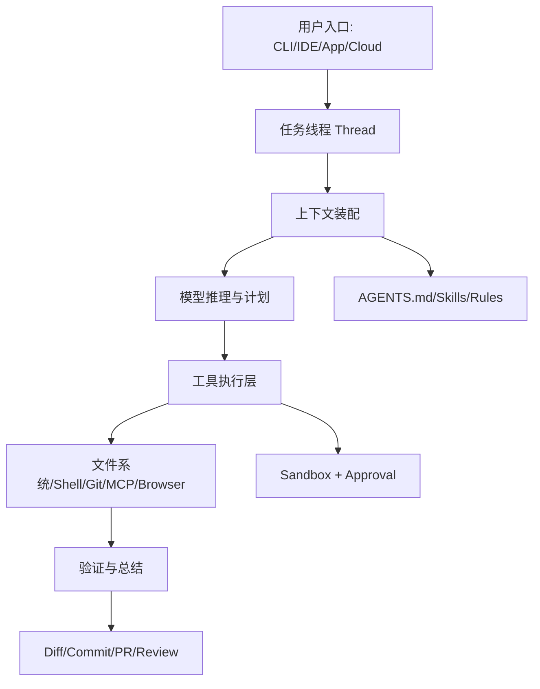

# Codex 产品定位与总体架构

> [!abstract] 一句话总结
> Codex 不是单一聊天工具，而是一个覆盖 CLI、IDE、桌面 app、云端和集成入口的软件工程 Agent 平台。

## 官方定位

OpenAI 官方文档把 Codex 定位为 coding agent，可帮助写代码、理解陌生代码库、审查代码、调试修复问题、自动化开发任务。

这说明 Codex 的核心用户任务不是“问答”，而是完整软件工程活动：

- 读代码。
- 改代码。
- 跑命令。
- 查问题。
- 做 review。
- 提交结果。

## Surface 设计

Codex 不是只有一个入口，而是多 surface：

| Surface | 适合场景 | 产品意义 |
| ------- | -------- | -------- |
| CLI | 终端内快速执行任务 | 贴近开发者命令行工作流 |
| IDE extension | 编辑器内理解和修改代码 | 贴近局部编辑和上下文选择 |
| Codex app | 多线程、多项目、worktree、Git 操作 | 适合复杂任务管理和并行工作 |
| Cloud/Web | 远程环境执行任务 | 适合 offload 和后台任务 |
| GitHub/Slack/Linear 等集成 | 在协作工具里触发 | 让 Agent 进入团队流程 |

## 架构抽象

## 关键产品取舍

### 1. 以线程承载任务，而不是一次性问答

Codex 的 thread 让任务有持续上下文。复杂开发任务通常要经历：

1. 读代码。
2. 形成计划。
3. 修改文件。
4. 运行测试。
5. 根据失败继续修。
6. 交付总结。

如果没有 thread，用户必须反复解释上下文。

### 2. 用 worktree 支持并行和隔离

Codex app 支持 Local / Worktree / Cloud 等模式。Worktree 的设计很关键：它让多个任务可以并行修改同一仓库的不同工作副本，降低互相覆盖的风险。

### 3. 把 Git/Diff 放进产品体验

编程 Agent 最终交付的是代码变更。Codex app 提供 diff、stage、commit、push、PR 等能力，本质是把“模型输出”接到“工程交付”。

### 4. 用 Skills 和 MCP 扩展能力边界

Codex 不可能内置所有团队工具，所以提供两类扩展：

- Skills：沉淀某类任务的工作流和资料。
- MCP：连接外部工具、文档、浏览器、Figma 等上下文或动作。

## 对我们做 AI 应用的启发

做任何企业 Agent，都可以借 Codex 这套思路：

- 不要只做聊天框，要嵌入真实工作流。
- 不要只返回答案，要返回可验证结果。
- 不要只靠 prompt，要有持久规则和权限治理。
- 不要把工具全内置，要提供扩展协议。
- 不要让 Agent 一次性跑完所有事，要支持线程、恢复和并行。

## 面试讲法

> 我理解 Codex 的架构核心是“任务线程 + 上下文装配 + 工具执行 + 安全治理 + 工程交付”。它不是简单代码生成器，而是把模型接入 CLI、IDE、桌面 app、云端和 Git 工作流，让 Agent 能持续完成真实开发任务。

## 📚 参考资料

- [OpenAI Codex Documentation](https://developers.openai.com/codex/)
- [OpenAI Codex Manual](https://developers.openai.com/codex/codex-manual.md)

