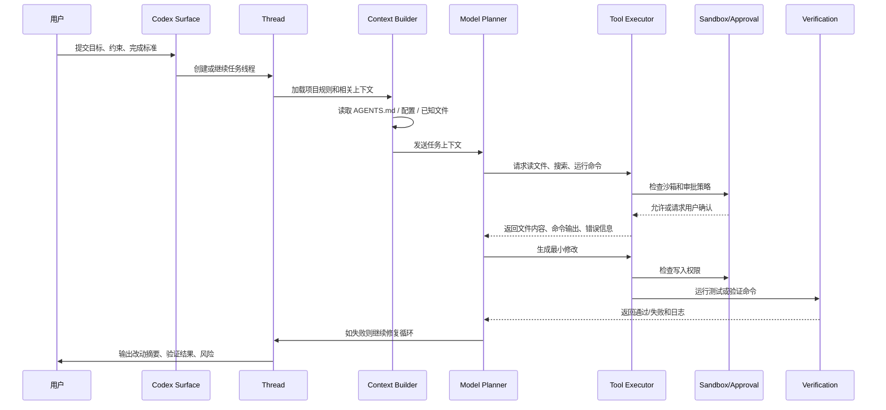
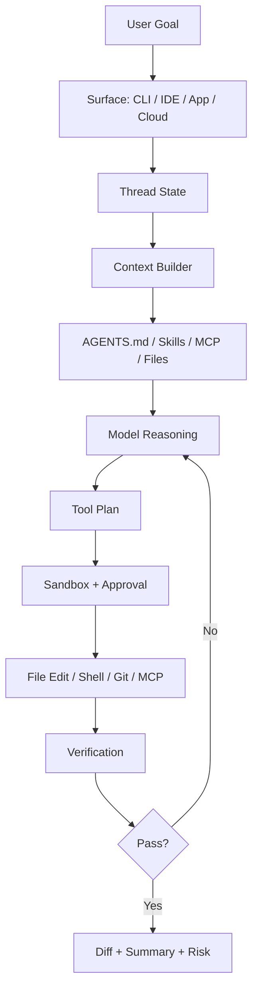

# Codex 一次任务执行全链路

> [!abstract] 一句话总结
> 用户给 Codex 一个开发目标后，Codex 会把它变成一个持续线程：装配上下文、规划、读写文件、运行命令、处理审批、验证结果，最后交付 diff 和总结。

## 场景例子

用户说：

> 帮我修一下订单接口的空指针问题，保持最小改动，修完跑相关测试。

这个任务看起来是一句话，但对 Codex 来说不是一次模型回复，而是一条工程执行链。

以下通过时序图展示该任务从提交到验证交付的完整执行链路：

## 全链路时序

## 分步骤讲解

### 1. 任务入口

Codex 可以从 CLI、IDE、Codex app、Cloud/Web 等 surface 进入。入口不同，但任务会被统一理解成一个 thread。

> Surface 负责提供贴合不同场景的交互体验，Thread 则负责持久化承载任务状态与上下文。

### 2. 上下文装配

Codex 不应该盲目读全仓库，而是按任务逐步获取上下文：

- 用户 prompt：目标、约束、完成标准。
- 项目规则：`AGENTS.md`、全局配置、局部目录规则。
- 文件上下文：相关源码、测试、错误日志。
- 工具上下文：MCP server instructions、skills 描述。
- 历史上下文：同一 thread 内之前的尝试和结果。

### 3. 规划与探索

模型先判断：

- 可能涉及哪些文件。
- 需要先读什么。
- 是否要跑测试复现。
- 是否需要搜索全局引用。
- 是否需要用户确认需求边界。

这一步对应普通开发者的“先看代码再动手”。

### 4. 工具执行

Codex 的关键不是只会回答，而是能使用工具：

- 文件读取。
- 搜索。
- 编辑。
- shell 命令。
- Git diff。
- MCP 工具。
- 浏览器或其他 app 工具，取决于当前 surface 和配置。

工具执行会受到 sandbox 和 approval 控制。

### 5. 沙箱与审批

Codex 官方手册强调两件事：

- **sandbox mode** 决定技术上能做什么。
- **approval policy** 决定什么时候必须问用户。

所以 Codex 的自治不是无限的，而是被运行环境约束。

### 6. 修改与验证循环

一次任务通常不是“一改就对”，而是循环：

1. 改文件。
2. 跑测试或构建。
3. 读失败日志。
4. 再修。
5. 再验证。

这就是编程 Agent 和普通聊天助手的核心差异。

### 7. 交付

最后交付不只是答案，而是工程结果：

- 改了哪些文件。
- 为什么这么改。
- 运行了什么验证。
- 哪些风险还存在。
- 是否需要用户手动检查。

## 一张架构图讲清楚

## 为什么这样设计

| 设计 | 原因 |
| ---- | ---- |
| Thread | 开发任务需要多轮状态，不是一次问答 |
| AGENTS.md | 项目规则要长期生效，不应每次重复提示 |
| Sandbox | 模型生成的命令不能天然可信 |
| Approval | 高风险动作需要人类确认 |
| Tool loop | 代码任务必须读、改、跑、修 |
| Diff/Git | 编程 Agent 最终交付的是可审查变更 |

## 讲给别人听的版本

> Codex 可以理解成一个有工具权限的软件工程代理。用户提出目标后，它在一个 thread 里持续工作：先装配 prompt、AGENTS.md、相关文件和工具说明，再规划要读哪些代码、改哪些文件、跑哪些命令。每次工具执行都经过 sandbox 和 approval 控制。修改后它会跑测试或构建，根据结果继续修复，直到能交付 diff、验证结果和残余风险。

## 关联

- [[01-Codex产品定位与总体架构]]
- [[03-Codex执行模型-线程-沙箱-审批]]
- [[04-Codex上下文工程-AGENTS-MCP-Skills]]
- [[../02-编程Agent通用架构图]]

## 📚 参考资料

- [OpenAI Codex Manual](https://developers.openai.com/codex/codex-manual.md)
- [OpenAI Codex Documentation](https://developers.openai.com/codex/)
