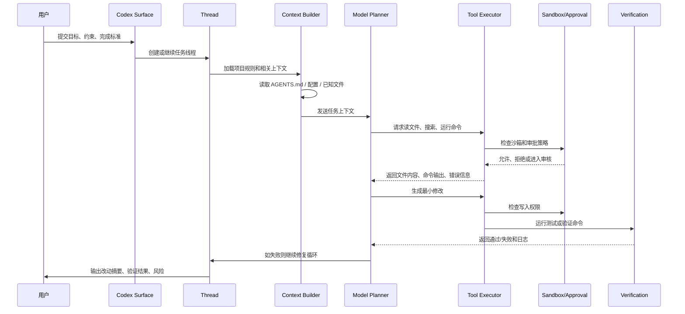
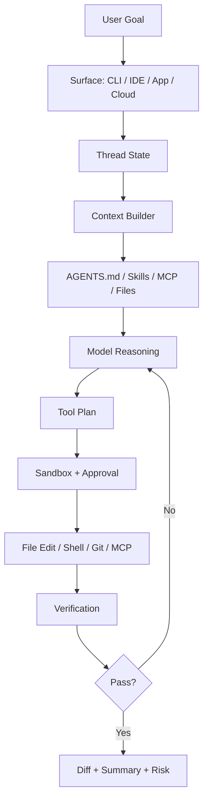

# Codex 一次任务执行全链路

> [!abstract] 一句话总结
> 用户给 Codex 一个开发目标后，Codex 会把它变成一个持续线程：装配上下文、规划、读写文件、运行命令、处理审批、验证结果，最后交付 diff 和总结。

## 🗣️ 场景例子

用户说：

> 帮我修一下订单接口的空指针问题，保持最小改动，修完跑相关测试。

这个任务看起来是一句话，但对 Codex 来说不是一次模型回复，而是一条工程执行链。
下图是帮助理解的一种可能流程，不是对产品内部模块或每次执行顺序的承诺；实际行为取决于任务、权限和配置。

## ⏱️ 全链路时序

## 📋 分步骤讲解

### 1. 任务入口

Codex 可以从 CLI、IDE、Codex app、Cloud/Web 等 surface 进入。入口不同，任务与会话的呈现及运行环境可能不同；此处用 thread 概括持续上下文。

> Surface 负责提供贴合不同场景的交互体验，Thread 则负责持久化承载任务状态与上下文。

### 2. 上下文装配

Codex 不应该盲目读全仓库，而是按任务逐步获取上下文：
- 用户 prompt：目标、约束、完成标准。
- 项目规则：`AGENTS.md`、全局配置、局部目录规则。
- 文件上下文：相关源码、测试、错误日志。
- 工具上下文：MCP server instructions、skills 描述。
- 历史上下文：同一 thread 内之前的尝试和结果。

### 3. 规划与探索

模型先判断：
- 可能涉及哪些文件。
- 需要先读什么。
- 是否要跑测试复现。
- 是否需要搜索全局引用。
- 是否需要用户确认需求边界。

这一步对应普通开发者的“先看代码再动手”。

### 4. 工具执行

Codex 可以按任务读取和编辑文件、搜索、运行命令及查看 Git diff，也可能使用 MCP、浏览器或其他应用工具。实际工具范围和执行权限取决于入口、配置及相应的沙箱与审批策略。

### 5. 沙箱与审批

Codex 的安全机制可以区分为两件事：
- **sandbox mode** 决定技术上能做什么。
- **approval policy** 决定什么时候需要审批或拒绝，审核方式取决于配置。

具体区别和自动审核边界见 [[03-Codex执行模型-线程-沙箱-审批#^codex-permissions|沙箱与审批]]。

### 6. 修改与验证循环

对需要修改的任务，可以按照下面的思路验证：
1. 改文件。
2. 跑测试或构建。
3. 读失败日志。
4. 再修。
5. 再验证。

这就是编程 Agent 和普通聊天助手的核心差异。

### 7. 交付

最后交付不只是答案，而是工程结果：
- 改了哪些文件。
- 为什么这么改。
- 运行了什么验证。
- 哪些风险还存在。
- 是否需要用户手动检查。

## 🏗️ 一张架构图讲清楚

## 🧩 为什么这样设计

| 设计 | 原因 |
| ---- | ---- |
| Thread | 开发任务需要多轮状态，不是一次问答 |
| AGENTS.md | 项目规则要长期生效，不应每次重复提示 |
| Sandbox | 模型生成的命令不能天然可信 |
| Approval | 需要审核的动作由当前策略决定如何处理，可交由用户或自动审核 |
| Tool loop | 根据任务探索、调用工具和验证；审查任务不一定修改文件 |
| Diff/Git | 修改类任务可用差异审查变更；审查任务也可能交付发现 |

## 🗣️ 讲给别人听的版本

> Codex 可以理解成一个有工具权限的软件工程代理。用户提出目标后，它在一个 thread 里持续工作：先装配 prompt、AGENTS.md、相关文件和工具说明，再规划要读哪些代码、改哪些文件、跑哪些命令。工具执行受当前环境的权限、沙箱与审批策略约束。修改后可运行适当的测试或构建，根据结果继续修复，并说明实际验证结果和剩余问题。

## 🔗 关联

- [[01-Codex产品定位与总体架构]]
- [[03-Codex执行模型-线程-沙箱-审批]]
- [[04-Codex上下文工程-AGENTS-MCP-Skills]]
- [[../02-编程Agent通用架构图]]

## 📚 参考资料

- [Codex 沙箱与审批](https://learn.chatgpt.com/docs/agent-approvals-security)
- [OpenAI Codex Documentation](https://learn.chatgpt.com/docs/glossary)
