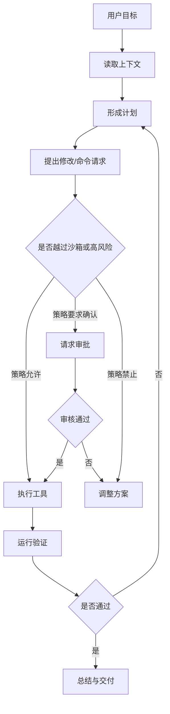

# Codex 执行模型：线程、沙箱、审批

> [!abstract] 一句话总结
> Codex 可以在持续会话中规划和行动；工具受运行环境、沙箱与权限策略约束，是否需要审批由当前配置决定。

## 🧵 Thread：任务状态容器

Thread 是包含多轮请求和结果的持续会话，可以记录用户目标、工具输出、文件修改和验证结果。一个任务可以跨多轮推进；历史进入模型上下文的方式会受压缩和具体配置影响。

## 📁 Local / Worktree / Cloud

| 模式 | 含义 | 适合 |
| ---- | ---- | ---- |
| Local | 直接在当前项目目录工作 | 小改动、用户想立即看到结果 |
| Worktree | 在 Git worktree 中隔离修改 | 并行任务、实验性改动 |
| Cloud | 在远程环境执行 | 后台任务、云端依赖、异步工作 |

Worktree 提供独立的工作目录，适合并行开发；Codex 管理的 worktree 可以处于 detached HEAD，并不一定对应独立分支。工作目录隔离不等于进程、端口、数据库或外部服务隔离，合并变更仍可能产生冲突。

## 🔐 Sandbox：技术边界

sandbox mode 控制命令能在技术上访问的范围，例如：
- 能否写文件。
- 可写范围在哪里。
- 是否能访问网络。
- 是否能碰工作区外文件。

沙箱限制命令的文件系统和网络能力，审批策略决定哪些请求需要额外审核；两者共同使用，但互不替代。远程工具还受其自身服务端权限控制。 ^codex-permissions

## 🔐 Approval：审批决策边界

Approval policy 决定哪些动作需要审核、允许或拒绝。以下是可能触发审核的例子，实际取决于权限配置：
- 需要访问网络。
- 需要写工作区外文件。
- 需要执行高风险命令。
- MCP 或 app tool 声明有副作用。

在人工审批模式下，符合条件的请求会交给用户决定；启用 Auto-review 时，符合条件的沙箱边界审批可由独立审核代理处理，拒绝后需遵循返回的限制。自动审核不扩大沙箱权限，也不是所有入口和操作的通用行为。

## 🗣️ 用一个任务区分沙箱和审批

假设当前任务允许修改指定工作区，Agent 请求在其中编辑文件时，执行是否允许由当前环境和权限策略决定；如果请求访问工作区外的路径，沙箱可能阻止，审批策略则决定能否申请额外授权及由谁审核。
具体的可写目录、网络访问和审核方式都以当前运行环境为准；即便审核通过，远程系统的账户权限仍会独立生效。

## ⚙️ 执行循环

## 💡 对企业 Agent 的启发

Codex 的 sandbox / approval 可以抽象成企业 Agent 的三级控制：

| 层级 | Codex 里的体现 | 企业 Agent 类比 |
| ---- | -------------- | --------------- |
| 技术限制 | sandbox | 只能访问授权数据和工具 |
| 操作审批 | 依配置交由用户或自动审核 | 退款、发券、改订单等操作按业务要求审批 |
| 结果验证 | tests / command output | 业务规则校验、回归测试、人工抽查 |

## ⚠️ 常见误区

- 自动化程度应根据任务风险决定。
- Prompt 不能代替运行环境和服务端的权限检查。
- 修改后需要按任务选择合适的验证方式。
- 并行任务应明确写入范围，必要时使用 worktree 隔离。

## 🎯 面试讲法

> [!question]- 会话、沙箱和审批分别解决什么问题？
> 会话承载持续上下文，沙箱限制执行环境，审批策略决定哪些动作需要审核；完成后还应结合实际测试或其他证据验证结果。

## 🔗 关联

- [[../../05-Agent-MCP-Skills/21-Agent权限治理与分级自治]]
- [[../../06-平台与工程化/09-AI应用评估数据集与回归测试]]

## 📚 参考资料

- [Codex 审批与安全](https://learn.chatgpt.com/docs/agent-approvals-security)；[Auto-review](https://learn.chatgpt.com/docs/sandboxing/auto-review)
- [Codex Worktree](https://learn.chatgpt.com/docs/environments/git-worktrees)
