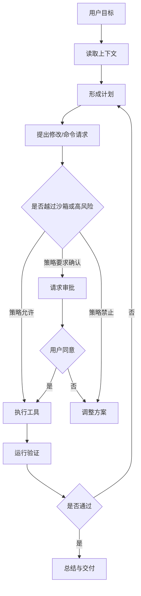

# Codex 执行模型：线程、沙箱、审批

> [!abstract] 一句话总结
> Codex 的执行模型可以理解为：在线程里规划和行动，在沙箱里运行工具，对越界或高风险动作触发审批。

## Thread：任务状态容器

Codex 以 thread 承载一次持续任务。一个 thread 里包含：

- 用户目标和约束。
- 已读文件和命令输出。
- 修改过的文件。
- 测试结果。
- 中途决策。
- 最终总结。

这解决了编程任务的长链路问题：不是一次性生成代码，而是在“读、改、跑、修、交付”的循环中推进。

## Local / Worktree / Cloud

| 模式 | 含义 | 适合 |
| ---- | ---- | ---- |
| Local | 直接在当前项目目录工作 | 小改动、用户想立即看到结果 |
| Worktree | 在 Git worktree 中隔离修改 | 并行任务、实验性改动 |
| Cloud | 在远程环境执行 | 后台任务、云端依赖、异步工作 |

Worktree 通过独立的文件目录与分支隔离代码修改，适合多任务并行开发；由于各工作区仍共享本地端口、数据库与外部服务环境，运行时安全隔离仍需依赖 Sandbox 机制，且分支合并时需处理潜在的代码冲突。

## Sandbox：技术边界

Codex 官方手册强调 sandbox mode 控制模型生成命令能做什么，例如：

- 能否写文件。
- 可写范围在哪里。
- 是否能访问网络。
- 是否能碰工作区外文件。

这对应企业 Agent 里的“最小权限原则”。Agent 的执行范围必须由底层运行环境实施硬性约束。

## Approval：人工决策边界

Approval policy 决定 Codex 什么时候必须停下来问用户，例如：

- 需要访问网络。
- 需要写工作区外文件。
- 需要执行高风险命令。
- MCP 或 app tool 声明有副作用。

审批触发行为由当前配置的 Approval Policy 决定：在严格策略下，越界请求会被直接拒绝；在受控审批策略下，高风险命令会暂停并等待用户确认。此外，本地沙箱主要约束本机文件与进程边界，针对远程 MCP Server 或外部业务系统的写操作，仍需在对应服务端实施独立的身份鉴权与权限控制。

## 执行循环

## 对企业 Agent 的启发

Codex 的 sandbox / approval 可以抽象成企业 Agent 的三级控制：

| 层级 | Codex 里的体现 | 企业 Agent 类比 |
| ---- | -------------- | --------------- |
| 技术限制 | sandbox | 只能访问授权数据和工具 |
| 操作审批 | approval | 退款、发券、改订单前人工确认 |
| 结果验证 | tests / command output | 业务规则校验、回归测试、人工抽查 |

## 常见误区

- 误区一：Agent 越自动越好。实际应按风险分级。
- 误区二：Prompt 能代替权限。实际必须靠运行环境和服务端判断。
- 误区三：一次生成就是完成。实际要有验证循环。
- 误区四：并行 Agent 可以随便改同一目录。实际要靠 worktree 或明确写范围隔离。

## 面试讲法

> Codex 的执行模型给我的启发是：生产 Agent 必须有任务状态、工具边界和审批机制。线程负责持续上下文，sandbox 负责技术限制，approval 负责高风险动作的人类确认，验证循环负责交付质量。

## 关联

- [[../../05-Agent-MCP-Skills/21-Agent权限治理与分级自治]]
- [[../../06-平台与工程化/09-AI应用评估数据集与回归测试]]

## 📚 参考资料

- [OpenAI Codex Manual：Approvals, Sandboxing, and Security](https://developers.openai.com/codex/codex-manual.md#approvals-sandboxing-and-security)
- [OpenAI Codex Manual：Codex app features](https://developers.openai.com/codex/codex-manual.md#surface-behavior)
