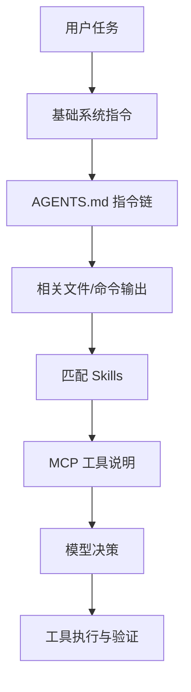

# Codex 上下文工程：AGENTS.md / MCP / Skills

> [!abstract] 一句话总结
> Codex 的上下文工程通过分层机制，将项目持久规则、外部工具连接与可复用工作流按需装配到模型上下文中。

## 三类上下文

| 类型 | 代表机制 | 解决什么 |
| ---- | -------- | -------- |
| 项目规则 | `AGENTS.md` | 这个仓库怎么 build、test、review、哪些文件不能乱动 |
| 外部能力 | MCP | 文档、浏览器、Figma、第三方工具如何接入 |
| 任务经验 | Skills | 某类任务的固定流程、参考资料、脚本 |

## AGENTS.md：项目级持久指令

Codex 官方手册说明，Codex 会在开始工作前读取 `AGENTS.md`，并支持全局、项目、子目录层级。越靠近当前目录的规则越具体。

这是一种很关键的产品设计：

- 把重复口头提示变成仓库文件。
- 让团队约定可版本化。
- 让不同会话、不同人、不同任务共享同一套规则。
- 支持按目录层级就近覆盖业务约定，而底层的工具执行权限与沙箱安全边界则始终由宿主环境策略统一管控。

## MCP：连接外部工具和上下文

MCP 让 Codex 可以接入第三方文档、浏览器、Figma、内部系统等。它本质上是工具和上下文的标准接口。

对 AI 应用开发来说，这说明成功 Agent 不会把所有功能写死在客户端里，而是：

1. 用协议连接工具。
2. 用 schema 描述工具能力。
3. 用认证和权限控制边界。
4. 用 server instructions 说明跨工具约束。

## Skills：可复用任务能力

Codex Skills 使用渐进式披露：初始上下文只放技能名、描述和路径；真正触发时再读取完整 `SKILL.md`。这个设计解决了上下文窗口浪费问题。

适合沉淀：

- 代码审查流程。
- 安全扫描流程。
- 文档生成流程。
- 前端设计检查。
- 数据分析流程。

## 上下文装配架构

## 关键取舍

### 1. 稳定规则进 AGENTS.md

例如构建命令、测试命令、代码风格、禁止操作。

### 2. 可复用流程进 Skill

例如“怎么做代码审查”“怎么写项目周报”“怎么排查线上问题”。

### 3. 实时外部能力走 MCP

例如浏览器、设计稿、文档库、工单系统、数据库只读查询。

## 对我们知识库的启发

我们已有：

- [[../../05-Agent-MCP-Skills/16-AGENTS规范详解]]
- [[../../05-Agent-MCP-Skills/09-MCP协议详解]]
- [[../../05-Agent-MCP-Skills/13-Skills详解]]

下一步可以把这些从“概念笔记”变成“实战项目”：为一个 Java 项目写 `AGENTS.md`、为代码审查写 Skill、为内部文档写 MCP Server。

## 面试讲法

> Codex 的上下文工程分三层：AGENTS.md 解决项目规则，MCP 解决外部工具和上下文接入，Skills 解决可复用任务流程。它不是简单扩大上下文窗口，而是把不同生命周期的信息放到不同载体里。

## 📚 参考资料

- [OpenAI Codex Manual：Custom instructions with AGENTS.md](https://developers.openai.com/codex/codex-manual.md#customization-and-tooling)
- [OpenAI Codex Manual：Model Context Protocol](https://developers.openai.com/codex/codex-manual.md#customization-and-tooling)
- [OpenAI Codex Manual：Agent Skills](https://developers.openai.com/codex/codex-manual.md#customization-and-tooling)
