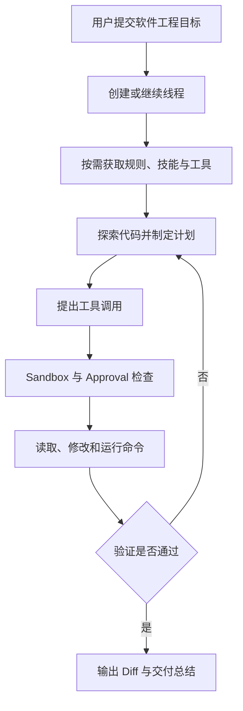

# Codex 总结与复习

> [!abstract] 一句话总结
> Codex 把软件工程任务放进可持续的线程，通过分层上下文、受控工具执行和修改验证循环，在不同工作入口中交付可审查的代码结果。

## 📋 知识 / 能力概览

| 维度 | 关键内容 | 应掌握的能力 |
| ---- | -------- | ------------ |
| 产品定位 | coding agent，多 surface 入口 | 区分一次问答与持续软件工程任务 |
| 任务容器 | thread、local、worktree、cloud | 理解任务状态、并行隔离和执行环境 |
| 执行治理 | sandbox、approval | 判断技术边界与人工决策边界 |
| 上下文工程 | `AGENTS.md`、Skills、MCP | 分开管理项目规则、复用流程与外部能力 |
| 工程闭环 | 探索、规划、修改、测试、Diff、总结 | 用验证证据判断任务是否完成 |

## 🗺️ 一次任务主线

下图展示一种修改任务的可能流程；规则、Skill 和 MCP 是否可用取决于环境和配置，审查或问答任务不一定修改文件。

## 🧠 快速复习

- Thread 持续承载任务目标、历史记录、执行状态与多轮协作上下文。
- Worktree 用独立工作目录降低并行修改冲突，且可能处于 detached HEAD；sandbox 控制执行边界，approval 依配置交由用户或自动审核。
- `AGENTS.md` 放稳定项目规则，Skill 放可复用任务流程，MCP 接实时外部工具与上下文。
- Codex 的核心循环是探索、修改、验证、再修复，最终应报告改动、测试结果和残余风险。
- Git、Diff 与自动化测试共同构成使 Agent 产出可审查、可回退的关键交付机制。

## ❓ 自测问题

> [!question]- Thread、worktree 和 cloud 环境分别解决什么问题？
> Thread 保留任务上下文；worktree 提供独立工作目录；cloud 环境让任务在远程环境执行，具体能力取决于产品配置。

> [!question]- Sandbox 与 approval 有什么区别？
> Sandbox 限制进程能访问什么；approval 控制哪些动作需要批准。两者配合，但配置和策略依环境而异。

> [!question]- 一条规则放在 AGENTS.md、Skill 还是 MCP？
> 项目约定放 AGENTS.md；可复用任务流程放 Skill；外部数据或动作可通过 MCP 工具接入。

> [!question]- 修复登录校验通常如何推进？
> 先查看实现与测试，明确复现方式，再做最小修改，运行相关验证，最后说明结果与未验证事项。

> [!question]- 多个任务并行修改同一仓库，如何降低覆盖风险？
> 为独立任务使用 worktree 或明确分工；合并前检查差异及冲突，并重新运行相关验证。

> [!question]- 什么证据可以支持任务完成？
> 依据任务选择相关测试、构建、实际操作结果和可审查的改动；未执行的验证要明确说明。

## 🔗 相关编号双链

- Codex：[[01-Codex产品定位与总体架构|产品定位]] · [[02-Codex一次任务执行全链路|执行过程]] · [[03-Codex执行模型-线程-沙箱-审批|沙箱与审批]] · [[04-Codex上下文工程-AGENTS-MCP-Skills|上下文与扩展]]
- 对比与迁移：[[../01-标杆产品对比-Codex-vs-Claude-Code|产品对比]] · [[../02-编程Agent通用架构图|通用架构]] · [[../03-从Codex和Claude-Code反推企业Agent设计|企业迁移]]
