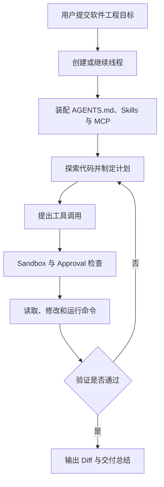

# Codex 总结与复习

> [!abstract] 一句话总结
> Codex 把软件工程任务放进可持续的线程，通过分层上下文、受控工具执行和修改验证循环，在不同工作入口中交付可审查的代码结果。

## 知识 / 能力概览

| 维度 | 关键内容 | 应掌握的能力 |
| ---- | -------- | ------------ |
| 产品定位 | coding agent，多 surface 入口 | 区分一次问答与持续软件工程任务 |
| 任务容器 | thread、local、worktree、cloud | 理解任务状态、并行隔离和执行环境 |
| 执行治理 | sandbox、approval | 判断技术边界与人工决策边界 |
| 上下文工程 | `AGENTS.md`、Skills、MCP | 分开管理项目规则、复用流程与外部能力 |
| 工程闭环 | 探索、规划、修改、测试、Diff、总结 | 用验证证据判断任务是否完成 |

## 一次任务主线

## 快速复习

- Thread 持续承载任务目标、历史记录、执行状态与多轮协作上下文。
- Worktree 用独立工作目录和分支降低并行修改冲突；sandbox 控制可执行边界，approval 把关键决策交还用户。
- `AGENTS.md` 放稳定项目规则，Skill 放可复用任务流程，MCP 接实时外部工具与上下文。
- Codex 的核心循环是探索、修改、验证、再修复，最终应报告改动、测试结果和残余风险。
- Git、Diff 与自动化测试共同构成使 Agent 产出可审查、可回退的关键交付机制。

## 自测问题

1. Thread、worktree 和 cloud 环境分别解决什么问题？
2. Sandbox 与 approval 有什么区别，为什么需要同时存在？
3. 一条规则应进入 `AGENTS.md`、Skill 还是 MCP 的判断标准是什么？
4. Codex 收到“修复登录校验”后，从探索到交付会经过哪些步骤？
5. 多个线程并行修改同一仓库时，如何降低覆盖和冲突风险？
6. 哪些验证证据足以支持“任务已经完成”的结论？

## 相关编号双链

[[01-Codex产品定位与总体架构]] · [[02-Codex一次任务执行全链路]] · [[03-Codex执行模型-线程-沙箱-审批]] · [[04-Codex上下文工程-AGENTS-MCP-Skills]]

对比与迁移：[[../01-标杆产品对比-Codex-vs-Claude-Code]] · [[../02-编程Agent通用架构图]] · [[../03-从Codex和Claude-Code反推企业Agent设计]]
