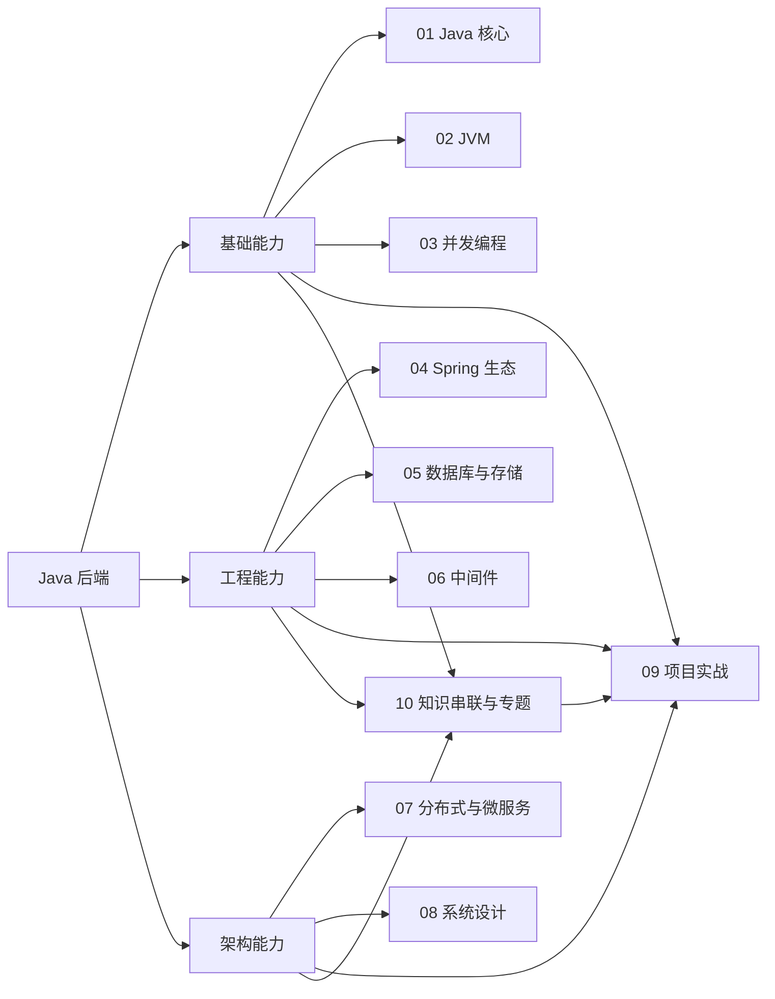

# Java 后端：整体复习地图

> [!abstract] 一句话总结
> Java 后端学习路线由 Java 核心、JVM 与并发编程打底，经 Spring、数据库和中间件形成工程能力，再用分布式、系统设计、知识串联和项目实战完成综合闭环。

## 核心知识概览

| 阶段    | 模块             | 复习定位                       | 仪表盘状态   | 笔记数 | 对应入口                   |
| ----- | -------------- | -------------------------- | ------- | --: | ---------------------- |
| 语言基础  | 01 · Java 核心   | 建立 Java 语言、集合、IO 与新特性的基础能力 | 🟡 已补笔记 |   9 | [[01-Java核心/_index]]   |
| 运行时基础 | 02 · JVM       | 理解 Java 程序的运行时机制与故障排查基础    | 🟡 已补笔记 |   9 | [[02-JVM/_index]]      |
| 执行模型  | 03 · 并发编程      | 衔接线程、并发控制与异步执行             | 🟡 已补笔记 |  10 | [[03-并发编程/_index]]     |
| 应用框架  | 04 · Spring 生态 | 进入 Java 后端应用框架与工程组织        | 🟡 已补笔记 |   9 | [[04-Spring生态/_index]] |
| 数据能力  | 05 · 数据库与存储    | 建立数据持久化与存储相关能力             | 🟡 已补笔记 |   9 | [[05-数据库与存储/_index]]   |
| 基础设施  | 06 · 中间件       | 衔接后端应用与常用中间件               | 🟡 已补笔记 |   8 | [[06-中间件/_index]]      |
| 分布式架构 | 07 · 分布式与微服务   | 从单体工程走向分布式与微服务问题域          | 🟡 已补笔记 |   9 | [[07-分布式与微服务/_index]]  |
| 架构设计  | 08 · 系统设计      | 汇总容量、边界与系统级设计能力            | 🟡 已补笔记 |   8 | [[08-系统设计/_index]]     |
| 综合验证  | 09 · 项目实战      | 用项目把前述模块串成可验证的实践闭环         | 🟡 已补笔记 |   6 | [[09-项目实战/_index]]     |
| 跨模块串联 | 10 · 知识串联与专题   | 连接执行链、数据链、治理链和故障链          | 🟡 已补笔记 |   9 | [[10-知识串联与专题/_index]]  |

## 全章主线

## 快速复习

1. 当前 Java 后端知识区分为 10 个编号模块，模块内共 86 篇笔记，包含各章总结。
2. `01-03` 是基础层：先掌握语言与类库，再理解 JVM 运行时，最后进入并发执行模型。
3. `04-06` 是工程层：Spring 生态负责应用框架，数据库与存储承接数据，中间件连接更多基础设施能力。
4. `07-08` 是架构层：从分布式与微服务继续上升到系统级设计。
5. `09` 是项目验证层，`10` 是跨模块串联层；二者应往返学习，用专题审查项目，用项目验证专题。
6. 仪表盘中 10 个模块目前均标记为“🟡 已补笔记”，应继续以章节索引和验证目标检查掌握程度。
7. 快速复习宜按“基础机制 → 工程组件 → 架构取舍 → 项目验证”推进，避免只按文件数量刷进度。
8. 仪表盘指定的实战复盘入口是 [[09-项目实战/05-项目-JVM故障排查演练]] 与 [[09-项目实战/01-项目-高并发秒杀系统]]，分别适合串联 JVM 排障和高并发主题。

## 自测问题

1. 能否不看目录，说出 10 个模块的顺序，并解释每一阶段在整条路线中的位置？
2. 遇到一个 Java 后端线上问题时，如何判断应回到 Java 核心、JVM、并发、数据、中间件还是分布式模块补证据？
3. 为什么项目实战应放在多模块知识之后复盘，而不能替代对基础机制的学习？
4. 当前仪表盘的“已补笔记”与真正掌握之间还需要哪些可验证动作？

## 下一章衔接

从 [[01-Java核心/_index|01 · Java 核心]] 开始进入具体章节：先建立集合、泛型、反射、异常、IO、Stream 与现代 Java 的语言和类库基础，再为 JVM 与并发编程准备共同语境。

## 相关编号双链

- 基础能力：[[01-Java核心/_index|01 · Java 核心]] · [[02-JVM/_index|02 · JVM]] · [[03-并发编程/_index|03 · 并发编程]]
- 工程能力：[[04-Spring生态/_index|04 · Spring 生态]] · [[05-数据库与存储/_index|05 · 数据库与存储]] · [[06-中间件/_index|06 · 中间件]]
- 架构与实战：[[07-分布式与微服务/_index|07 · 分布式与微服务]] · [[08-系统设计/_index|08 · 系统设计]] · [[09-项目实战/_index|09 · 项目实战]]
- 跨模块串联：[[10-知识串联与专题/_index|10 · 知识串联与专题]]
- 总览入口：[[20-Java后端/00-总览/学习仪表盘|Java 学习仪表盘]]
