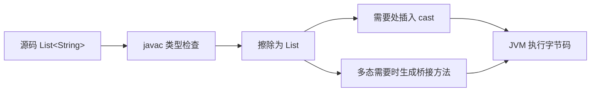

# 泛型与类型擦除

> [!abstract] 一句话总结
> Java 泛型把"类型安全"放在编译期解决：编译器帮你检查、帮你强转，但为了兼容早期字节码，运行期大多数泛型信息被擦除；理解擦除的边界，才能解释桥接方法、通配符 PECS 和反射取泛型这些经典问题。

## 🎯 本节定位

- **本章第 1 课，语言地基**。集合（04）、Lambda/Stream（10）、反射（12）、Record（14）全部建立在泛型之上：`List<String>` 为什么安全、`ParameterizedTypeReference` 为什么能拿到类型，都来自这一课。
- **延伸阅读（本课不展开）**：泛型在集合 API 中的应用见 [[04-集合框架-核心机制与选型]]；桥接方法/`getGenericType` 的反射读取见 [[12-反射与动态代理]]；`TypeReference` 在 Spring/Jackson 反序列化中的用法属于框架章节，本课只讲原理。

## 📌 这是什么

- 泛型把"类型"参数化：类、接口、方法可以声明类型参数（如 `List<E>`、`Map<K,V>`、`Optional<T>`），在使用时传入具体类型。
- 泛型是**编译期**机制：javac 负责类型检查，并在必要位置插入强转（cast）；编译后的字节码里，大多数泛型参数被替换为上界或 `Object`，这个过程叫**类型擦除（type erasure）**。
- 所以：`List<String>` 和 `List<Integer>` 在运行期都是同一个 `List` 类，不存在 `List<String>.class`。

## 🤔 解决什么问题 / 为什么需要

- **编译期发现类型错误**：`List<String> list` 里 `list.add(1)` 直接编译报错，而不是运行期 `ClassCastException`。
- **消除强制转换**：JDK 5 之前取元素要 `(String) list.get(i)`，写错位置才在运行期炸；泛型让"取出即正确类型"，转换由编译器插入。
- **设计通用组件**：`Repository<T, ID>`、`Result<T>`、`Cache<K, V>` 这类通用抽象必须用类型参数表达。
- **面试必考**：擦除、通配符、PECS、桥接方法、反射获取泛型信息，是 Java 核心的"守门题"。

## 🧩 核心概念

| 概念 | 含义 | 精通要点 |
| ---- | ---- | -------- |
| 类型参数 | 类/接口/方法声明中的 `T`、`E`、`K`、`V`。 | 名字只是约定，关键是**边界（bound）**。 |
| 上界 `T extends Number` | 限定类型参数必须是 Number 或其子类。 | 擦除后类型参数变成上界本身；可调用上界的方法。 |
| 通配符 `?` | 未知类型的占位，用于方法签名表达灵活边界。 | `? extends T` 是生产者（只读），`? super T` 是消费者（只写）。 |
| 桥接方法 | 编译器为擦除后多态正确性生成的 synthetic 方法。 | `javap -v` 里 `ACC_BRIDGE`、`ACC_SYNTHETIC` 标记。 |
| `Signature` 属性 | class 文件中保留的泛型元数据。 | 反射用 `getGenericType`/`ParameterizedType` 读声明，但读不到"运行期对象的具体类型"。 |

## ⚙️ 工作原理 / 流程



**擦除的三条规则**（记牢）：
1. 无界类型参数 `T` → 擦除为 `Object`。
2. 有界类型参数 `T extends Number` → 擦除为上界 `Number`。
3. 类型参数出现在泛型类里时，字段类型、方法签名同步替换。

## 🔍 源码 / 原理深挖

### 为什么 Java 要擦除？（核心因果）

Java 5 才引入泛型，但必须保证 JDK 5 之前编译的字节码（raw `List`）还能在新 JDK 上跑，新泛型代码也要能调用老库。擦除让**新旧字节码共用同一套类文件格式**——`ArrayList` 只有一份，不管它被 `ArrayList<String>` 还是 `ArrayList<Integer>` 引用。代价是运行期拿不到类型参数，于是有了下面的限制：

### 为什么不能 `new T()`、`new T[]`、`instanceof List<String>`？

- `new T()`：运行期不知道 `T` 是什么（已被擦除），无法确认调用哪个构造器。
- `new T[10]`：数组在运行期**携带元素类型**（数组协变 + 类型检查依赖它），而泛型参数已被擦除，无法创建。只能 `(T[]) new Object[10]` 并承担 unchecked 警告。
- `instanceof List<String>`：运行期只有 `List`，没有 `List<String>`，无法判断。正确做法是 `list instanceof List<?>`。

### 桥接方法为什么存在？（多态 × 擦除的冲突）

```java
class Parent<T> { T get() { return null; } }
class Child extends Parent<String> { @Override String get() { return "ok"; } }
```

擦除后 `Parent.get()` 返回 `Object`。若 `Child` 只有返回 `String` 的 `get()`，方法签名（返回类型不同）不构成重写，多态就断了：`Parent p = new Child(); p.get()` 会调用到返回 `Object` 的父类方法。编译器于是在 `Child` 里生成一个返回 `Object` 的**桥接方法** `get()`，它强转后调用返回 `String` 的真实方法——这样"擦除前的重写关系"在擦除后依然成立。

### PECS 到底在防什么？（生产者 extends / 消费者 super）

```java
static double sum(List<? extends Number> nums)      // 只读：生产者
static void fill(List<? super Integer> out)          // 只写：消费者
```

- `? extends Number`：列表里可能是 Integer 也可能是 Double，**你无法确定具体类型，所以不能 add 任何值**（除了 null）；但取出来一定可以当 `Number` 用。→ 只读安全。
- `? super Integer`：列表里可能是 `List<Number>` 或 `List<Object>`，往里 add 一个 Integer **一定安全**（Integer 是 Number 也是 Object）；但取出来只能是 `Object`，无法确定具体类型。→ 只写安全。
- 本质：**通配符把"类型安全"从某个具体类型让渡给"满足边界的所有类型"，编译器必须同时保护"写入方"和"读取方"，于是两端各牺牲一端**。`Collections.copy(dest, src)` 就是 PECS 的标准样板：`copy(List<? super T> dest, List<? extends T> src)`。

### 泛型数组的协变陷阱

数组是**协变**的：`String[]` 是 `Object[]` 的子类型。泛型是**不变**的：`List<String>` 不是 `List<Object>` 的子类型。两者结合会出事：

```java
Object[] arr = new String[1];
arr[0] = 1;            // 运行期 ArrayStoreException，数组运行期会检查
```

而 `List<Object> list = new ArrayList<String>()` 编译期直接报错——泛型在编译期就拦截了，这正是泛型比数组更安全的体现。

## 💻 代码实践 / 排查命令

```java
// 1. 生产者：只读，任何 Number 子类都能进来
static double sum(List<? extends Number> nums) {
    double total = 0;
    for (Number n : nums) total += n.doubleValue();
    return total;
}

// 2. 消费者：只写，任何 Integer 的父类型容器都能接收
static void addIntegers(List<? super Integer> out) {
    out.add(1);
    out.add(2);
}

// 3. 反序列化保留类型信息：匿名子类继承父类的泛型签名
//    List<User>.class 不存在！用 TypeReference 间接持有
TypeReference<List<User>> ref = new TypeReference<List<User>>() {};
// TypeReference 构造器里读取 (this.getClass().getGenericSuperclass())
// 拿到 ParameterizedType，从而得到 List<User> 里的 User
```

## 🛠️ 排查 / 实践要点

- 公共 API：**返回值**只读数据用 `? extends`，**入参**需要往里写用 `? super`；两侧都不需要类型信息时用 `?`。
- 反序列化泛型对象：Jackson 用 `TypeReference<T>`，Spring 用 `ParameterizedTypeReference<T>`，原理相同——把泛型信息留在匿名子类的父类签名里，绕过擦除。
- 排查 `ClassCastException`：看编译后插入 cast 的位置，源头大多是 **raw type 混入**（老代码 `List list = new ArrayList<String>()`）或反序列化时类型信息丢失。

## ⚠️ 踩坑与注意事项

- 用 raw type 绕过编译期检查（`List list`），等于放弃泛型全部价值。
- 写 `new T()`、`new T[]`、`instanceof List<String>`、`List<String>.class` 这些不存在的语法。
- 滥用通配符：签名写成 `List<?>` 但方法体里需要具体类型，结果到处强转——能确定类型就写具体类型。
- 过度泛型化：`<T extends Comparable<? super T>>` 这种签名对调用方是噪音，能简单就简单。

## 🎯 面试问题

> [!question] 高频问题
> - Q: 什么是类型擦除？为什么 Java 要擦除？
>   - A: 编译后类型参数被替换为上界或 Object，并在需要处插入强转。目的是二进制兼容：让 Java 5 之前编译的字节码与泛型代码共用同一类文件格式。代价是运行期拿不到类型参数。
> - Q: `List<?>` 和 `List<Object>` 有什么区别？
>   - A: `List<?>` 是"元素类型未知的某种 List"，基本只能安全读取为 Object，不能 add（null 除外）；`List<Object>` 是"只能装 Object 的 List"，`List<String>` 不是它的子类型，不能互相赋值。
> - Q: PECS 怎么理解？为什么 `? extends` 不能写、`? super` 不能读？
>   - A: extends 列表的具体元素类型不确定，写任何具体值都可能类型不符，但读出来至少是上界类型，所以只读；super 列表往里写子类型一定安全，但读出来只能当 Object。PECS：Producer Extends, Consumer Super。
> - Q: 为什么不能用 `new T()`？
>   - A: 类型参数运行期已被擦除，JVM 不知道 T 是什么类，无法确定调用哪个构造器。同理不能创建泛型数组和 instanceof 具体泛型类型。

## 🧭 源码入口速查

- `javac` 类型检查阶段：泛型错误在编译期拦截，字节码里没有 `List<String>` 这种真实类型。
- `javap -v Xxx.class`：查看 `Signature` 属性、`ACC_BRIDGE`、`ACC_SYNTHETIC` 桥接方法。
- `java.lang.reflect.ParameterizedType` / `TypeVariable`：读取字段、父类、方法返回值上的泛型声明。
- `java.util.Collections#copy(List<? super T>, List<? extends T>)`：PECS 的 JDK 标准样例。
- `com.fasterxml.jackson.core.type.TypeReference`：构造器里 `getGenericSuperclass()` 读取匿名子类持有的泛型类型。

## 🧪 最小验证

```java
class Parent<T> { T get() { return null; } }
class Child extends Parent<String> { @Override String get() { return "ok"; } }
```

执行 `javap -v Child.class`，能看到编译器生成返回 `Object` 的 bridge `get()`，它强转后调用返回 `String` 的真实方法——这就是擦除后多态仍成立的原因。

```java
// 验证擦除：两个不同泛型的 Class 是同一个
System.out.println(new ArrayList<String>().getClass() == new ArrayList<Integer>().getClass()); // true
```

## ✅ 精通检查清单

- 能用自己的话讲清本主题解决的问题和适用边界。
- 能指出至少 2 个源码入口或底层机制。
- 能给出一个最小代码示例或一组线上排查命令。
- 能回答本页列出的高频面试题，并补充项目中的真实取舍。

## 🔗 关联笔记

- 本课内：下一课 [[02-异常处理最佳实践]]（错误处理地基）；应用见 [[04-集合框架-核心机制与选型]]、[[10-Lambda与Stream]]、[[14-Java新特性-Record与密封类]]
- 延伸：[[12-反射与动态代理]]（反射读取泛型元数据）

## 📚 参考资料

- [Dev.java Tutorials](https://dev.java/learn/)
- [Oracle Java Documentation](https://docs.oracle.com/en/java/)
- [Java Language Specification - Generic Types](https://docs.oracle.com/javase/specs/jls/se21/html/jls-4.html)
