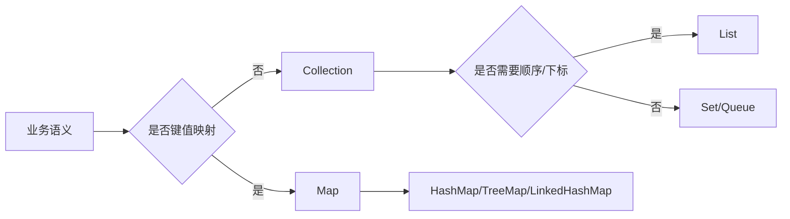

# 集合框架-List-Map-Set源码

> [!abstract] 一句话总结
> Java 集合框架把常用数据结构抽象成 Collection 与 Map 两条主线，源码重点是数据结构、扩容策略、迭代一致性和复杂度边界。

## 📌 这是什么

- Collection 是单元素容器根接口，List 保序可重复，Set 不保证重复元素，Queue/Deque 面向队列语义。
- Map 是键值映射，不继承 Collection；HashMap、TreeMap、LinkedHashMap 分别侧重哈希、排序和访问顺序。
- 面试和实践都不要只背 API，要能把一次 add/put/get/remove 映射到底层数组、链表、树、迭代器和 modCount。

## 🤔 解决什么问题 / 为什么需要

- 选择合适容器，避免把 O(1)、O(log n)、O(n) 混用成线上慢接口。
- 理解 fail-fast、equals/hashCode、排序比较器，减少“本地正常、线上数据错乱”的问题。
- 读懂 JDK 源码后，才能解释 ArrayList 扩容、HashSet 去重、TreeMap 排序、LinkedHashMap LRU 的设计取舍。

## 🧩 核心概念

| 概念 | 含义 | 精通要点 |
| ---- | ---- | -------- |
| Collection | 单值容器根接口，核心操作是 add/remove/iterator。 | List、Set、Queue 都继承它。 |
| List | 有序、可重复、按下标访问。 | ArrayList 随机访问快，LinkedList 插入不一定更快。 |
| Set | 不重复集合。 | HashSet 基于 HashMap key，TreeSet 基于 TreeMap。 |
| Map | 键值映射。 | HashMap 看哈希分布，TreeMap 看比较器，LinkedHashMap 看链表顺序。 |
| Iterator/modCount | 迭代器通过 expectedModCount 检测结构性修改。 | fail-fast 是尽力而为，不是并发安全保证。 |

## ⚙️ 工作原理 / 流程



## 🔍 源码 / 原理深挖

- ArrayList.add 先 ensureCapacityInternal，再在 elementData[size++] 写入；扩容通常按 1.5 倍增长。
- LinkedList 是双向链表，节点对象额外占内存，按下标访问需要从头或尾遍历。
- HashSet.add 实际调用 HashMap.put(key, PRESENT)，去重依赖 key 的 equals/hashCode。
- TreeMap 是红黑树，put 后通过旋转和染色维持近似平衡。

## 💻 代码实践 / 排查命令

```java
List<String> names = new ArrayList<>();
names.add("alice");
names.add("bob");

Set<String> unique = new HashSet<>(names);
Map<String, Integer> count = new HashMap<>();
for (String name : names) {
    count.merge(name, 1, Integer::sum);
}

Map<String, Integer> ordered = new LinkedHashMap<>(count);
```

## 🛠️ 排查 / 实践要点

- 慢接口先看容器规模和操作复杂度：List.contains 是 O(n)，HashSet.contains 平均 O(1)。
- 排查 ConcurrentModificationException：检查增强 for 中是否直接 remove，改用 iterator.remove 或收集后批量删除。
- 排查去重失败：检查 equals/hashCode 是否同时重写，字段是否可变。

## ⚠️ 踩坑与注意事项

- 用 LinkedList 代替 ArrayList 期待“插入更快”，但忽略定位成本和对象分配成本。
- 把 HashMap 迭代顺序当成稳定行为。
- 在并发场景使用普通 HashMap/ArrayList 做共享可变状态。

## 🎯 面试问题

> [!question] 高频问题
> - Q: ArrayList 和 LinkedList 怎么选？
>   - A: ArrayList 基于连续数组，随机访问快、缓存友好，尾部追加常见场景更优；LinkedList 插入删除只有在已拿到节点位置时才有优势，实际业务中较少。
> - Q: HashSet 为什么能去重？
>   - A: HashSet 底层是 HashMap，元素作为 key，value 是固定占位对象；是否重复由 hashCode 定位桶，再由 equals 判断语义相等。
> - Q: fail-fast 是并发安全机制吗？
>   - A: 不是。它通过 modCount 尽早暴露结构性修改错误，但不能保证一定检测到并发问题。

## 🧭 源码入口速查

- `java.util.ArrayList#add(E)` -> `ensureCapacityInternal` -> `grow`：看 1.5 倍扩容、`Arrays.copyOf` 和 `modCount++`。
- `java.util.LinkedList#linkBefore`、`unlink`、`node(int)`：看为什么按下标访问会从头或尾线性走。
- `java.util.HashSet#add`：直接委托 `HashMap#put(e, PRESENT)`，去重语义完全依赖 key。
- `java.util.TreeMap#put`、`fixAfterInsertion`：看红黑树旋转、染色和比较器路径。
- `java.util.AbstractList.Itr#checkForComodification`：fail-fast 的核心检查点。

## 🧪 最小验证

```java
List<Integer> list = new ArrayList<>(1);
list.add(1);
list.add(2); // 断点进 ArrayList.grow 看 elementData 如何扩容

Iterator<Integer> it = list.iterator();
list.add(3);
it.next(); // ConcurrentModificationException
```

生产里看到集合慢接口，先把操作写成表：容器类型、数据量、单次操作、复杂度、是否在循环内调用。例如 `for users -> roles.contains(x)`，如果 `roles` 是 `ArrayList`，整体可能从 O(n) 变成 O(n*m)。

## ✅ 精通检查清单

- 能用自己的话讲清本主题解决的问题和适用边界。
- 能指出至少 2 个源码入口或底层机制。
- 能给出一个最小代码示例或一组线上排查命令。
- 能回答本页列出的高频面试题，并补充项目中的真实取舍。

## 🔗 关联笔记

- [[_index]]
- [[02-HashMap原理与扩容]]
- [[08-并发容器-ConcurrentHashMap]]

## 📚 参考资料

- [Dev.java Tutorials](https://dev.java/learn/)
- [Oracle Java Documentation](https://docs.oracle.com/en/java/)
