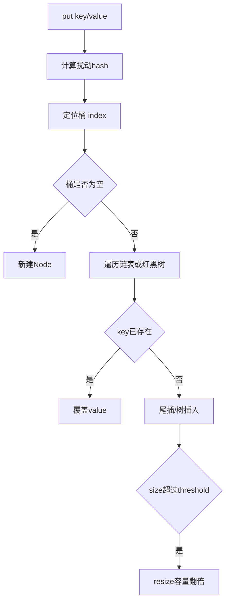

# HashMap原理与扩容

> [!abstract] 一句话总结
> HashMap 通过数组、链表和红黑树在平均 O(1) 时间完成键值访问，扩容的本质是容量翻倍后重新分布桶位。

## 📌 这是什么

- JDK 8 HashMap 的主结构是 Node<K,V>[] table，每个桶先是链表，冲突严重且容量足够时树化为红黑树。
- 默认负载因子 0.75 是空间和查找成本的折中；threshold = capacity * loadFactor。
- HashMap 允许 null key 和 null value，但不保证顺序，也不是线程安全容器。

## 🤔 解决什么问题 / 为什么需要

- 理解 hash 扰动、扩容和树化，才能解释 put/get 的性能边界。
- 正确设计 key 的 equals/hashCode，避免缓存、去重、分组统计出现隐蔽错误。
- 能识别高冲突、容量估算不足、并发误用造成的线上风险。

## 🧩 核心概念

| 概念 | 含义 | 精通要点 |
| ---- | ---- | -------- |
| hash 扰动 | h ^ (h >>> 16) 让高位参与低位桶索引。 | table 长度是 2 的幂，索引用 (n - 1) & hash。 |
| 负载因子 | 元素数量和桶数组容量的比例。 | 默认 0.75，太高冲突多，太低浪费空间。 |
| 树化 | 单桶链表长度达到阈值且数组容量足够时转红黑树。 | treeifyThreshold=8，minTreeifyCapacity=64。 |
| 扩容 | 容量翻倍，节点按 oldCap 位拆成 low/high 两组。 | JDK 8 不需要重新计算完整 hash。 |

## ⚙️ 工作原理 / 流程



## 🔍 源码 / 原理深挖

- HashMap.put 入口会调用 putVal(hash(key), key, value, false, true)。
- putVal 主流程：初始化 table、定位桶、处理首节点命中、链表/树插入、必要时 treeifyBin、最后 resize。
- resize 中 oldCap 翻倍后，节点只看 hash & oldCap：0 留在原索引，1 移到 index + oldCap。
- getNode 先检查桶首节点，再按树节点或链表继续查找。

## 💻 代码实践 / 排查命令

```java
int expectedSize = 10_000;
int capacity = (int) (expectedSize / 0.75f) + 1;
Map<Long, String> cache = new HashMap<>(capacity);

record UserKey(long tenantId, long userId) {}
Map<UserKey, String> userCache = new HashMap<>();
userCache.put(new UserKey(1L, 100L), "Alice");
```

## 🛠️ 排查 / 实践要点

- 大批量 put 前预估容量，减少 resize 带来的 CPU 和临时对象成本。
- 排查命中率异常：打印 key 的 hashCode/equals 相关字段，确认字段没有在入 map 后被修改。
- 多线程共享写入改用 ConcurrentHashMap，或在外层串行化写入。

## ⚠️ 踩坑与注意事项

- 用可变对象做 key，put 后修改参与 hashCode 的字段，导致 get/remove 找不到。
- 只重写 equals 不重写 hashCode。
- 误以为 HashMap 树化后所有操作都是稳定 O(log n)，实际整体仍依赖哈希分布和 resize。

## 🎯 面试问题

> [!question] 高频问题
> - Q: HashMap 为什么容量是 2 的幂？
>   - A: 这样可以用 (n - 1) & hash 替代取模，计算快；扩容翻倍时也能用 oldCap 位把节点拆成原位置或原位置+oldCap。
> - Q: JDK 8 HashMap 扩容做了什么优化？
>   - A: 不再对每个节点重新计算完整位置，而是看 hash & oldCap，把链表拆成 low/high 两条链，分别放到原索引和原索引+oldCap。
> - Q: HashMap 为什么线程不安全？
>   - A: put、resize、链表或树结构修改都没有同步保护，并发写可能丢数据、覆盖错误、结构异常；并发场景应使用 ConcurrentHashMap。

## 🧭 源码入口速查

- `HashMap#hash`：`h ^ (h >>> 16)`，解决高位信息参与低位索引的问题。
- `HashMap#putVal`：初始化 table、首节点命中、链表遍历、树节点插入、`treeifyBin`、`resize` 都在这个方法。
- `HashMap#resize`：关注 `oldCap`、`oldThr`、`newCap`、`newThr`，以及 `loHead/hiHead` 拆链。
- `HashMap#treeifyBin`：桶长度达到 8 时不一定树化，容量小于 64 会优先扩容。
- `HashMap.TreeNode#split`：扩容时红黑树节点也按 `hash & oldCap` 拆分，必要时退化回链表。

## 🧪 最小验证

```java
final class BadKey {
    final int id;
    BadKey(int id) { this.id = id; }
    public int hashCode() { return 1; }
    public boolean equals(Object o) { return o instanceof BadKey k && k.id == id; }
}

Map<BadKey, Integer> map = new HashMap<>(64);
for (int i = 0; i < 9; i++) map.put(new BadKey(i), i);
// 断点进 treeifyBin，可观察链表转 TreeNode 的条件。
```

线上缓存命中异常时，优先检查 key：参与 `equals/hashCode` 的字段是否可变、是否包含数组、是否跨服务序列化后语义变化。HashMap 本身很少“随机丢数据”，大多是 key 语义或并发写入破坏了查找路径。

## ✅ 精通检查清单

- 能用自己的话讲清本主题解决的问题和适用边界。
- 能指出至少 2 个源码入口或底层机制。
- 能给出一个最小代码示例或一组线上排查命令。
- 能回答本页列出的高频面试题，并补充项目中的真实取舍。

## 🔗 关联笔记

- [[_index]]
- [[01-集合框架-List-Map-Set源码]]
- [[08-并发容器-ConcurrentHashMap]]

## 📚 参考资料

- [Dev.java Tutorials](https://dev.java/learn/)
- [Oracle Java Documentation](https://docs.oracle.com/en/java/)
