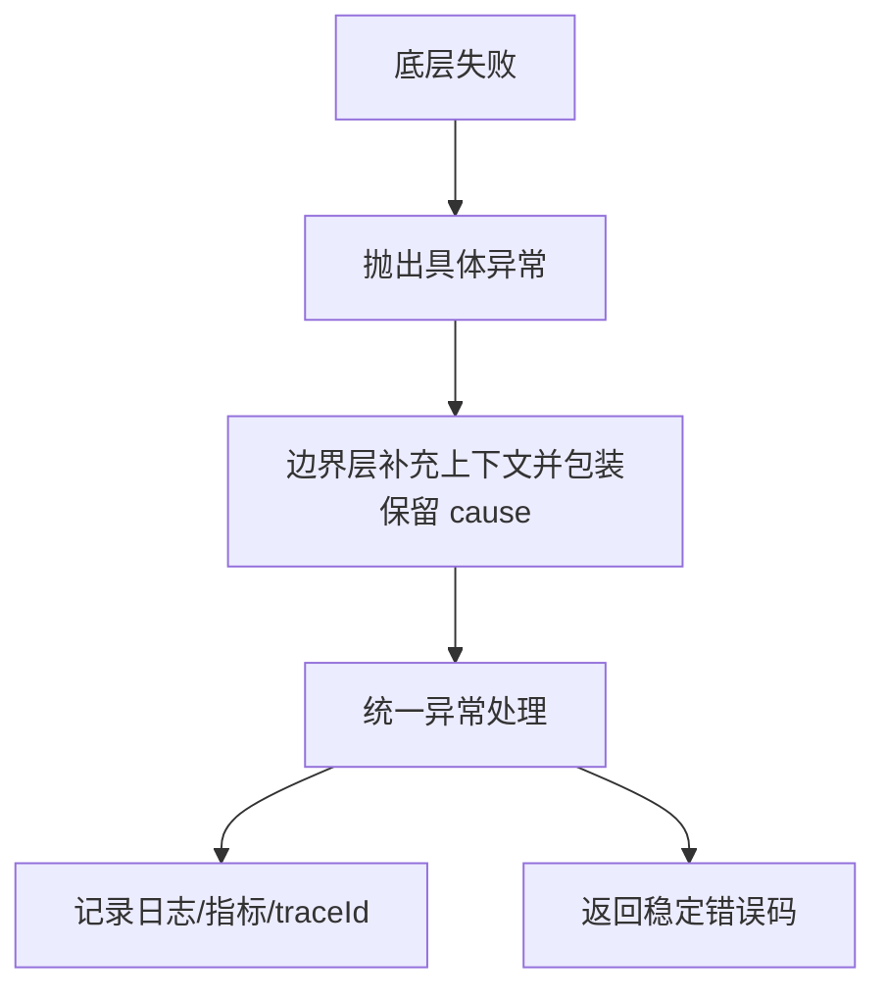

# 异常处理最佳实践

> [!abstract] 一句话总结
> 异常是 Java 唯一的错误传播通道：Throwable 分 Error 与 Exception，Checked/Unchecked 决定"谁必须处理"；好的异常设计要保留 cause、上下文和边界语义，让错误可分类、可恢复、可观测——try-with-resources 是资源关闭的标准答案。

## 🎯 本节定位

- **本章第 2 课，错误处理地基**。下一课 IO（[[11-IO与NIO]]）的文件/网络资源管理全部依赖 try-with-resources 与 suppressed 机制；反射（[[12-反射与动态代理]]）里的 `InvocationTargetException` 也来自这一课的概念。
- **延伸阅读（本课不展开）**：Web 层统一异常处理（`@ControllerAdvice`）与事务回滚语义属于 Spring 章节；JVM 层错误（`OOM`、`StackOverflowError`）的排查在 [[20-Java后端/02-JVM/07-OOM问题排查|02-JVM 章节]]。

## 📌 这是什么

- 所有错误都从 `Throwable` 派生，两大分支：`Error`（JVM/系统级，如 `OutOfMemoryError`，业务代码不处理）和 `Exception`（可处理的失败）。
- `Exception` 又分：**Checked Exception**（编译器强制处理，如 `IOException`）和 **Unchecked Exception**（`RuntimeException` 及其子类，如 `NullPointerException`，编译器不强制）。
- 异常对象携带三样东西：`message`（信息）、`cause`（根因链）、`stackTrace`（调用栈），还有一组 `suppressed`（被压制/附加的异常）。

## 🤔 解决什么问题 / 为什么需要

- **错误需要传播**：方法无法处理失败时，必须把"发生了什么、在哪发生的"传给上层，异常链（cause）保证根因不丢。
- **错误需要分类**：Checked/Unchecked 的分界决定 API 的契约——调用方必须处理 vs 调用方可忽略（靠约定）。
- **错误需要可观测**：线上排查依赖异常类型、堆栈、错误码、traceId 和上下文日志。
- **资源必须释放**：文件、连接、锁一旦打开就必须关闭，try-with-resources 让"关闭"和"主逻辑异常"同时发生时两个异常都能被看到。

## 🧩 核心概念

| 概念 | 含义 | 精通要点 |
| ---- | ---- | -------- |
| 异常层次 | `Throwable` → `Error`/`Exception` → `RuntimeException`。 | 不要 catch `Throwable`/`Error` 做业务兜底。 |
| Checked Exception | 编译器**强制**声明或捕获（`IOException`、`SQLException`）。 | 调用方有明确恢复动作时才值得用。 |
| Unchecked Exception | `RuntimeException` 子类，编译器**不强制**处理。 | 多数业务失败用它 + 错误码 + 统一处理。 |
| cause 异常链 | 包装异常时传入原异常，根因可追溯。 | `new BizException(msg, e)` 而不是丢 e。 |
| try-with-resources | 自动关闭 `AutoCloseable`，关闭异常挂到 suppressed。 | 编译后变成 finally + `addSuppressed`。 |
| 错误码 | 面向调用方的稳定错误语义（如 `FILE_NOT_FOUND`）。 | 异常类型面向代码，错误码面向协议/用户。 |

## ❓ Checked vs Unchecked：最常见误区澄清

> **误区**：以为 Checked 是"编译期报的错误"，Unchecked 是"运行期的错误"。
> **真相**：两者**都在运行期抛出**。区分标准不是"何时发生"，而是 **编译器是否强制调用方处理**。

先分清三个完全不同的概念：

| 概念 | 是什么 | 编译器管不管 |
| ---- | ---- | ---- |
| 编译错误 | 语法错、类型错（`String s = 123`），编译不过 | 直接编译失败 |
| Checked 异常 | `IOException`、`SQLException`——**运行期**才发生（如文件不存在） | **强制**处理：不 try-catch 也不 throws → 编译报错 |
| Unchecked 异常 | `NullPointerException`、`ArithmeticException`——**运行期**才发生 | 不强制，没人处理就抛到 JVM 终止程序 |

```java
// ① 编译错误（不属于异常体系，编译不过）：
// String s = 123;   // 类型不匹配

// ② Checked：IDE 标红"Unhandled exception"，但异常真正抛出是在运行期（文件不存在那一刻）
void readFile(String path) throws IOException {   // 不写 throws 或 try-catch → 编译错
    Files.readAllBytes(Paths.get(path));
}

// ③ Unchecked：编译器完全不提示，b=0 时运行期直接炸
int divide(int a, int b) {
    return a / b;    // ArithmeticException
}
```

**你的直觉里对的部分**：写 `Files.readAllBytes(...)` 时 IDE 立刻标红"必须处理 IOException"——这是 Checked 的"检查"：**编译器检查你有没有处理它，而不是它已经发生了**。

**为什么这样设计**：
- Checked 用于**可预期、调用方有义务处理**的失败（文件打不开、网络断、数据库连不上）——强制处理，防止你忘了。
- Unchecked 用于**编程错误或无法预期**的失败（NPE、参数非法、除零）——强制处理没意义，还污染签名。

**为什么"避免 checked 层层污染方法签名"**：

```java
// 10 层调用链用 checked：每一层都被迫 throws，底层换异常类型上面全要改
void a() throws BizException { b(); }
void b() throws BizException { c(); }
void c() throws BizException { d(); }
// 而中间层根本处理不了这个业务异常，throws 纯属噪音

// 用 unchecked：中间层什么都不写，只有最外层统一处理一次
void a() { b(); }
void b() { c(); }
void c() { d(); }
// 最外层 @ControllerAdvice 统一捕获转错误响应
```

## ⚙️ 工作原理 / 流程



**推荐的错误处理分层**（因果链）：
1. **底层**：抛出语义最具体的异常（`NoSuchFileException` 而不是笼统 `IOException`）。
2. **中间层**：只补充业务上下文后包装（"读取文件失败: xxx"），**必须保留 cause**，不重复打日志。
3. **边界层**：统一处理（Web 层是 `@ControllerAdvice`，见 Spring 章节），只在这里记录一次 error、转成稳定错误响应。

## 🔍 源码 / 原理深挖

### try-with-resources 到底编译成什么？

```java
try (InputStream in = Files.newInputStream(path)) {
    return in.readAllBytes();
}
```

等价于（编译器展开）：

```java
InputStream in = Files.newInputStream(path);
Throwable primary = null;
try {
    return in.readAllBytes();
} catch (Throwable t) {
    primary = t;          // 记录主异常
    throw t;
} finally {
    if (in != null) {
        if (primary != null) {
            try { in.close(); } catch (Throwable t2) { primary.addSuppressed(t2); }
        } else {
            in.close();    // 主流程没异常，关闭异常直接抛出
        }
    }
}
```

**关键语义**：主逻辑抛异常、close 也抛异常时，close 的异常作为 **suppressed** 挂到主异常上（`e.getSuppressed()` 可见）。这比手写 finally 更安全——手写 `finally { in.close() }` 若 close 抛异常，会**覆盖掉主异常**，根因直接丢失。

### 异常的性能成本（容易被忽略）

- `new RuntimeException()` 时 `fillInStackTrace()` 采集整个调用栈，这是异常的主要成本，**频繁抛异常比返回错误码慢几个数量级**。
- JVM 有优化：同一位置异常抛得太多（默认阈值）后，HotSpot 会**省略堆栈填充**（`-XX:-OmitStackTraceInFastThrow` 可关），此时异常对象只有 message 没有堆栈——线上看到"有异常没堆栈"别慌，先找热点。
- 结论：异常用于"失败路径"，不要用于正常控制流（如用异常跳出循环、做 if/else）。

### 为什么 Error 不能 catch

`OutOfMemoryError`、`StackOverflowError` 表示 JVM 或线程已处于不可靠状态，catch 后继续运行大概率更糟。日志里见到 Error 的正确姿势是保留现场（堆转储）排查根源，而不是 try-catch 兜底。

## 💻 代码实践 / 排查命令

```java
// 正确：try-with-resources + 具体异常分类 + 保留 cause
try (InputStream in = Files.newInputStream(path)) {
    return in.readAllBytes();
} catch (NoSuchFileException e) {
    throw new BizException("FILE_NOT_FOUND", "文件不存在: " + path, e);
} catch (IOException e) {
    throw new BizException("FILE_READ_FAILED", "读取文件失败: " + path, e);
}
```

```java
// 自定义异常：错误码 + 上下文 + cause
class BizException extends RuntimeException {
    private final String code;
    BizException(String code, String message, Throwable cause) {
        super(message, cause);
        this.code = code;
    }
}
```

```bash
# 排查：按 traceId 串起整条调用链
grep "traceId=abc123" app.log          # 找到入口日志
grep -A 50 "abc123" app.log | grep -B 2 -A 20 "Exception\|Caused by"   # 顺着 cause 看根因
```

## 🛠️ 排查 / 实践要点

- **日志只在边界层打一次**：每层 `log.error` 后再 throw，同一异常会变成 N 条噪音。
- **看 cause 链**：`Caused by:` 逐层往下的最后一条才是根因；包装异常时丢 cause 是最常见的排查杀手。
- **重试只针对可恢复异常**：超时、连接重置可重试；业务校验失败、数据不存在**绝不能重试**。重试要带次数、退避、幂等保护。
- **suppressed 要会看**：try-with-resources 里 close 失败，日志会出现 `Suppressed:` 段，别忽略它。
- **异常监控打标签**：按错误码、异常类、下游系统、traceId 聚合，同一根因只告警一次。

## ⚠️ 踩坑与注意事项

- `catch (Exception e) { }` 空处理，或只打印 `e.getMessage()`（堆栈没了，根因也没了）。
- `log.error` 后再 `throw`，同一异常重复记录。
- 用异常做普通 if/else 控制流（性能差 + 语义错）。
- 包装异常时丢失 cause：`throw new BizException("...")` 不传原异常。
- catch 了 `Throwable`/`Error` 做"兜底"，掩盖 JVM 级故障。
- 在 finally 里直接 `close()` 不处理异常，覆盖主异常。

## 🎯 面试问题

> [!question] 高频问题
> - Q: Checked 和 Unchecked 怎么选？
>   - A: 调用方有明确恢复动作（如重试、换路径）时用 checked；多数业务失败用 unchecked + 错误码 + 统一处理，避免 checked 层层污染方法签名。
> - Q: finally 一定会执行吗？try-with-resources 好在哪？
>   - A: 一般会执行，但 `System.exit`、JVM 崩溃、进程被 kill 时不执行。try-with-resources 保证关闭异常以 suppressed 挂到主异常上，不会像手写 finally 那样覆盖主异常。
> - Q: 怎么设计项目异常体系？
>   - A: 区分业务异常、参数异常、外部依赖异常和系统异常；统一基类带错误码，保留 cause 与上下文，边界层统一转换响应。
> - Q: 为什么说异常很贵？
>   - A: 创建时 `fillInStackTrace` 采集完整调用栈；热点路径频繁抛异常成本高，且 HotSpot 优化后可能省略堆栈。所以异常用于失败路径，不用做控制流。

## 🧭 源码入口速查

- `Throwable#fillInStackTrace`：创建异常时采集栈，主要性能成本所在。
- `Throwable#addSuppressed/getSuppressed`：try-with-resources 的关闭异常挂载点。
- `Throwable#initCause`：包装异常时设置根因（构造器传 cause 底层走它）。
- `AutoCloseable#close`：try-with-resources 要求实现的接口。
- 运行期参数 `-XX:-OmitStackTraceInFastThrow`：控制热点异常的堆栈省略优化。

## 🧪 最小验证

```java
// 验证 suppressed：主异常 + close 异常同时可见
try (AutoCloseable r = () -> { throw new IOException("close failed"); }) {
    throw new IllegalStateException("main failed");
} catch (Exception e) {
    System.out.println(e.getMessage());           // main failed
    System.out.println(Arrays.toString(e.getSuppressed())); // [java.io.IOException: close failed]
}
```

```java
// 验证 cause 链：包装后根因仍在
try {
    throw new BizException("X", "wrapper", new IOException("root"));
} catch (BizException e) {
    System.out.println(e.getCause().getMessage()); // root
}
```

## ✅ 精通检查清单

- 能用自己的话讲清本主题解决的问题和适用边界。
- 能指出至少 2 个源码入口或底层机制。
- 能给出一个最小代码示例或一组线上排查命令。
- 能回答本页列出的高频面试题，并补充项目中的真实取舍。

## 🔗 关联笔记

- 本课内：上一课 [[01-泛型与类型擦除]]；应用见 [[11-IO与NIO]]（资源关闭）、[[12-反射与动态代理]]（`InvocationTargetException`）
- 延伸：[[20-Java后端/02-JVM/07-OOM问题排查|OOM 问题排查]]（Error 的排查，02-JVM 章节）

## 📚 参考资料

- [Dev.java Tutorials](https://dev.java/learn/)
- [Oracle Java Documentation](https://docs.oracle.com/en/java/)
- [JLS 11 - Exceptions](https://docs.oracle.com/javase/specs/jls/se21/html/jls-11.html)
