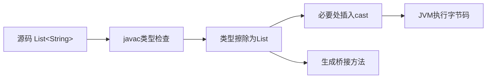

# 泛型与类型擦除

> [!abstract] 一句话总结
> Java 泛型提供编译期类型安全，运行期通过类型擦除保持二进制兼容，因此要理解边界、桥接方法和通配符。

## 📌 这是什么

- 泛型把类型参数化，让集合、接口、方法在编译期发现类型错误。
- 类型擦除意味着运行期大多数泛型参数会变成上界类型，默认是 Object。
- 复杂泛型的重点不是写花哨声明，而是表达生产者、消费者和 API 边界。

## 🤔 解决什么问题 / 为什么需要

- 减少强制类型转换和 ClassCastException。
- 设计通用组件时保持类型安全，例如 Repository<T, ID>、Result<T>。
- 面试常考擦除、协变/逆变、PECS、桥接方法和反射获取泛型信息。

## 🧩 核心概念

| 概念 | 含义 | 精通要点 |
| ---- | ---- | -------- |
| 类型参数 | 类、接口、方法声明中的 T/E/K/V。 | 命名只是约定，关键是边界。 |
| 上界 | T extends Number 限定可用类型和可调用方法。 | 擦除后通常变成上界。 |
| 通配符 | ? extends T 表示生产者，? super T 表示消费者。 | PECS: Producer Extends Consumer Super。 |
| 桥接方法 | 编译器为擦除后的多态正确性生成的 synthetic 方法。 | 常见于泛型继承和重写。 |

## ⚙️ 工作原理 / 流程



## 🔍 源码 / 原理深挖

- javac 编译期校验泛型约束，字节码中的普通方法签名多为擦除后类型。
- Signature 属性会保留部分泛型元数据，反射可通过 getGenericType 等 API 读取声明信息。
- List<String>.class 不存在，List<String> 和 List<Integer> 运行期都是 List。

## 💻 代码实践 / 排查命令

```java
static double sum(List<? extends Number> nums) {
    double total = 0;
    for (Number n : nums) total += n.doubleValue();
    return total;
}

static void addIntegers(List<? super Integer> out) {
    out.add(1);
    out.add(2);
}
```

## 🛠️ 排查 / 实践要点

- 公共 API 返回值需要读数据时用 ? extends，向集合写入某类对象时用 ? super。
- 反序列化泛型对象时使用 TypeReference 或 ParameterizedTypeReference 保留类型信息。
- 排查 ClassCastException 时看编译器插入的 cast 位置，真正错误常在原始类型 raw type 混入。

## ⚠️ 踩坑与注意事项

- 使用 raw type 绕过编译期检查。
- 尝试 new T()、new T[] 或 instanceof List<String>。
- 过度泛型化，让调用方难以理解 API。

## 🎯 面试问题

> [!question] 高频问题
> - Q: 什么是类型擦除？
>   - A: 泛型主要在编译期生效，编译后类型参数会被擦除为上界或 Object，并在需要处插入强转，以保持和早期 Java 字节码兼容。
> - Q: List<?> 和 List<Object> 有什么区别？
>   - A: List<?> 表示未知元素类型，基本只能安全读取为 Object；List<Object> 明确只能接收 Object 类型列表，不能接收 List<String>。
> - Q: PECS 怎么理解？
>   - A: 只从结构中读 T，用 ? extends T；需要向结构写入 T，用 ? super T。

## 🧭 源码入口速查

- `javac` 类型检查阶段：泛型错误大多在编译期拦截，字节码执行时没有 `List<String>` 这种真实类型。
- `javap -v Xxx.class`：查看 `Signature` 属性、`ACC_BRIDGE`、`ACC_SYNTHETIC` 桥接方法。
- `java.lang.reflect.ParameterizedType`：读取字段、父类、方法返回值上的泛型声明。
- `java.util.Collections#copy(List<? super T>, List<? extends T>)`：PECS 的 JDK 标准样例。

## 🧪 最小验证

```java
class Parent<T> { T get() { return null; } }
class Child extends Parent<String> { @Override String get() { return "ok"; } }
```

执行 `javap -v Child.class`，能看到编译器生成返回 `Object` 的 bridge `get()`，它调用返回 `String` 的真实方法，保证擦除后的多态仍然成立。

反序列化时不要写 `List<User>.class` 这种不存在的类型。Spring 常用 `new ParameterizedTypeReference<List<User>>() {}`，Jackson 常用 `new TypeReference<List<User>>() {}`，本质都是把泛型信息保留在匿名子类的父类签名里。

## ✅ 精通检查清单

- 能用自己的话讲清本主题解决的问题和适用边界。
- 能指出至少 2 个源码入口或底层机制。
- 能给出一个最小代码示例或一组线上排查命令。
- 能回答本页列出的高频面试题，并补充项目中的真实取舍。

## 🔗 关联笔记

- [[_index]]
- [[01-集合框架-List-Map-Set源码]]
- [[04-反射与动态代理]]

## 📚 参考资料

- [Dev.java Tutorials](https://dev.java/learn/)
- [Oracle Java Documentation](https://docs.oracle.com/en/java/)
