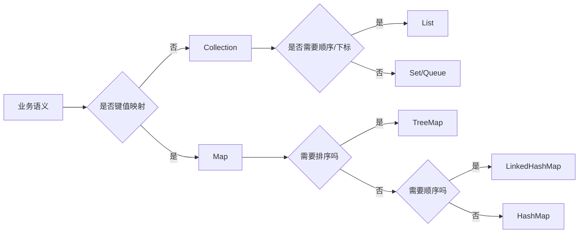

# 集合框架-List-Map-Set源码

> [!abstract] 一句话总结
> Java 集合框架把常用数据结构抽象成 Collection 与 Map 两条主线：先按业务语义选接口（List/Set/Map），再按复杂度、顺序、并发边界选实现；源码重点是数据结构、扩容策略、迭代一致性（modCount）和 equals/hashCode 契约。

## 🎯 本节定位

- **本章第 3 课，数据组织**。前置：[[01-泛型与类型擦除]]（集合 API 的类型安全就来自泛型）、[[02-异常处理最佳实践]]（迭代中的 `ConcurrentModificationException` 属于运行期异常）。
- 下一课 [[04-HashMap原理与扩容]] 专门深挖 HashMap；本课把 `HashSet` 底层是 HashMap、`TreeMap` 是红黑树这些关系讲清楚，下一课直接接续。
- **延伸阅读（本课不展开）**：红黑树的旋转/染色原理在 [[30-算法与数据结构/01-数据结构/07-平衡树-AVL-红黑树|算法章节]]；并发容器（`ConcurrentHashMap`、`CopyOnWriteArrayList`）在 [[20-Java后端/03-并发编程/08-并发容器-ConcurrentHashMap|03-并发编程章节]]，本课只讲单线程语义。

## 📌 这是什么

- **Collection**：单元素容器根接口。`List`（有序、可重复、按下标访问）、`Set`（不重复）、`Queue`/`Deque`（队列语义）。
- **Map**：键值映射，**不继承 Collection**。`HashMap`（哈希）、`TreeMap`（排序）、`LinkedHashMap`（插入/访问顺序）是三个典型实现。
- 所有实现类的关系一句话记住：**HashSet 基于 HashMap，TreeSet 基于 TreeMap，LinkedHashSet 基于 LinkedHashMap**——Set 就是"只用 key 的 Map"。

## 🤔 解决什么问题 / 为什么需要

- **选型错误 = 线上慢接口**：`List.contains` 是 O(n)，`HashSet.contains` 平均 O(1)，循环里调用 10 万次就是 10 万倍差距。
- **正确性依赖契约**：去重失败、找不到 key、迭代报错，根源大多是 equals/hashCode 契约被破坏。
- **读懂 JDK 源码**：才能解释 ArrayList 扩容、HashSet 去重、TreeMap 排序、LinkedHashMap 的 LRU 设计取舍，面试和排障都靠它。

## 🧩 核心概念

| 概念 | 含义 | 精通要点 |
| ---- | ---- | -------- |
| Collection | 单值容器根接口，核心操作 add/remove/iterator。 | List、Set、Queue 都继承它。 |
| List | 有序、可重复、按下标访问。 | ArrayList 随机访问 O(1)；LinkedList 按下标访问 O(n)。 |
| Set | 不重复集合。 | 去重靠 equals/hashCode，HashSet 底层就是 HashMap。 |
| Map | 键值映射。 | HashMap 看哈希分布，TreeMap 看比较器，LinkedHashMap 看链表顺序。 |
| modCount | 记录结构性修改次数的字段。 | 迭代器用 expectedModCount 检测并发修改（fail-fast）。 |
| equals/hashCode 契约 | 相等对象 hashCode 必须相同；hashCode 相同对象不一定相等。 | 两个都重写才安全；参与计算的字段要不可变。 |

## ⚙️ 工作原理 / 流程



**选型决策树**（按因果顺序问自己）：
1. 是键值对 → Map；否则 Collection。
2. 要不要保序/下标 → List；要不要去重 → Set；FIFO → Queue。
3. 具体实现看三个维度：**复杂度、顺序性、线程安全**。

## 🔍 源码 / 原理深挖

### ArrayList：为什么"插入快"是误解

- `add(E)` 先 `ensureCapacityInternal`（容量不够就 `grow`，按 **1.5 倍**扩容，`int newCapacity = oldCapacity + (oldCapacity >> 1)`），再 `elementData[size++] = e`，尾部追加是 O(1)（摊还）。
- 扩容用 `Arrays.copyOf` 整块搬移，容量不够时一次 add 是 O(n)，但均摊后仍是 O(1)。
- **LinkedList 插入不一定更快**：`add(index, e)` 要先 `node(index)` 从头部或尾部线性走到目标位置（O(n)），**定位成本 + 节点对象分配成本**往往超过 ArrayList 的数组搬移；只有**已经持有节点引用**（如迭代器内删除）才有 O(1) 优势。
- 缓存局部性：ArrayList 是连续内存，遍历时 CPU 缓存命中率高；LinkedList 节点散落堆中，每次访问都可能缓存未命中。
- 结论：**业务代码默认 ArrayList**，LinkedList 只在明确场景使用。

### HashSet 为什么能去重

`HashSet.add(e)` 实际调用 `HashMap.put(e, PRESENT)`——元素作为 key，value 是固定占位对象。去重语义完全由 key 的 `equals/hashCode` 决定：
1. `hashCode()` 定位桶（哈希函数见 [[04-HashMap原理与扩容]]）；
2. `equals()` 判断桶内是否已有相等元素。

### equals/hashCode 契约（所有集合正确性的地基）

- **相等对象 hashCode 必须相等**：`a.equals(b) == true` ⇒ `a.hashCode() == b.hashCode()`。违反它，相等的对象会散到不同桶，get/contains 找不到。
- **hashCode 相等不代表相等**：不同对象可能同桶（哈希冲突），由 equals 再判断。
- **参与计算的字段必须不可变**：对象放进 HashSet/HashMap 后若修改了参与 hashCode 的字段，桶位错乱，再也找不到——这是最常见的"诡异 bug"。
- 现代写法：`Objects.hash(field1, field2)` 或 record（见 [[08-Java新特性-Record-密封类-虚拟线程]]）。

### fail-fast 迭代器

- `ArrayList.Itr` 持有 `expectedModCount`，每次 `next()` 调 `checkForComodification()`，发现 `modCount != expectedModCount` 就抛 `ConcurrentModificationException`。
- 增强 for 本质就是迭代器遍历，**循环内 `list.remove()` 会改 modCount**，触发异常；正确做法是 `iterator.remove()`（它同步维护 expectedModCount）或收集后批量删除。
- **fail-fast 是"尽力检测"不是并发安全保证**：它检测的是结构性修改，不保证一定能抓到，也不适合当并发控制手段。

### TreeMap 与 LinkedHashMap 一句话原理

- `TreeMap`：红黑树（自平衡二叉搜索树），`put` 后 `fixAfterInsertion` 旋转+染色保持近似平衡，保证 `floorEntry/ceilingEntry` 等排序操作 O(log n)。旋转细节在算法章节，本课只需知道"有序 + 对数复杂度"。
- `LinkedHashMap`：HashMap + 双向链表记录顺序。`accessOrder=true` 时每次 get 把节点移到链表尾 → 天然实现 **LRU** 淘汰（`removeEldestEntry` 返回 true 时淘汰头节点），是本地缓存的常用底座。

## 💻 代码实践 / 排查命令

```java
// 选型示范：按语义选接口，按复杂度选实现
List<String> names = new ArrayList<>();          // 保序、按下标访问
Set<String> unique = new HashSet<>(names);       // 去重
Map<String, Integer> count = new HashMap<>();    // 计数
Map<String, Integer> ordered = new LinkedHashMap<>(count);  // 保留插入顺序
TreeMap<String, Integer> sorted = new TreeMap<>(count);     // 按键排序

// 去重计数一次完成
for (String name : names) {
    count.merge(name, 1, Integer::sum);
}

// 正确删除：用迭代器
Iterator<String> it = names.iterator();
while (it.hasNext()) {
    if (it.next().length() < 3) it.remove();
}
```

```bash
# 排查慢接口：把循环里的容器操作列成表
# for (User u : users) roles.contains(u.role)  ← roles 是 ArrayList 的话整体 O(n*m)
```

## 🛠️ 排查 / 实践要点

- 慢接口先看**容器规模和操作复杂度**：`List.contains` O(n)、`HashSet.contains` 平均 O(1)、`TreeMap` 操作 O(log n)；循环内调用要乘外层循环次数。
- 排查 `ConcurrentModificationException`：检查增强 for 中是否直接 remove，改用 `iterator.remove()` 或收集后批量删除。
- 排查去重失败/找不到：检查 equals/hashCode 是否同时重写、参与计算的字段是否可变、序列化后字段是否变化。
- 预估大容量：`new ArrayList<>(expectedSize)`、`new HashMap<>(capacity)` 避免反复扩容。

## ⚠️ 踩坑与注意事项

- 用 LinkedList 代替 ArrayList 期待"插入更快"，忽略定位成本和对象分配成本。
- 把 HashMap 迭代顺序当成稳定行为（HashMap 不保证任何顺序）。
- 修改放进集合后的对象字段（破坏 hashCode）。
- 只重写 equals 不重写 hashCode（或反过来）。
- 单线程场景用普通容器即可，别为了"保险"到处用并发容器（有额外开销）；并发场景用普通 HashMap 共享写则是大忌——正确选择见 03-并发编程章节。

## 🎯 面试问题

> [!question] 高频问题
> - Q: ArrayList 和 LinkedList 怎么选？
>   - A: ArrayList 基于连续数组，随机访问 O(1)、缓存友好、尾部追加摊还 O(1)；LinkedList 按下标定位 O(n)、节点对象开销大，只有持有节点引用时的插删才有优势。业务默认 ArrayList。
> - Q: HashSet 为什么能去重？
>   - A: 底层是 HashMap，元素作 key、value 是固定占位对象；hashCode 定位桶、equals 判断语义相等，两者缺一不可。
> - Q: fail-fast 是并发安全机制吗？
>   - A: 不是。它通过 modCount 尽早暴露"迭代过程中被结构性修改"的错误，但不保证一定检测到，也不提供并发保护。
> - Q: 为什么 equals 和 hashCode 必须一起重写？
>   - A: 哈希容器先用 hashCode 找桶、再用 equals 判断相等；只重写一个会导致相等的对象找不到或去重失效。

## 🧭 源码入口速查

- `java.util.ArrayList#add(E)` → `ensureCapacityInternal` → `grow`：看 1.5 倍扩容、`Arrays.copyOf`、`modCount++`。
- `java.util.LinkedList#linkBefore`、`unlink`、`node(int)`：看为什么按下标访问要线性走。
- `java.util.HashSet#add`：直接委托 `HashMap#put(e, PRESENT)`。
- `java.util.TreeMap#put`、`fixAfterInsertion`：红黑树旋转与染色入口。
- `java.util.LinkedHashMap#afterNodeAccess`、`removeEldestEntry`：LRU 顺序维护入口。
- `java.util.AbstractList.Itr#checkForComodification`：fail-fast 核心检查点。

## 🧪 最小验证

```java
// 1. 扩容断点
List<Integer> list = new ArrayList<>(1);
list.add(1);
list.add(2); // 断点进 ArrayList.grow，看 elementData 容量变化

// 2. fail-fast
Iterator<Integer> it = list.iterator();
list.add(3);
it.next(); // ConcurrentModificationException

// 3. hashCode 契约破坏
class BadKey { int id; }   // 只重写 equals，不重写 hashCode
Set<BadKey> s = new HashSet<>();
s.add(new BadKey());
System.out.println(s.contains(new BadKey())); // false：hashCode 不同，桶都不同
```

生产里看到集合慢接口，先把操作写成表：容器类型、数据量、单次操作复杂度、是否在循环内调用。例如 `for users -> roles.contains(x)`，如果 `roles` 是 `ArrayList`，整体可能从 O(n) 变成 O(n×m)。

## ✅ 精通检查清单

- 能用自己的话讲清本主题解决的问题和适用边界。
- 能指出至少 2 个源码入口或底层机制。
- 能给出一个最小代码示例或一组线上排查命令。
- 能回答本页列出的高频面试题，并补充项目中的真实取舍。

## 🔗 关联笔记

- 本课内：上一课 [[02-异常处理最佳实践]]；深挖见 [[04-HashMap原理与扩容]]；应用见 [[05-Lambda与Stream]]
- 延伸：[[30-算法与数据结构/01-数据结构/07-平衡树-AVL-红黑树|红黑树原理]]（算法章节）；[[20-Java后端/03-并发编程/08-并发容器-ConcurrentHashMap|并发容器]]（并发章节）

## 📚 参考资料

- [Dev.java Tutorials](https://dev.java/learn/)
- [Oracle Java Documentation](https://docs.oracle.com/en/java/)
- [Java Collections Framework Overview](https://docs.oracle.com/javase/8/docs/technotes/guides/collections/overview.html)
