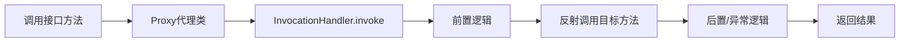

# 反射与动态代理

> [!abstract] 一句话总结
> 反射让程序在运行期检查和调用类成员，动态代理则把方法调用转发到统一拦截器，是 Spring AOP、RPC、Mock 的基础。

## 📌 这是什么

- 反射核心类包括 Class、Constructor、Field、Method，可在运行期加载类、创建对象和调用方法。
- JDK 动态代理基于接口生成代理类，方法调用统一进入 InvocationHandler。
- 没有接口时通常用字节码增强库或框架代理，例如 CGLIB/ByteBuddy。

## 🤔 解决什么问题 / 为什么需要

- 框架需要在不知道业务类具体类型时完成依赖注入、注解扫描、序列化、ORM 映射。
- 动态代理把横切逻辑和业务逻辑分离，例如事务、鉴权、日志、重试。
- 理解代理边界，才能排查 Spring 事务自调用失效、final 方法无法代理等问题。

## 🧩 核心概念

| 概念 | 含义 | 精通要点 |
| ---- | ---- | -------- |
| Class 对象 | JVM 中类元数据的运行期入口。 | 每个加载器命名空间中同名类可对应不同 Class。 |
| AccessibleObject | 控制反射访问检查。 | Java 9+ 模块化后还要考虑 open/export。 |
| InvocationHandler | JDK 代理的调用分发入口。 | proxy/method/args 三个参数构成一次调用上下文。 |
| 代理对象 | 对调用方表现为目标接口，内部转发到拦截逻辑。 | Spring AOP 默认常见 JDK/CGLIB 两类代理。 |

## ⚙️ 工作原理 / 流程



## 🔍 源码 / 原理深挖

- Proxy.newProxyInstance 接收 ClassLoader、接口数组、InvocationHandler，运行期生成实现接口的代理类。
- 代理类方法体大致是把 Method 对象和参数数组传给 handler.invoke。
- Method.invoke 会经过访问检查、参数适配和底层调用，频繁路径需缓存 Method 或使用 MethodHandle。

## 💻 代码实践 / 排查命令

```java
interface UserService { String findName(long id); }

UserService target = id -> "u" + id;
UserService proxy = (UserService) Proxy.newProxyInstance(
    UserService.class.getClassLoader(),
    new Class<?>[] {UserService.class},
    (obj, method, args) -> {
        long start = System.nanoTime();
        try {
            return method.invoke(target, args);
        } finally {
            System.out.println(method.getName() + " cost=" + (System.nanoTime() - start));
        }
    });
```

## 🛠️ 排查 / 实践要点

- 排查代理是否生效：打印 bean.getClass()，JDK 代理通常是 $Proxy，CGLIB 常带 $$SpringCGLIB。
- 反射性能问题先看是否在热点循环里重复查 Method/Field，缓存元数据。
- Spring 事务失效先检查是否自调用、方法是否 public、类是否被容器管理。

## ⚠️ 踩坑与注意事项

- 反射吞掉真实异常，只看到 InvocationTargetException，必须看 getCause。
- JDK 动态代理只能代理接口。
- 对 final 类/final 方法/private 方法期望被子类代理增强。

## 🎯 面试问题

> [!question] 高频问题
> - Q: JDK 动态代理和 CGLIB 区别？
>   - A: JDK 动态代理基于接口生成实现类，调用进 InvocationHandler；CGLIB 通过继承目标类生成子类，不能增强 final 类或 final 方法。
> - Q: 反射为什么慢？
>   - A: 有访问检查、方法查找、参数装箱拆箱、间接调用等成本；现代 JDK 已优化，但热点路径仍应缓存或用 MethodHandle。
> - Q: Spring 事务为什么自调用失效？
>   - A: 声明式事务通常在代理对象上拦截外部方法调用，同类内部 this.method() 绕过代理，因此不会进入事务拦截器。

## 🧭 源码入口速查

- `Class#forName`：默认会触发类初始化；只加载不初始化可用三参重载。
- `Class#getDeclaredMethods/getMethods`：一个看本类声明，一个包含 public 继承成员。
- `Method#invoke`：异常会包进 `InvocationTargetException`，排查必须拿 `getCause()`。
- `Proxy#newProxyInstance` -> `Proxy#getProxyConstructor`：生成代理类并绑定 `InvocationHandler`。
- Spring AOP 入口可看 `JdkDynamicAopProxy#invoke`、`CglibAopProxy.DynamicAdvisedInterceptor#intercept`。

## 🧪 最小验证

```java
System.setProperty("jdk.proxy.ProxyGenerator.saveGeneratedFiles", "true");
Runnable proxy = (Runnable) Proxy.newProxyInstance(
    Runnable.class.getClassLoader(),
    new Class<?>[] { Runnable.class },
    (p, method, args) -> null);
proxy.run();
```

运行后反编译生成的 `$Proxy` 类，可以看到接口方法最终把 `Method` 常量和参数数组交给 `InvocationHandler.invoke`。排查 Spring 事务时，打印 `bean.getClass()` 和调用链：只有经过代理对象的方法调用才会进入事务拦截器。

## ✅ 精通检查清单

- 能用自己的话讲清本主题解决的问题和适用边界。
- 能指出至少 2 个源码入口或底层机制。
- 能给出一个最小代码示例或一组线上排查命令。
- 能回答本页列出的高频面试题，并补充项目中的真实取舍。

## 🔗 关联笔记

- [[_index]]
- [[03-泛型与类型擦除]]
- [[05-类加载机制与双亲委派]]

## 📚 参考资料

- [Dev.java Tutorials](https://dev.java/learn/)
- [Oracle Java Documentation](https://docs.oracle.com/en/java/)
