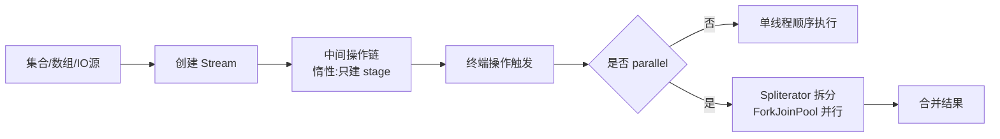

# Lambda与Stream

> [!abstract] 一句话总结
> Lambda 是函数式接口的简洁实现（底层 invokedynamic），Stream 是声明式的集合处理流水线：中间操作惰性、终端操作触发、短路与并行有明确边界——理解"数据流怎么走"比背 API 更重要。

## 🎯 本节定位

- **本章第 5 课，数据处理**。前置：[[01-泛型与类型擦除]]（函数式接口的泛型签名、PECS）、[[03-集合框架-List-Map-Set源码]]（Stream 的源头是集合）。
- **延伸阅读（本课不展开）**：并行流底层的 ForkJoinPool 与线程模型在 [[20-Java后端/03-并发编程/09-CompletableFuture异步编程|03-并发编程章节]]；本课只讲边界，不深入线程调度。

## 📌 这是什么

- **Lambda**：函数式接口（只有一个抽象方法的接口）的匿名实现，如 `x -> x * 2`。
- **Stream**：不是集合、不存储数据，它是**数据处理流水线的描述**：数据源 → 中间操作链 → 终端操作触发执行。
- 四类函数式接口记牢：`Predicate<T>`（判断，返回 boolean）、`Function<T,R>`（转换）、`Consumer<T>`（消费，无返回）、`Supplier<T>`（生产，无入参）。

## 🤔 解决什么问题 / 为什么需要

- 让集合处理代码更短、更接近业务语义：`filter/map/reduce/groupingBy` 直接表达"过滤、转换、归约、分组"。
- 通过组合操作减少临时变量和外部可变状态（更不容易出并发 bug）。
- 惰性 + 短路让流水线只算必要部分：`findFirst` 找到即停，不遍历全量。
- 理解边界才能避免性能误判和副作用事故（并行流的坑）。

## 🧩 核心概念

| 概念 | 含义 | 精通要点 |
| ---- | ---- | -------- |
| 函数式接口 | `@FunctionalInterface` 标注的单抽象方法接口。 | Predicate/Function/Consumer/Supplier 四大天王。 |
| 变量捕获 | Lambda 能读取外层局部变量，但必须是 effectively final。 | 为什么？Lambda 可能在其他线程执行，变量已复制，改外层变量无意义且不安全。 |
| 中间操作 | filter/map/sorted/distinct 等，返回新 Stream。 | **惰性**：只记录流水线，不遍历。 |
| 终端操作 | collect/reduce/forEach/count 等，触发执行。 | Stream 执行后不可复用（IllegalStateException）。 |
| 短路操作 | findFirst/findAny/anyMatch/limit。 | 找到结果就停止上游遍历，可大幅减少计算。 |
| Spliterator | 数据源遍历器 + 拆分器。 | 并行流靠 `trySplit()` 把数据拆给多个线程。 |
| 收集器 | `Collectors.toList/groupingBy/partitioningBy...`。 | collect 的底层是 `Collector` 接口的 accumulate/finish。 |

## ⚙️ 工作原理 / 流程



**执行时机**：中间操作只是"装配流水线"（每个操作创建一个新 stage 挂在 `AbstractPipeline` 上），直到终端操作才真正拉取数据。所以：

```java
Stream<Integer> s = Stream.of(1, 2, 3).peek(i -> System.out.println("peek " + i)).filter(i -> i > 1);
System.out.println("before terminal");  // 这行先打印
s.findFirst();                          // 现在才开始执行
```

## 🔍 源码 / 原理深挖

### Lambda 底层：invokedynamic，不是匿名内部类

```java
list.forEach(x -> System.out.println(x));
```

现代 javac 编译为 `invokedynamic` 调用点，引导方法 `LambdaMetafactory.metafactory` 在**运行期**生成函数对象（`CallSite` + 适配器类）。相比匿名内部类（每个 Lambda 一个 class 文件、每次 new 一个实例）：
- 无额外类文件（字节码更小）；
- 无捕获时单例复用（`x -> ...` 不捕获变量时是同一个实例）；
- 调用点一次引导后直接内联目标方法，性能接近手写。

**方法引用**是 Lambda 的语法糖：`x -> System.out.println(x)` ≡ `System.out::println`。四种形态：`类::静态方法`、`对象::实例方法`、`类::实例方法`（第一个参数当 receiver）、`类::new`（构造器引用）。

### 为什么 Lambda 只能捕获 effectively final 变量？

Lambda 编译后可能被**延迟到其他线程执行**（并行流、异步任务）。JVM 的实现方式是**拷贝**捕获的变量到 Lambda 对象里：若允许修改外层变量，修改只发生在拷贝上，外层看不到，语义混乱。所以编译器强制：捕获的局部变量要么 `final`，要么从未被重新赋值（effectively final）。`int[] arr` 这类"包装"技巧能改内容，但那是绕过规则的下策。

### Stream 的执行模型：融合（fusion）

顺序流中，相邻的中间操作（如 `filter→map`）会**融合**在同一个循环里对每个元素依次执行，而不是"先全部 filter 完再全部 map"——这就是为什么 `limit(5)` 能只处理前 5 个元素就停下来，也是惰性的价值所在。`stateful` 操作（`sorted`、`distinct`）会打断融合，因为它们必须看到全部元素。

### 并行流的真相

- `parallelStream()` 默认使用 `ForkJoinPool.commonPool`（线程数 = CPU 核数 - 1），数据通过 `Spliterator.trySplit()` 拆分给各线程。
- **并行 ≠ 更快**：拆分、合并、线程切换都有成本。小数据量、简单操作、有状态操作（sorted）往往串行更快。
- **大忌**：并行流里做阻塞 IO、访问共享可变状态、依赖线程局部变量、包事务——commonPool 是全局共享的，一个任务卡住会拖累同 JVM 所有并行流。

## 💻 代码实践 / 排查命令

```java
// 分组计数：最常用的 collect
Map<String, Long> byDept = users.stream()
    .filter(User::active)                 // Predicate 方法引用
    .collect(Collectors.groupingBy(       // 按部门分组
        User::department,
        Collectors.counting()));          // 每组的数量

// 短路：找到第一个管理员就停
Optional<User> firstAdmin = users.stream()
    .filter(u -> u.roles().contains("admin"))
    .findFirst();

// 归约：求和、最大、拼接
int total = orders.stream().mapToInt(Order::amount).sum();
String names = users.stream().map(User::name).collect(Collectors.joining(", "));

// 注意：复杂收集器拆成命名方法，别写一行谜题
Map<String, Map<String, Long>> stats = users.stream()
    .collect(Collectors.groupingBy(User::department,
        Collectors.groupingBy(User::city, Collectors.counting())));
// ↑ 超过一层分组建议提取为独立方法
```

## 🛠️ 排查 / 实践要点

- **性能对比要实测**：for 循环、stream、parallelStream 三选一，小数据量下 for 和 stream 差别很小，parallel 常更慢；拿数据量说话，不凭感觉。
- **看线程名**：并行流压测时若 `ForkJoinPool.commonPool-worker-*` 卡着 RPC/锁/DB，其他用 commonPool 的模块全被拖慢。
- **副作用排查**：Stream 里修改外部 List/Map（`forEach` 里 put）在多线程下必出问题；用 `collect` 收敛，不用 `forEach` 堆积。
- **`toList()` 不可变**：JDK 16+ 的 `stream().toList()` 返回不可变列表（`add` 抛异常），需要可变集合用 `.collect(Collectors.toList())`。

## ⚠️ 踩坑与注意事项

- 在 stream 中修改外部集合（`forEach` 里 `list.add/remove` 或 map.put）。
- 复用同一个 Stream → `IllegalStateException: stream has already been operated upon or closed`。
- 把 `parallelStream` 用在 IO 阻塞或有事务上下文的业务链路上。
- 用 `stream().toList()` 后试图 `add`，抛 `UnsupportedOperationException`。
- 大集合无限流（`Stream.iterate(0, i -> i+1)` 不配 `limit` 直接终端操作）→ 永不终止。

## 🎯 面试问题

> [!question] 高频问题
> - Q: Lambda 底层是匿名内部类吗？
>   - A: 不是简单等同。现代 javac 用 `invokedynamic` + `LambdaMetafactory` 在运行期生成函数对象：无独立类文件、无捕获时单例复用、引导后性能接近手写。匿名内部类是编译期固定类文件、每次 new 实例。
> - Q: Stream 为什么是惰性的？短路是什么？
>   - A: 中间操作只装配流水线不遍历，终端操作才拉数据；相邻中间操作融合执行，`findFirst/anyMatch/limit` 等短路操作找到结果即停，不必处理全部数据。
> - Q: 为什么 Lambda 捕获的局部变量必须是 effectively final？
>   - A: Lambda 可能延迟到其他线程执行，捕获变量是拷贝而非引用；允许修改会产生"改了但外层看不见"的语义混乱，编译器直接禁止。
> - Q: parallelStream 有什么风险？
>   - A: 默认用全局共享的 commonPool，阻塞任务会拖累其他并行流；共享可变状态会出数据竞争；事务/线程局部变量语义会丢失。小数据量并行往往更慢。

## 🧭 源码入口速查

- `java.lang.invoke.LambdaMetafactory#metafactory`：Lambda 动态调用点引导入口。
- `java.util.stream.AbstractPipeline`：保存 source、stage、flags、上下游链表。
- `ReferencePipeline#filter/map`：创建新 stage，不立即遍历。
- `java.util.stream.TerminalOp` / `ReduceOps` / `ForEachOps`：终端操作触发执行。
- `java.util.Spliterator#trySplit`：并行拆分任务的关键接口。
- `java.util.stream.Collectors#groupingBy`：多级分组与下游收集器组合。

## 🧪 最小验证

```java
// 1. 惰性 + 短路：只处理必要元素
Stream.of(1, 2, 3, 4, 5, 6)
    .peek(i -> System.out.println("visit " + i))
    .filter(i -> i > 2)
    .findFirst();   // 只打印 visit 1~3，找到 3 就停

// 2. effectively final
int threshold = 10;         // 不重新赋值 → 可捕获
list.removeIf(x -> x > threshold);
// threshold = 20;          // 若解除注释 → 编译错误

// 3. 并行流线程观察
IntStream.range(0, 8).parallel()
    .forEach(i -> System.out.println(Thread.currentThread().getName() + " " + i));
// 输出会混入 ForkJoinPool.commonPool-worker-N
```

## ✅ 精通检查清单

- 能用自己的话讲清本主题解决的问题和适用边界。
- 能指出至少 2 个源码入口或底层机制。
- 能给出一个最小代码示例或一组线上排查命令。
- 能回答本页列出的高频面试题，并补充项目中的真实取舍。

## 🔗 关联笔记

- 本课内：上一课 [[04-HashMap原理与扩容]]；下一课 [[06-IO与NIO]]
- 延伸：[[20-Java后端/03-并发编程/09-CompletableFuture异步编程|CompletableFuture 异步编程]]（并行任务模型，并发章节）

## 📚 参考资料

- [Dev.java Tutorials](https://dev.java/learn/)
- [Oracle Java Documentation](https://docs.oracle.com/en/java/)
- [JLS 15.27 - Lambda Expressions](https://docs.oracle.com/javase/specs/jls/se21/html/jls-15.html#jls-15.27)
