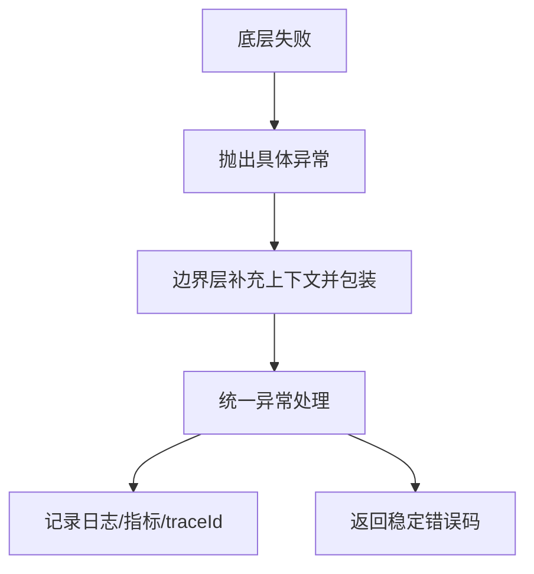

# 异常处理最佳实践

> [!abstract] 一句话总结
> 异常处理的目标是让错误可分类、可恢复、可观测，避免吞异常、乱包装和把控制流写成异常流。

## 📌 这是什么

- Throwable 分为 Error 和 Exception；业务代码通常只处理 Exception，Error 多表示 JVM 或系统级严重问题。
- Checked Exception 强迫调用方处理，Unchecked Exception 表示编程错误或运行期失败。
- 好的异常设计要保留 cause、上下文和边界语义。

## 🤔 解决什么问题 / 为什么需要

- 线上排查依赖异常类型、堆栈、错误码、traceId 和上下文日志。
- 接口层要把内部异常转成稳定错误响应，不能泄漏实现细节。
- 资源释放、重试、降级和事务回滚都依赖异常语义。

## 🧩 核心概念

| 概念 | 含义 | 精通要点 |
| ---- | ---- | -------- |
| 异常层次 | Throwable -> Error/Exception -> RuntimeException。 | 不要捕获 Throwable 做业务兜底。 |
| cause | 异常链保留根因。 | 包装异常时传入原异常。 |
| try-with-resources | 自动关闭 AutoCloseable 资源。 | 比 finally 手写 close 更稳。 |
| 错误码 | 面向调用方的稳定错误语义。 | 异常类型面向代码，错误码面向协议。 |

## ⚙️ 工作原理 / 流程



## 🔍 源码 / 原理深挖

- Throwable 维护 detailMessage、cause、stackTrace 和 suppressed exceptions。
- try-with-resources 会把 close 期间异常作为 suppressed 挂到主异常上。
- Spring @ControllerAdvice 常用于 Web 层统一异常响应，事务默认对 RuntimeException 回滚。

## 💻 代码实践 / 排查命令

```java
try (InputStream in = Files.newInputStream(path)) {
    return in.readAllBytes();
} catch (NoSuchFileException e) {
    throw new BizException("FILE_NOT_FOUND", "文件不存在: " + path, e);
} catch (IOException e) {
    throw new BizException("FILE_READ_FAILED", "读取文件失败: " + path, e);
}
```

## 🛠️ 排查 / 实践要点

- 日志只在边界层集中打一次，避免每层 log.error 后再 throw 造成重复噪音。
- 排查线上异常先按 traceId 串起入口参数、关键状态和根因 cause。
- 重试只针对超时、网络抖动等可恢复异常，并设置次数、退避和幂等保护。

## ⚠️ 踩坑与注意事项

- catch Exception 后空处理或只打印 e.getMessage。
- log.error 后继续抛出，导致同一异常被多次记录。
- 用异常做普通 if/else 控制流。
- 包装异常时丢失 cause。

## 🎯 面试问题

> [!question] 高频问题
> - Q: Checked 和 Unchecked 怎么选？
>   - A: 调用方有明确恢复动作时可用 checked；多数业务失败用 unchecked 搭配错误码和统一处理，避免层层污染签名。
> - Q: finally 一定会执行吗？
>   - A: 一般会执行，但 System.exit、JVM 崩溃、进程被 kill 等场景不会；try-with-resources 更适合资源释放。
> - Q: 怎么设计项目异常体系？
>   - A: 区分业务异常、参数异常、外部依赖异常和系统异常；保留 cause、错误码、上下文，并在统一异常处理器转换响应。

## 🧭 源码入口速查

- `Throwable#fillInStackTrace`：创建异常时采集栈，频繁异常会带来明显成本。
- `Throwable#addSuppressed/getSuppressed`：try-with-resources 中 close 失败会挂到主异常上。
- `ExceptionInInitializerError`：静态初始化失败的包装异常，后续访问常表现为 `NoClassDefFoundError`。
- Spring MVC 可看 `HandlerExceptionResolver`、`@ControllerAdvice`、`ResponseEntityExceptionHandler`。

## 🧪 最小验证

```java
try (AutoCloseable r = () -> { throw new IOException("close failed"); }) {
    throw new IllegalStateException("main failed");
} catch (Exception e) {
    System.out.println(e.getMessage());
    System.out.println(Arrays.toString(e.getSuppressed()));
}
```

生产日志规范：入口层记录一次 `error`，中间层包装异常时补业务上下文并保留 cause，不重复打印完整堆栈。需要告警的异常按错误码、异常类、下游系统、traceId 打标签，否则同一根因会在日志平台里变成多条噪音。

## ✅ 精通检查清单

- 能用自己的话讲清本主题解决的问题和适用边界。
- 能指出至少 2 个源码入口或底层机制。
- 能给出一个最小代码示例或一组线上排查命令。
- 能回答本页列出的高频面试题，并补充项目中的真实取舍。

## 🔗 关联笔记

- [[_index]]
- [[06-IO与NIO]]
- [[07-OOM问题排查]]

## 📚 参考资料

- [Dev.java Tutorials](https://dev.java/learn/)
- [Oracle Java Documentation](https://docs.oracle.com/en/java/)
