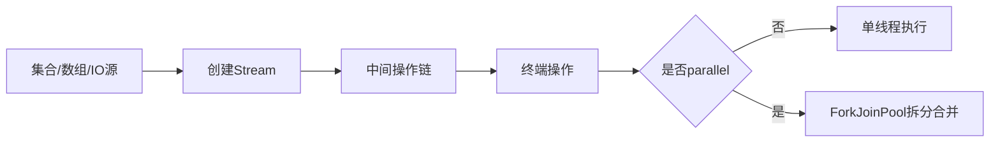

# Lambda与Stream

> [!abstract] 一句话总结
> Lambda 是函数式接口的简洁实现形式，Stream 是声明式集合处理流水线，源码重点是 invokedynamic、惰性求值和并行执行边界。

## 📌 这是什么

- Lambda 只能赋值给函数式接口，即只有一个抽象方法的接口。
- Stream 不是集合，不存储数据；它描述数据处理流水线，终端操作触发执行。
- Stream 适合表达 map/filter/reduce/grouping 等数据转换，不适合复杂副作用流程。

## 🤔 解决什么问题 / 为什么需要

- 让集合处理代码更短、更接近业务语义。
- 通过组合操作减少临时变量和外部可变状态。
- 理解惰性和短路操作，避免性能误判和并发副作用。

## 🧩 核心概念

| 概念 | 含义 | 精通要点 |
| ---- | ---- | -------- |
| 函数式接口 | @FunctionalInterface 标注的单抽象方法接口。 | Predicate、Function、Consumer、Supplier 常用。 |
| 中间操作 | filter/map/sorted/distinct 等返回新 Stream。 | 惰性执行。 |
| 终端操作 | collect/reduce/forEach/count 等触发流水线。 | Stream 使用后不能复用。 |
| Spliterator | 用于遍历和拆分数据源。 | 并行 Stream 依赖它拆任务。 |

## ⚙️ 工作原理 / 流程



## 🔍 源码 / 原理深挖

- Lambda 编译后通常通过 invokedynamic 和 LambdaMetafactory 生成函数对象。
- Stream pipeline 由 source、若干 stateless/stateful 中间操作和 terminal operation 组成。
- parallelStream 默认使用 ForkJoinPool.commonPool，阻塞任务可能影响同 JVM 其他并行任务。

## 💻 代码实践 / 排查命令

```java
Map<String, Long> byDept = users.stream()
    .filter(User::active)
    .collect(Collectors.groupingBy(
        User::department,
        Collectors.counting()));

Optional<User> firstAdmin = users.stream()
    .filter(u -> u.roles().contains("admin"))
    .findFirst();
```

## 🛠️ 排查 / 实践要点

- 性能排查先比较普通 for 循环、stream、parallelStream，不凭感觉判断。
- 复杂 collect 拆成命名方法，避免一行 Stream 写成不可读谜题。
- 并行流中避免访问共享可变对象，必要时使用无副作用归约或线程安全收集器。

## ⚠️ 踩坑与注意事项

- 在 stream 中修改外部 List/Map。
- 复用同一个 Stream 导致 IllegalStateException。
- 把 parallelStream 用在 IO 阻塞或有事务上下文的业务链路上。

## 🎯 面试问题

> [!question] 高频问题
> - Q: Lambda 底层是不是匿名内部类？
>   - A: 不是简单等同。现代 javac 通常用 invokedynamic 引导到 LambdaMetafactory 生成函数对象，避免每个 Lambda 都生成固定匿名类字节码。
> - Q: Stream 为什么是惰性的？
>   - A: 中间操作只记录流水线，终端操作才触发遍历，这样可以融合操作并支持 findFirst、anyMatch 等短路。
> - Q: parallelStream 有什么风险？
>   - A: 默认使用 commonPool，阻塞任务、共享可变状态、事务上下文和线程本地变量都可能出问题。

## 🧭 源码入口速查

- `java.lang.invoke.LambdaMetafactory#metafactory`：Lambda 的动态调用点引导入口。
- `java.util.stream.AbstractPipeline`：保存 source、stage、flags 和上下游链路。
- `ReferencePipeline#filter/map`：中间操作创建新 stage，不立即遍历数据。
- `TerminalOp`、`ReduceOps`、`ForEachOps`：终端操作触发流水线执行。
- `Spliterator#trySplit`：并行流拆分任务的关键接口。

## 🧪 最小验证

```java
Stream<Integer> s = Stream.of(1, 2, 3)
    .peek(i -> System.out.println("peek " + i))
    .filter(i -> i > 1);
System.out.println("before terminal");
s.findFirst();
```

输出会先打印 `before terminal`，说明中间操作没有立即执行。并行流压测时要单独看 `ForkJoinPool.commonPool-worker-*`：如果里面卡着 RPC、数据库或锁等待，其他使用 commonPool 的模块也会被拖慢。

## ✅ 精通检查清单

- 能用自己的话讲清本主题解决的问题和适用边界。
- 能指出至少 2 个源码入口或底层机制。
- 能给出一个最小代码示例或一组线上排查命令。
- 能回答本页列出的高频面试题，并补充项目中的真实取舍。

## 🔗 关联笔记

- [[_index]]
- [[01-集合框架-List-Map-Set源码]]
- [[09-CompletableFuture异步编程]]

## 📚 参考资料

- [Dev.java Tutorials](https://dev.java/learn/)
- [Oracle Java Documentation](https://docs.oracle.com/en/java/)
