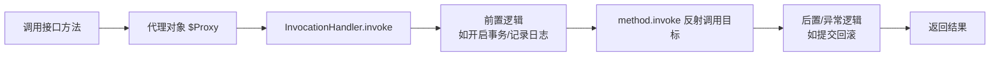

# 反射与动态代理

> [!abstract] 一句话总结
> 反射让程序在运行期检查和调用类成员（Class/Field/Method），动态代理把方法调用统一转发到 InvocationHandler——这是 Spring AOP、RPC、Mock、ORM 的地基；理解"代理对象 vs 真实对象"的边界，才能排查事务失效、final 方法无法增强等问题。

## 🎯 本节定位

- **本章第 7 课，运行期机制**。前置：[[01-泛型与类型擦除]]（反射读取泛型元数据）、[[02-异常处理最佳实践]]（`InvocationTargetException` 的 cause 链）。
- **延伸阅读（本课不展开）**：Spring AOP 的完整代理体系（`@Transactional` 自调用失效、切面织入）在 04-Spring 生态章节；CGLIB 子类代理细节跟随 Spring 一起学；Java 9 模块系统（open/export）属于语言背景知识，本课只提概念。

## 📌 这是什么

- **反射**：运行期加载类、查看成员、调用方法的机制。核心类：`Class`、`Constructor`、`Field`、`Method`。
- **JDK 动态代理**：基于**接口**在运行期生成代理类，所有方法调用进入一个 `InvocationHandler.invoke`。
- 没有接口时用**子类代理**（CGLIB/ByteBuddy 等字节码增强库）：生成目标类的子类，重写方法实现拦截。

## 🤔 解决什么问题 / 为什么需要

- **框架要操作未知类型**：Spring 注入 bean、MyBatis 映射结果、Jackson 反序列化、注解扫描——框架在编译期不知道你的业务类，只能靠反射在运行期"发现"它。
- **横切逻辑与业务分离**：事务、鉴权、日志、重试不该写进每个业务方法，动态代理把调用拦截下来统一处理。
- **排查依赖代理认知**：`@Transactional` 为什么自调用失效？`final` 方法为什么没被增强？答案是"调用没有经过代理对象"。

## 🧩 核心概念

| 概念 | 含义 | 精通要点 |
| ---- | ---- | -------- |
| Class 对象 | JVM 中类元数据的运行期入口。 | 每个类加载器命名空间中同名类是不同的 Class。 |
| 反射 API | `getDeclaredMethods`/`getFields`/`getAnnotations`... | Declared=本类声明；不带=包含 public 继承成员。 |
| setAccessible | 关闭访问检查，可操作 private 成员。 | Java 9+ 模块化后还要模块 open/export 配合。 |
| InvocationHandler | JDK 代理的调用分发入口。 | `(proxy, method, args)` 构成一次调用上下文。 |
| 代理对象 | 对调用方表现为目标接口，内部转发到拦截逻辑。 | `bean.getClass()` 是 `$Proxy` 就说明在用 JDK 代理。 |
| MethodHandle | `java.lang.invoke` 提供的轻量方法调用句柄。 | 比反射快，是 invokedynamic 的底层基础。 |

## ⚙️ 工作原理 / 流程



**JDK 动态代理三步**：
1. `Proxy.newProxyInstance(classLoader, interfaces, handler)` 在运行期生成并加载一个实现所有指定接口的类（`$Proxy0`）。
2. `$Proxy0` 每个接口方法的方法体大致是：把 `Method` 常量 + 参数数组传给 `handler.invoke`。
3. `handler.invoke` 返回什么，调用方就收到什么——拦截逻辑全在 handler 里。

## 🔍 源码 / 原理深挖

### 为什么 JDK 动态代理只能代理接口？

因为代理类是**凭空生成的**：它没有目标类的源码，只能实现接口（Java 单继承，也不能 extend 一个不存在的类）。而接口本身就是"契约"，实现契约即可冒充目标。目标类的方法通过 `method.invoke(target, args)` 转发。若目标没有接口，JDK 代理无从下手 → 需要 CGLIB 在运行期生成目标类的**子类**（子类重写父类方法），代价是 final 类/final 方法无法被继承/重写，也就无法代理。

### 反射为什么慢？（以及怎么优化）

`Method.invoke` 的成本：
1. **访问检查**：每次调用检查调用方是否有权限（可 `setAccessible(true)` 跳过）。
2. **参数适配**：`Object[] args` 装箱/拆箱、类型转换。
3. **间接调用**：反射调用不能像直接调用那样内联，JIT 优化受限（HotSpot 有 inflation 优化，多次调用后会生成专用适配器，比想象中快，但仍有差距）。

优化手段：**缓存 Method/Field 对象**（避免重复 `getMethod` 查找）、`setAccessible(true)`、热点路径用 `MethodHandle`（`LambdaMetafactory` 生成直接调用点）甚至生成代码。

### InvocationTargetException 陷阱

`method.invoke` 抛出目标方法内部的任何异常时，都会包一层 `InvocationTargetException` 再抛出——**反射吞掉了真实异常**。排查必须 `e.getCause()` 才看得到真凶。这是反射排查的第一课。

### Class 对象与类加载

`Class.forName("x.Y")` 默认会**初始化**类（执行静态块）；只想加载不初始化用三参重载 `forName(name, false, loader)`。同一个类被不同类加载器加载就是两个 Class——这是类加载机制（02-JVM 章节）的入口概念。

## 💻 代码实践 / 排查命令

```java
// 动态代理：给任意接口方法加耗时日志
interface UserService { String findName(long id); }

UserService target = id -> "u" + id;
UserService proxy = (UserService) Proxy.newProxyInstance(
    UserService.class.getClassLoader(),
    new Class<?>[] {UserService.class},
    (obj, method, args) -> {
        long start = System.nanoTime();
        try {
            return method.invoke(target, args);
        } finally {
            System.out.println(method.getName() + " cost=" + (System.nanoTime() - start));
        }
    });

String name = proxy.findName(1L);   // 走 handler → 打印 findName cost=xxx
```

```java
// 反射读取泛型元数据（衔接 01 课）
Method m = Foo.class.getDeclaredMethod("bar");
Type t = m.getGenericReturnType();           // 不是 getReturnType！
if (t instanceof ParameterizedType pt) {
    System.out.println(pt.getActualTypeArguments()[0]);  // 拿到 List<User> 里的 User
}
```

```bash
# 确认代理类型：打印 bean 的真实类
# JDK 代理: class com.sun.proxy.$Proxy12
# CGLIB:    class com.example.Foo$$SpringCGLIB$$0
# 排查 Spring 事务失效时第一步就是看它
```

## 🛠️ 排查 / 实践要点

- **代理是否生效**：打印 `bean.getClass()`——`$Proxy` 是 JDK 代理，`$$SpringCGLIB` 是 CGLIB；直接 new 出来的对象没有代理。
- **反射性能问题**：先看是否在热点循环里重复 `getMethod/getField`，缓存元数据；必要时 `setAccessible(true)` 或 MethodHandle。
- **Spring 事务失效排查**（详情在 Spring 章节）：① 自调用（this.method() 绕过代理）② 方法非 public ③ 类未被容器管理 ④ 异常被吞导致不触发回滚。
- **异常被包装**：反射调用失败永远先看 `getCause()`。

## ⚠️ 踩坑与注意事项

- 反射吞掉真实异常，只看到 `InvocationTargetException`，必须取 `getCause()`。
- JDK 动态代理**只能代理接口**——对实现类直接 `Proxy.newProxyInstance` 传实现类会报错。
- 对 final 类/final 方法期望被子类代理增强（CGLIB 也不行）。
- 热点路径频繁用反射而不缓存，性能差距明显。
- Java 9+ 模块化后，未 open 的模块即使 setAccessible(true) 也访问不了——框架会通过 `--add-opens` 解决。

## 🎯 面试问题

> [!question] 高频问题
> - Q: JDK 动态代理和 CGLIB 的区别？
>   - A: JDK 代理基于接口，运行期生成实现接口的 `$Proxy` 类，调用进 InvocationHandler；CGLIB 通过继承目标类生成子类重写方法，不能代理 final 类/final 方法。Spring 默认：目标有接口用 JDK 代理，无接口用 CGLIB。
> - Q: 反射为什么慢？
>   - A: 访问检查、参数装箱/适配、间接调用限制 JIT 优化。优化：缓存 Method、setAccessible(true)、MethodHandle。
> - Q: Spring 事务为什么自调用失效？
>   - A: 声明式事务拦截在**代理对象**上，同类内部 `this.method()` 调用不经过代理，拦截器不生效。解决：注入自身代理、拆到别的 bean、或 AopContext.currentProxy。
> - Q: 为什么反射调用抛 InvocationTargetException？
>   - A: invoke 把目标方法的所有异常统一包装，防止反射 API 本身被目标异常污染；取 `e.getCause()` 才是原始异常。

## 🧭 源码入口速查

- `Class#forName`：默认触发类初始化；只加载用三参重载。
- `Class#getDeclaredMethods/getMethods`：本类声明 vs 含 public 继承成员。
- `Method#invoke`：异常包进 `InvocationTargetException`，必须 `getCause()`。
- `Proxy#newProxyInstance` → `Proxy#getProxyConstructor`：生成代理类并绑定 InvocationHandler。
- `java.lang.invoke.MethodHandle` / `LambdaMetafactory`：更快的调用路径（衔接 05 课 invokedynamic）。

## 🧪 最小验证

```java
// 保存生成的代理类字节码，反编译看结构
System.setProperty("jdk.proxy.ProxyGenerator.saveGeneratedFiles", "true");
Runnable proxy = (Runnable) Proxy.newProxyInstance(
    Runnable.class.getClassLoader(),
    new Class<?>[] { Runnable.class },
    (p, method, args) -> null);
proxy.run();
// 运行后在 com/sun/proxy/$Proxy0.class 生成文件，反编译可见
// 每个接口方法体: return handler.invoke(this, METHOD_常量, new Object[]{...});
```

```java
// InvocationTargetException 演示
Method m = Thread.class.getDeclaredMethod("sleep", long.class);
m.setAccessible(true);
try {
    m.invoke(null, -1L);          // 目标抛 IllegalArgumentException
} catch (InvocationTargetException e) {
    System.out.println(e.getCause());  // java.lang.IllegalArgumentException: timeout value is negative
}
```

排查 Spring 事务时，打印 `bean.getClass()` 和调用链：只有经过代理对象的方法调用才会进入事务拦截器；`this.method()` 自调用不会。

## ✅ 精通检查清单

- 能用自己的话讲清本主题解决的问题和适用边界。
- 能指出至少 2 个源码入口或底层机制。
- 能给出一个最小代码示例或一组线上排查命令。
- 能回答本页列出的高频面试题，并补充项目中的真实取舍。

## 🔗 关联笔记

- 本课内：上一课 [[06-IO与NIO]]；下一课 [[08-Java新特性-Record-密封类-虚拟线程]]（反射 API 识别 record/sealed）
- 延伸：[[20-Java后端/02-JVM/05-类加载机制与双亲委派|类加载机制]]（Class 对象的来源，02-JVM 章节）；Spring AOP 在 04-Spring 生态章节

## 📚 参考资料

- [Dev.java Tutorials](https://dev.java/learn/)
- [Oracle Java Documentation](https://docs.oracle.com/en/java/)
- [java.lang.reflect 包文档](https://docs.oracle.com/en/java/javase/21/docs/api/java.base/java/lang/reflect/package-summary.html)
