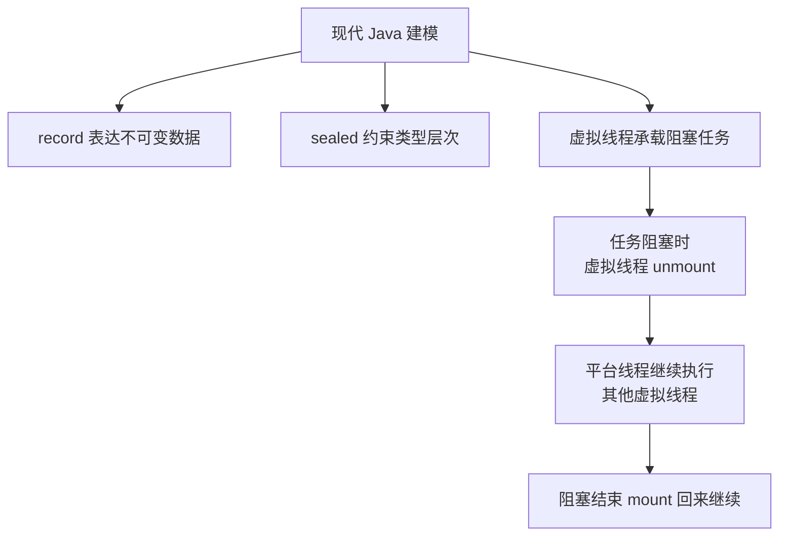

# Java新特性-Record-密封类-虚拟线程

> [!abstract] 一句话总结
> Record、密封类、虚拟线程解决三个互不相关的问题：Record 消灭数据载体样板代码（建模），sealed 收窄继承边界（类型约束），虚拟线程用轻量线程承载海量阻塞任务（并发）——本课把它们各自讲透，并指出虚拟线程的深入内容在并发章节。

## 🎯 本节定位

- **本章第 8 课（最后一课），现代语法收尾**。前置：[[01-泛型与类型擦除]]（record 组件可以是泛型）、[[03-集合框架-List-Map-Set源码]]（record 天然是不可变 key）、[[07-反射与动态代理]]（用反射 API 识别 record/sealed）。
- **延伸阅读（本课只入门）**：虚拟线程与平台线程的调度、pinning 的完整机制、线程池对比在 [[20-Java后端/03-并发编程/01-线程基础与生命周期|03-并发编程章节]] 深入；sealed + 模式匹配（switch 穷尽检查）属于语言新特性，本课讲动机不展开语法。

## 📌 这是什么

- **record**（JDK 16 正式）：**浅不可变数据载体**，编译器自动生成构造器、访问器、`equals`、`hashCode`、`toString`。`record UserView(long id, String name) {}` 一行顶一个 DTO 类。
- **sealed**（JDK 17 正式）：**限制继承边界**的接口/类，`permits` 明确列出合法子类型，子类型必须 final/sealed/non-sealed。
- **虚拟线程**（JDK 21 正式）：JVM 调度的轻量线程，一个平台线程可承载成千上万个虚拟线程，用同步阻塞代码达到高并发。

## 🤔 解决什么问题 / 为什么需要

- **Record**：DTO、值对象、事件对象过去要手写构造器 + getter + equals/hashCode/toString（或用 Lombok 生成），样板代码多且易错（漏改字段）。record 让"数据载体"成为语言一等公民，字段即契约。
- **Sealed**：状态机、支付结果、命令类型这类"有限子类型"场景，过去要么 final 封死、要么开放继承失控；sealed 让继承边界**显式且可穷尽**，编译器知道全部合法子类型，支撑模式匹配穷尽检查。
- **虚拟线程**：线程是昂贵资源（1MB 栈 + 内核调度），BIO 一连接一线程撑不住高并发，异步编程又难写难排。虚拟线程让你**用同步写法获得高并发承载**（IO 密集场景）。

## 🧩 核心概念

| 概念 | 含义 | 精通要点 |
| ---- | ---- | -------- |
| Record | 浅不可变数据载体，字段来自 record components。 | 适合 DTO/值对象/不可变 key；不适合复杂可变实体。 |
| compact constructor | 在构造器里做校验的简写。 | `record X(int n) { X { if (n < 0) throw ... } }`。 |
| Sealed | `permits` 限定直接子类集合。 | 子类必须 final/sealed/non-sealed，同模块内才能扩展。 |
| 虚拟线程 | JVM 调度的轻量线程（JDK 21 正式）。 | 适合阻塞 IO；不提升 CPU 密集计算。 |
| Pinning | 虚拟线程被平台线程绑定无法卸载。 | 长时间 synchronized/native 调用会 pinning，注意容量。 |

## ⚙️ 工作原理 / 流程



**虚拟线程的核心因果链**：虚拟线程阻塞（如读 IO）时，JVM 把它的栈（continuation 对象）**卸载**到堆上，平台线程（carrier）腾出来跑别的虚拟线程；IO 就绪后虚拟线程再**装载**回来继续跑。于是"阻塞等待"不再占用平台线程——这是它与 BIO"一连接一线程"的本质区别。

## 🔍 源码 / 原理深挖

### record 到底生成了什么？

`record UserView(long id, String name) {}` 编译后等价于：
- 一个 final 类，继承 `java.lang.Record`；
- `private final long id; private final String name;` 字段；
- 全参构造器、`id()`/`name()` 访问器（注意**没有 get 前缀**）、`equals`/`hashCode`/`toString`。

关键语义：
- **浅不可变**：组件字段是 final，但组件引用的对象（如 `List<String>`）本身可变——`line.tags().add(...)` 依然能改。
- **compact constructor**：`record OrderLine(String sku, List<String> tags) { OrderLine { if (sku.isBlank()) throw new IllegalArgumentException(); } }` 在构造时校验，避免非法对象诞生。
- **静态成员限制**：record 不能有实例字段（除了组件）、不能继承别的类、不能有 native 方法；可以有静态方法/静态字段、可以 implements 接口。
- 与 Lombok `@Data` 的区别：record 是**语言级**语义（final、值语义、组件契约），Lombok 是编译期代码生成（默认可变 JavaBean）。

### sealed 与 final / enum 的取舍

- `final`：彻底封死，连"有限扩展"都不允许 → 适合没有子类型的场景。
- `enum`：固定实例集合，适合"值有限"（如状态枚举），但每个实例不是类型。
- `sealed`：**类型有限但可扩展**——需要"几个不同行为类型"且集合固定时用它，编译器穷尽检查让 switch 少写 default。

```java
sealed interface PayResult permits Success, Failed {}
record Success(String tradeNo) implements PayResult {}
record Failed(String reason) implements PayResult {}

// 配合模式匹配（新特性语法），编译器知道只有两种结果
String msg = switch (result) {
    case Success s -> "支付成功 " + s.tradeNo();
    case Failed f -> "支付失败 " + f.reason();
};
```

### 虚拟线程的容量边界（上线前必看）

虚拟线程省的是**线程成本**，不省**下游资源**：
- 数据库连接池、HTTP 连接池、限流令牌都是**有上限的共享资源**——10 万虚拟线程同时等连接池的 20 个连接，排队等待时间会暴涨。
- CPU 密集计算：虚拟线程不增加算力，反而有调度开销，别用来加速计算。
- **Pinning**：虚拟线程进入 `synchronized` 块或执行某些 native 调用时被"钉"在平台线程上无法卸载，此时退化成"占着平台线程阻塞"——长时间持锁场景要改用 `ReentrantLock`（并发章节讲）。

## 💻 代码实践 / 排查命令

```java
// 1. record 建模 + compact constructor 校验
record OrderLine(String sku, List<String> tags) {
    OrderLine {
        if (sku.isBlank()) throw new IllegalArgumentException("sku 不能为空");
        tags = List.copyOf(tags);   // 防御性拷贝，避免外部改 list
    }
}

// 2. sealed 表达有限结果
sealed interface PayResult permits Success, Failed {}
record Success(String tradeNo) implements PayResult {}
record Failed(String reason) implements PayResult {}

// 3. 虚拟线程：每任务一线程的写法，代价极低
try (var executor = Executors.newVirtualThreadPerTaskExecutor()) {
    executor.submit(() -> blockingHttpCall());
    executor.submit(() -> blockingHttpCall());
}
// 等价旧写法 Executors.newFixedThreadPool(200)，但虚拟线程可以开几万个
```

```bash
# 观察虚拟线程（JDK 21+）
jcmd <pid> Thread.dump_to_file -format=json threads.json
# 栈里线程名形如 "virtual" 的成千上万条 —— 正常，别慌
```

## 🛠️ 排查 / 实践要点

- DTO、查询结果、消息事件、不可变 key 优先 record；**JPA 实体通常仍用普通类**（可变、代理、懒加载需要）。
- 密封类型适合：支付结果、订单命令、解析结果、状态机——子类型集合固定且业务上"就这么多"。
- 虚拟线程上线前压三类指标：**应用 P99、数据库连接池等待时间、下游 QPS/限流**——瓶颈从线程数转移到下游资源。
- 代码里把 `synchronized` 长临界区换 `ReentrantLock`，避免虚拟线程 pinning。

## ⚠️ 踩坑与注意事项

- 以为 record 是深不可变：组件引用的可变对象仍可被修改（`line.tags().add(...)` 合法）。
- 给 record 加可变实例字段：编译错误，这是设计使然（record 就是数据载体）。
- 用虚拟线程绕过连接池容量限制 → 数据库/下游被打爆（这是最常见的线上事故）。
- 在虚拟线程中长时间持有 `synchronized` 锁或调用可能 pinning 的 native 逻辑。
- 把虚拟线程当 CPU 加速器：计算密集型任务用虚拟线程反而更慢。

## 🎯 面试问题

> [!question] 高频问题
> - Q: record 和 Lombok @Data 的区别？
>   - A: record 是语言级透明数据载体：默认 final 类、组件 final、值语义方法（equals/hashCode/toString）由编译器生成、不能有实例字段；@Data 是编译期代码生成，默认可变 JavaBean，字段语义由你维护。record 不可变、透明、可被框架识别（getRecordComponents）。
> - Q: sealed 类解决什么问题？和 final/enum 怎么选？
>   - A: 它把继承扩展点收窄为**显式许可列表**，编译器知道全部合法子类型，可做模式匹配穷尽检查。需要固定集合的可扩展类型用 sealed；完全不需要子类型用 final；值是固定实例用 enum。
> - Q: 虚拟线程适合什么场景？有什么坑？
>   - A: 适合大量阻塞 IO 任务，用同步代码模型提高并发承载；不提升 CPU 密集计算；不扩大连接池/限流等下游容量（瓶颈转移）；synchronized 临界区会 pinning，长锁场景用 ReentrantLock。
> - Q: record 的浅不可变什么意思？
>   - A: 组件字段本身 final 不可重新赋值，但组件引用的对象仍可变；要真正不可变需在 compact constructor 里防御性拷贝。

## 🧭 源码入口速查

- `javap -p UserView.class`：查看 record 生成的 private final 字段、访问器、`equals/hashCode/toString`。
- `Class#isRecord`、`Class#getRecordComponents`：框架识别 record 组件的反射入口。
- `Class#isSealed`、`Class#getPermittedSubclasses`：读取 sealed 类型许可子类。
- `Thread#ofVirtual`、`Executors#newVirtualThreadPerTaskExecutor`：虚拟线程创建入口。
- `jcmd <pid> Thread.dump_to_file -format=json threads.json`：观察虚拟线程栈。

## 🧪 最小验证

```java
// 1. 浅不可变验证
record OrderLine(String sku, List<String> tags) {}

var tags = new ArrayList<>(List.of("new"));
var line = new OrderLine("A", tags);
tags.add("changed");
System.out.println(line.tags());   // [new, changed] —— record 是浅不可变！

// 2. sealed 反射验证
System.out.println(PayResult.class.isSealed());                    // true
System.out.println(Arrays.toString(PayResult.class.getPermittedSubclasses())); // [Success, Failed]

// 3. 虚拟线程数量验证：开 10 万虚拟线程也毫无压力
try (var ex = Executors.newVirtualThreadPerTaskExecutor()) {
    IntStream.range(0, 100_000).forEach(i -> ex.submit(() -> {
        Thread.sleep(1000);   // 阻塞也不占平台线程
        return i;
    }));
}
```

虚拟线程上线前要压三类指标：应用 P99、数据库连接池等待时间、下游 QPS/限流。虚拟线程能降低线程成本，但不能让数据库连接、HTTP 连接、限流令牌变多；容量瓶颈会从线程数转移到下游资源。

## ✅ 精通检查清单

- 能用自己的话讲清本主题解决的问题和适用边界。
- 能指出至少 2 个源码入口或底层机制。
- 能给出一个最小代码示例或一组线上排查命令。
- 能回答本页列出的高频面试题，并补充项目中的真实取舍。

## 🔗 关联笔记

- 本课内：上一课 [[07-反射与动态代理]]（isRecord/isSealed 反射 API）；[[03-集合框架-List-Map-Set源码]]（record 做不可变 key）
- 延伸：[[20-Java后端/03-并发编程/01-线程基础与生命周期|线程基础与生命周期]]、[[20-Java后端/03-并发编程/07-线程池原理与参数|线程池原理与参数]]（虚拟线程深入，并发章节）

## 📚 参考资料

- [Dev.java Tutorials](https://dev.java/learn/)
- [Oracle Java Documentation](https://docs.oracle.com/en/java/)
- [JEP 395: Records](https://openjdk.org/jeps/395) / [JEP 409: Sealed Classes](https://openjdk.org/jeps/409) / [JEP 444: Virtual Threads](https://openjdk.org/jeps/444)
