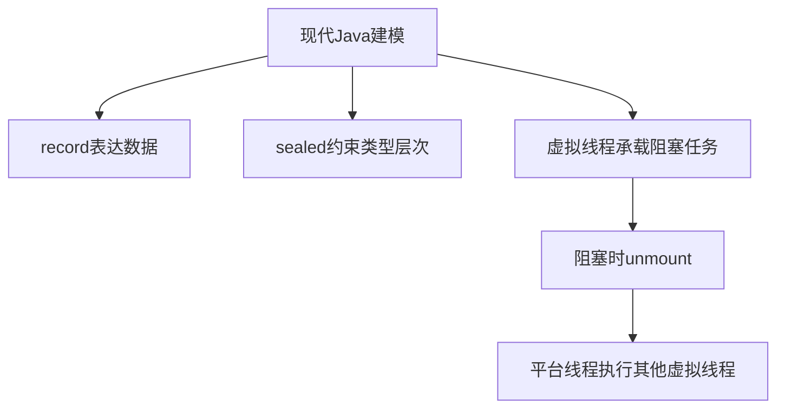

# Java新特性-Record-密封类-虚拟线程

> [!abstract] 一句话总结
> Record、密封类和虚拟线程分别改善数据建模、类型层次约束和高并发阻塞编程，是现代 Java 后端的重要语法与运行时能力。

## 📌 这是什么

- record 是浅不可变数据载体，编译器生成构造器、访问器、equals、hashCode、toString。
- sealed class/interface 限制可继承类型，让领域模型和模式匹配更可控。
- 虚拟线程是 JDK 21 正式能力，用低成本线程承载大量阻塞任务，简化异步代码。

## 🤔 解决什么问题 / 为什么需要

- 减少 DTO、值对象、事件对象样板代码。
- 让状态机、结果类型、命令类型的继承边界显式化。
- 在 IO 密集服务中用同步写法获得更高并发承载能力。

## 🧩 核心概念

| 概念 | 含义 | 精通要点 |
| ---- | ---- | -------- |
| Record | 透明数据载体，字段来自 record components。 | 适合不可变 DTO，不适合有复杂可变状态的实体。 |
| Sealed | 通过 permits 限定直接子类。 | 子类必须 final/sealed/non-sealed。 |
| Virtual Thread | 由 JVM 调度的轻量线程。 | 适合阻塞 IO，不提升 CPU 密集计算本身。 |
| Pinning | 虚拟线程被平台线程绑定无法卸载。 | 长时间 synchronized 或 native 调用需关注。 |

## ⚙️ 工作原理 / 流程



## 🔍 源码 / 原理深挖

- record 编译后仍是普通 final 类，继承 java.lang.Record，字段 private final。
- sealed 的许可子类信息写入 class 文件，编译期和运行期都会校验继承合法性。
- 虚拟线程由 carrier 线程承载，阻塞可挂起 continuation 并释放 carrier。

## 💻 代码实践 / 排查命令

```java
record UserView(long id, String name) {}

sealed interface PayResult permits Success, Failed {}
record Success(String tradeNo) implements PayResult {}
record Failed(String reason) implements PayResult {}

try (var executor = Executors.newVirtualThreadPerTaskExecutor()) {
    executor.submit(() -> blockingHttpCall());
}
```

## 🛠️ 排查 / 实践要点

- DTO、查询结果、消息事件优先考虑 record，但 JPA 实体通常仍用普通类。
- 密封类型适合表达有限状态，例如支付结果、订单命令、解析结果。
- 虚拟线程压测要观察吞吐、延迟、数据库连接池、下游限流，而不是只看线程数。

## ⚠️ 踩坑与注意事项

- record 只是浅不可变，组件引用的可变对象仍可被修改。
- 用虚拟线程绕过连接池容量限制，导致数据库或下游被打爆。
- 在虚拟线程中长时间持有 synchronized 锁或调用可能 pinning 的 native 逻辑。

## 🎯 面试问题

> [!question] 高频问题
> - Q: record 和 Lombok @Data 区别？
>   - A: record 是语言级透明数据载体，默认 final、组件 final、值语义方法由编译器生成；@Data 是编译期代码生成，通常仍是可变 JavaBean。
> - Q: sealed 类解决什么问题？
>   - A: 它把继承扩展点收窄，编译器知道所有合法子类型，适合领域状态建模和模式匹配穷尽检查。
> - Q: 虚拟线程适合什么场景？
>   - A: 适合大量阻塞 IO 任务，用同步代码模型提高并发承载；不适合指望它加速 CPU 密集计算，也不能替代限流和连接池治理。

## 🧭 源码入口速查

- `javap -p UserView.class`：查看 record 生成的 private final 字段、访问器、`equals/hashCode/toString`。
- `Class#isRecord`、`Class#getRecordComponents`：框架识别 record 组件的反射入口。
- `Class#isSealed`、`Class#getPermittedSubclasses`：读取 sealed 类型许可子类。
- `Thread#ofVirtual`、`Executors#newVirtualThreadPerTaskExecutor`：虚拟线程创建入口。
- JDK 诊断可用 `jcmd <pid> Thread.dump_to_file -format=json threads.json` 观察大量虚拟线程栈。

## 🧪 最小验证

```java
record OrderLine(String sku, List<String> tags) {}

var tags = new ArrayList<>(List.of("new"));
var line = new OrderLine("A", tags);
tags.add("changed");
System.out.println(line.tags()); // record 是浅不可变
```

虚拟线程上线前要压三类指标：应用 P99、数据库连接池等待时间、下游 QPS/限流。虚拟线程能降低线程成本，但不能让数据库连接、HTTP 连接、限流令牌变多；容量瓶颈会从线程数转移到下游资源。

## ✅ 精通检查清单

- 能用自己的话讲清本主题解决的问题和适用边界。
- 能指出至少 2 个源码入口或底层机制。
- 能给出一个最小代码示例或一组线上排查命令。
- 能回答本页列出的高频面试题，并补充项目中的真实取舍。

## 🔗 关联笔记

- [[_index]]
- [[01-线程基础与生命周期]]
- [[07-线程池原理与参数]]

## 📚 参考资料

- [Dev.java Tutorials](https://dev.java/learn/)
- [Oracle Java Documentation](https://docs.oracle.com/en/java/)
