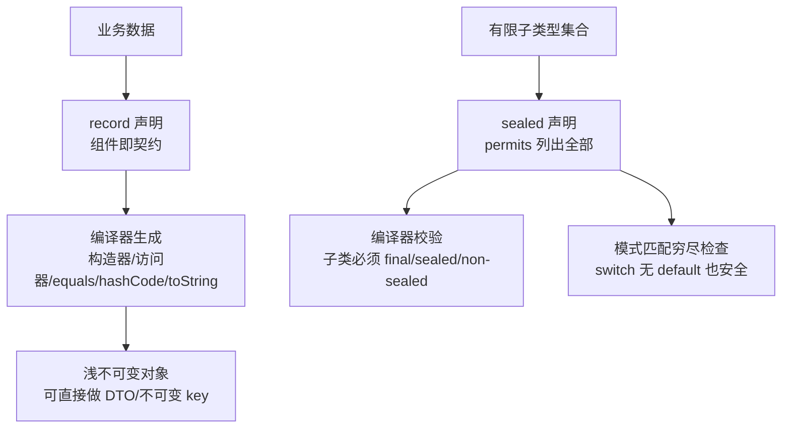

# Java新特性-Record与密封类

> [!abstract] 一句话总结
> Record 和密封类（sealed）是现代 Java 建模的一对搭档：Record 消灭"数据载体"的样板代码（不可变 DTO/值对象），密封类收窄继承边界让类型层次可穷尽（状态机/结果类型），两者配合模式匹配让代码既简洁又安全。

## 🎯 本节定位

- **本章第 10 课，现代建模**。前置：[[01-泛型与类型擦除]]（record 组件可为泛型）、[[03-String与字符串常量池]]（String 不可变与 record 不可变的对比）、[[04-集合框架-List-Map-Set源码]]（record 天然是不可变 key）、[[08-反射与动态代理]]（`isRecord/isSealed/getRecordComponents` 反射 API）、[[09-注解与注解处理器]]。
- **延伸阅读（本课只讲动机不展开语法）**：sealed + 模式匹配的 switch 穷尽检查属于语言新特性；虚拟线程是独立的并发主题，见下一课 [[11-虚拟线程]]。

## 📌 这是什么

- **record**（JDK 16 正式）：**浅不可变数据载体**。`record UserView(long id, String name) {}` 一行声明，编译器自动生成构造器、访问器（`id()`、`name()`，**无 get 前缀**）、`equals`、`hashCode`、`toString`。
- **sealed**（JDK 17 正式）：**显式收窄继承边界**。`sealed interface PayResult permits Success, Failed {}` 只允许列出的类型继承，编译器知道全部合法子类型。

## 🤔 解决什么问题 / 为什么需要

- **Record**：DTO、值对象、事件对象过去要手写构造器 + getter + equals/hashCode/toString（或用 Lombok 生成），样板多且易错——新增字段忘改 equals 就是隐蔽 bug。record 让"数据载体"成为语言一等公民：**字段列表即契约**。
- **Sealed**：支付结果、订单命令、解析结果这类"子类型集合固定"的领域模型，过去要么 `final` 封死（无法扩展）、要么开放继承（失控、模式匹配没法穷尽）。sealed 让边界**显式且可穷尽**，编译器替你检查"没有漏掉分支"。
- 两者常组合：**sealed 接口 + record 实现**是表达"有限结果类型"的标准姿势。

## 🧩 核心概念

| 概念 | 含义 | 精通要点 |
| ---- | ---- | -------- |
| Record 组件 | record 头里声明的字段列表（components）。 | 组件即构造器参数、私有 final 字段、访问器。 |
| 浅不可变 | 组件字段 final，但组件引用的对象仍可变。 | 需要真正不可变时在 compact constructor 防御性拷贝。 |
| compact constructor | 构造器简写，在赋值前做校验。 | `record X(int n) { X { if (n < 0) throw ... } }`。 |
| Sealed 许可 | `permits` 列出的直接子类型。 | 子类型必须 final/sealed/non-sealed。 |
| 模式匹配穷尽 | 编译器检查 switch 是否覆盖所有子类型。 | sealed 的价值核心：少写 default、漏分支编译报错。 |

## ⚙️ 工作原理 / 流程



**组合范式（支付结果）**：

```java
sealed interface PayResult permits Success, Failed {}
record Success(String tradeNo) implements PayResult {}
record Failed(String reason) implements PayResult {}

String msg = switch (result) {          // 编译器知道只有两种
    case Success s -> "支付成功 " + s.tradeNo();
    case Failed f -> "支付失败 " + f.reason();
};   // 以后新增子类型，这里编译报错提醒你补分支
```

## 🔍 源码 / 原理深挖

### record 编译后到底长什么样？

`record UserView(long id, String name) {}` 等价于：
- final 类，继承 `java.lang.Record`；
- `private final long id; private final String name;`；
- 全参构造器、`id()`/`name()` 访问器、`equals`/`hashCode`/`toString`（全部基于组件）。

关键语义与限制：
- **不能有实例字段**（组件除外）、**不能有 native 方法**、不能继承其他类（已继承 Record）；可以有静态字段/静态方法、可以实现接口。
- **equals 的规则**：同一 record 类、组件逐一相等才相等——值语义，适合做集合元素和 map key（衔接 [[04-集合框架-List-Map-Set源码]] 的契约）。
- **compact constructor** 写法：`record OrderLine(String sku, List<String> tags) { OrderLine { if (sku.isBlank()) throw new IllegalArgumentException(); tags = List.copyOf(tags); } }`——校验 + **防御性拷贝**都在这。
- **浅不可变**：`line.tags().add(...)` 依然能改 list 内容；要深不可变得自己拷贝。

### record 与 Lombok @Data 的本质区别

| 维度 | record | Lombok @Data |
| --- | --- | --- |
| 机制 | 语言级语法，编译器生成 | 编译期 APT 生成代码 |
| 可变性 | 默认 final、组件 final（不可变） | 默认可变 JavaBean（@Data 有 setter） |
| 契约 | 组件列表即契约，字段变了所有方法同步变 | 字段变了 equals/toString 需重新生成 |
| 框架识别 | `Class#isRecord`/`getRecordComponents` 原生支持 | 运行时看不出区别 |
| 继承 | 不能继承其他类 | 可以 |

### sealed 与 final / enum 怎么选？

- `final`：**完全不许扩展**——工具类、固定实现。
- `enum`：**实例固定**——`OrderStatus.PAID`，是"值"的枚举。
- `sealed`：**类型固定但可扩展**——需要"几个不同行为的类型"且集合有限。判据：问自己"未来会不会加新子类型？"会但很少 → sealed；绝不可能 → final；子类型是固定几个实例 → enum。

### 编译器怎么保证 sealed 不破？

- 许可子类型列表写入 class 文件的 `PermittedSubclasses` 属性（`javap -v` 可见）。
- **编译期**校验：子类型必须出现在 permits 里，且必须 final/sealed/non-sealed。
- **运行期**也校验：非法继承在类加载时抛 `IncompatibleClassChangeError`。
- 跨模块限制：子类型必须与 sealed 类型在同一模块（未命名模块则同包）——避免别人绕过 permits 偷偷继承。

## 💻 代码实践 / 排查命令

```java
// 1. record 做不可变 DTO + 校验 + 防御性拷贝
record OrderLine(String sku, List<String> tags) {
    OrderLine {
        if (sku.isBlank()) throw new IllegalArgumentException("sku 不能为空");
        tags = List.copyOf(tags);      // 外部改 list 不影响内部
    }
}

// 2. record 做不可变 key（衔接 04 集合、05 HashMap）
record UserKey(long tenantId, long userId) {}
Map<UserKey, String> cache = new HashMap<>();
cache.put(new UserKey(1L, 100L), "Alice");
// 不需要手写 equals/hashCode —— record 自动生成且正确配套

// 3. sealed + record 表达有限结果（见上方"组合范式"）
sealed interface PayResult permits Success, Failed {}
record Success(String tradeNo) implements PayResult {}
record Failed(String reason) implements PayResult {}
```

```bash
# 查看 record/sealed 的 class 文件结构
javap -p UserView.class        # 看生成的字段、访问器、equals/hashCode/toString
javap -v PayResult.class       # 看 PermittedSubclasses 属性
```

## 🛠️ 排查 / 实践要点

- DTO、查询结果、消息事件、不可变 key 优先 record；**JPA 实体仍用普通类**（可变、代理、懒加载、无参构造需要）。
- 校验逻辑放 compact constructor：**非法对象在诞生前就被拦截**，比"用的时候再校验"更早、更集中。
- 需要真正不可变：compact constructor 里 `List.copyOf`/`Map.copyOf`/`Collections.unmodifiableXxx` 防御性拷贝。
- sealed 场景：状态机、支付/订单结果、命令类型、解析结果——子类型集合业务上"就这么多"。
- 框架兼容性：老框架（如某些序列化库）不认识 record 时，检查版本是否支持（Jackson 2.12+/Fastjson2 支持 record）。

## ⚠️ 踩坑与注意事项

- 以为 record 是深不可变：组件引用的可变对象仍可改（`line.tags().add(...)` 合法）。
- 给 record 加实例字段：编译错误——这是设计使然（record 就是数据载体）。
- record 组件含数组：数组本身可变且 equals 是引用比较（`Arrays.equals` 才是值比较）——组件含数组时 equals 语义容易踩坑。
- 用 record 承载"需要随业务演进的复杂实体"：加字段要动所有构造点，实体类用普通类更灵活。
- sealed 忘了给子类标 final/sealed/non-sealed → 编译报错。
- 对"一定会扩展"的接口滥用 sealed：每加一个子类型都要改 permits，约束太死。

## 🎯 面试问题

> [!question] 高频问题
> - Q: record 和 Lombok @Data 的区别？
>   - A: record 是语言级：final 类、组件 final、值语义方法由编译器生成、不能有实例字段、可被 `isRecord/getRecordComponents` 识别；@Data 是编译期代码生成，默认可变 JavaBean。record 的不可变与契约更严格。
> - Q: record 是深不可变吗？怎么保证不可变？
>   - A: 不是。组件字段 final 但引用对象可变；在 compact constructor 里用 `List.copyOf` 等做防御性拷贝。
> - Q: sealed 和 final / enum 怎么选？
>   - A: 需要"固定集合的可扩展类型"用 sealed；完全不允许子类型用 final；值是固定实例用 enum。sealed 让编译器能做模式匹配穷尽检查。
> - Q: sealed 怎么防止被绕过？
>   - A: 许可列表写入 class 文件 `PermittedSubclasses`，编译期和类加载期双重校验；跨模块时子类型必须与 sealed 同模块/同包。

## 🧭 源码入口速查

- `javap -p UserView.class`：查看 record 生成的字段、访问器、`equals/hashCode/toString`。
- `javap -v PayResult.class`：查看 `PermittedSubclasses` 属性。
- `Class#isRecord`、`Class#getRecordComponents`：框架识别 record 组件的反射入口。
- `Class#isSealed`、`Class#getPermittedSubclasses`：读取 sealed 许可子类。
- `java.lang.Record`：所有 record 的隐式父类。

## 🧪 最小验证

```java
// 1. 浅不可变验证
record OrderLine(String sku, List<String> tags) {}

var tags = new ArrayList<>(List.of("new"));
var line = new OrderLine("A", tags);
tags.add("changed");
System.out.println(line.tags());   // [new, changed] —— 浅不可变

// 2. record 自动值语义
record Point(int x, int y) {}
System.out.println(new Point(1, 2).equals(new Point(1, 2)));  // true
System.out.println(new Point(1, 2).hashCode() == new Point(1, 2).hashCode());  // true

// 3. sealed 反射验证
System.out.println(PayResult.class.isSealed());                                    // true
System.out.println(Arrays.toString(PayResult.class.getPermittedSubclasses()));     // [Success, Failed]

// 4. compact constructor 校验
new OrderLine("", List.of());   // IllegalArgumentException: sku 不能为空
```

生产实践：新写 DTO/事件/不可变 key 优先 record；领域状态用 sealed + record 组合；记住"浅不可变 + 防御性拷贝"这对组合拳，以及"实体类别用 record"这条边界。

## ✅ 精通检查清单

- 能用自己的话讲清本主题解决的问题和适用边界。
- 能指出至少 2 个源码入口或底层机制。
- 能给出一个最小代码示例或一组线上排查命令。
- 能回答本页列出的高频面试题，并补充项目中的真实取舍。

## 🔗 关联笔记

- 本课内：上一课 [[09-注解与注解处理器]]；应用见 [[04-集合框架-List-Map-Set源码]]（record 做 key）、[[05-HashMap原理与扩容]]
- 下一课：[[11-虚拟线程]]（现代 Java 的并发新特性）
- 延伸：sealed + 模式匹配完整语法属语言新特性；[[20-Java后端/03-并发编程/_index|并发编程章节]]

## 📚 参考资料

- [Dev.java Tutorials](https://dev.java/learn/)
- [JEP 395: Records](https://openjdk.org/jeps/395)
- [JEP 409: Sealed Classes](https://openjdk.org/jeps/409)
